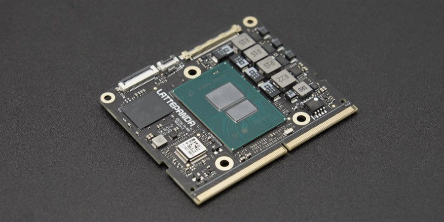
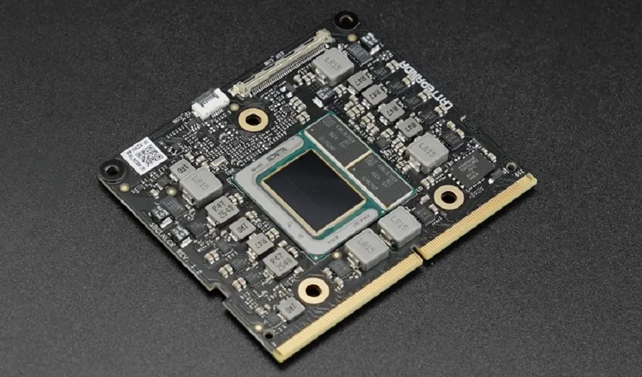

# Documentation

## Compute Module Overview

| [LattePanda Mu][1] |
| ---------------------------------------- |
|  |
| Model                             |
| DFR1146: N100 CPU, 8GB RAM, 64GB eMMC DFR1146-ENT: N100 CPU, 8GB RAM, 64GB eMMC, Win11 Enterprise License DFR1147: N100 CPU, 16GB RAM, 64GB eMMC DFR1149: N305 CPU, 16GB RAM, 64GB eMMC |

[1]: introduction.md

| [LattePanda Mu Ultra][2] |
| ---------------------------------------- |
|  |
| Model                             |
| DFR1294: Intel Core Ultra 5 226V Processor, 16GB RAM DFR1295: Intel Core Ultra 7 256V Processor, 16GB RAM |

[2]: ../mu_ultra_edition/introduction.md

## Carrier Board Design

Designing your own carrier board for LattePanda Mu? Check out the [Carrier Board Design Guide for LattePanda Mu](./design_guide_foreword.md), which covers the edge connector, power supply, USB, HDMI, PCIe, SATA and more.

We are preparing the carrier board design guide for the LattePanda Mu Ultra, please stay tuned.

## Ready-to-Use Carrier Boards

If you prefer an out-of-the-box solution, see the [**Carrier Board Section**](./module_carrier_compatibility.md) for the compatibility list of official carrier boards such as the `Mini Carrier`, `Lite Carrier`, `Full Eval Carrier`, `MXM GPU Carrier`.
