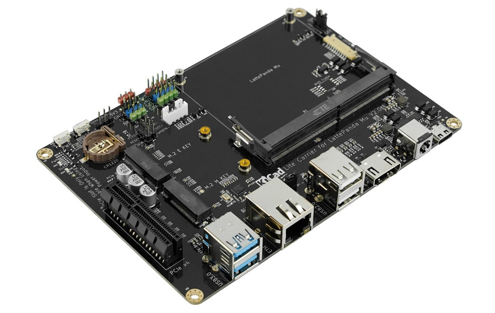
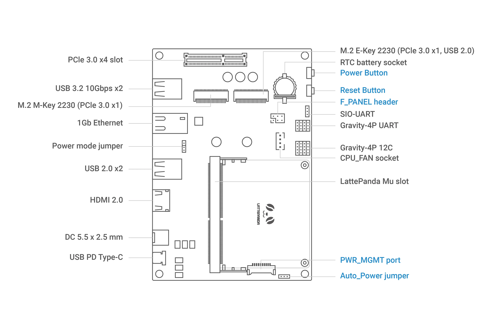

# DFR1142 Lite Carrier Board

{ width="600" }

## Introduction

The Lite Carrier Board is a development platform designed for the LattePanda Mu/Mu Ultra compute module, integrating common interfaces such as USB 3.2, Type-C(Power Input Only), Ethernet, PCIe, M.2 M Key, M.2 E Key, and HDMI. This allows for the connection of various external devices and modules, facilitating rapid prototyping and testing of different design concepts, thereby reducing the product development cycle. Additionally, its full design is open-source, making it highly suitable as a reference for carrier board designs.

!!! danger

    - 🔌 Before inserting/removing the LattePanda Mu/Mu Ultra or connecting/disconnecting any type of ribbon cable and internal interface, ensure that the power is completely disconnected and wait for the power indicator light on the carrier board to turn off.
    - ❗ Read the [**voltage‑warning**](#voltage-warning) information carefully before using all pin headers.
    - ⚡️ The PCIe slot is only available when powered by a 12V supply via the DC 5.5x2.5mm input.
    - 🔥 If installing high-powered expansion cards such as graphics cards into the PCIe x4 slot, verify that the power supply is sufficient.

## Get Started

1. Install the heatsink onto the LattePanda Mu.
2. Insert the LattePanda Mu equipped with a heatsink at a 30° angle into the slot, then press down.
3. Secure the LattePanda Mu with fixing screws.
4. Connect the wireless module, NVMe SSD(2230 only), eDP ribbon cable, and other internal peripherals as required.
5. Install the RTC battery.
6. Connect the power supply and press the power button to start the device.

!!! Note 
    - Because the RTC loses power, the initial boot may be slow and the system may automatically restart 1-2 times. Please be patient. After the first boot, as long as the RTC remains powered, the boot speed will return to normal.
    -  When assembling a **LattePanda Mu Ultra** for the first time, the device may power on automatically as soon as the power supply is connected. This is not a malfunction. Simply complete one full power-on and power-off cycle, after which the power button will function normally.

## Hardware Interface

In the above image, the blue text indicates the hardware differences between version V1 and version V2.

1. **M.2 E Key**: Supports expansion with an M.2 2230 WLAN wireless network card, PCIe x1, USB2.0 signal.
2. **RTC Battery socket**: Supports insertion of a CR1220 battery to power the RTC.
3. **Power Button**: Lite Carrier Board Power‑on Button.
4. **Reset Button**: Lite Carrier Board Reset Button.
5. **F_PANEL header**: The F_PANEL header connects front‑panel power/reset switches and status LEDs.
6. **SIO-UART**: 3.3V logic level, can be used as a serial port terminal.
7. **Gravity-4P UART**: 3.3V or 1.8V logic level, for connecting UART peripherals.
8. **Gravity-4P I2C**: 3.3V or 1.8V logic level, for connecting I2C peripherals.
9. **CPU FAN socket**: Connect a 5V cooling fan.
10. **LattePanda Mu Slot**: For installing the LattePanda Mu/Mu Ultra compute module.
11. **PWR_MGMT port**: MX1.25‑10pin Port, Used for connecting the [LattePanda Smart UPS Expansion Board](https://www.dfrobot.com/product-2983.html).
12. **Auto_Power jumper**: PH2.54‑3pin, Auto‑power‑on function can be enabled or disabled via a jumper cap.
13. **USB PD Type-C**: Power supply only, negotiates 15V PD supply.
14. **DC 5.5x2.5mm**: Power input, supports 12~20V wide voltage range.
15. **HDMI 2.0**: Video output, supports 4K resolution, maximum signal bandwidth TMDS 600MHz.
16. **USB 2.0 x2**: Standard USB 2.0 interfaces.
17. **Power Mode Jumper**: Used to switch power modes, see [Power Mode Jumper](#power-mode-jumper) for details.
18. **Gigabit Ethernet**: RTL8111 NIC.
19. **M.2 M-Key**: Supports expansion with an M.2 2230 NVMe SSD, PCIe x1 signal.
20. **USB 3.2 10Gbps x2**: Standard USB 3.2 interfaces, supporting up to 10Gbps transfer rates.
21. **PCIe 3.0 x4 Slot**: For expanding PCIe devices, available only with 12V power supply via the DC 5.5x2.5mm input.

## Interface User Guide

### Power Mode Jumper

The carrier board's auxiliary supply (USB, Ethernet, M.2 Slot, etc) has two power management modes that can be controlled via jumpers:

- **PSON\#**: Enable auxiliary power only when the system is powered on (ACPI S0 state).
- **SLP**: Enable auxiliary power during both the powered on (ACPI S0) and sleep (ACPI S3) states.

### PCIe 3.0 x4 Slot

The PCIe slot is available only when powered by a 12V supply via the DC 5.5x2.5mm input.

Compatible with common PCIe slot devices such as NVMe SSDs, network cards, and graphics cards. If a device requires more than x4 PCIe lanes, it will automatically downgrade to operate at x4 lanes.

!!!warning

    When installing power-hungry devices such as graphics cards, ensure that the power adapter is sufficiently powerful. For example, a 75W graphics card should be paired with a 12V 120W power supply for system stability.

### M.2 M Key Slot

Compatible with M.2 M Key 2230 SSDs, and can also connect to other PCIe devices via an M.2 adapter.

Since the M.2 M-Key provides only a PCIe 3.0 x1 signal with the LattePanda Mu, or a PCIe 4.0 x1 signal with the LattePanda Mu Ultra, the maximum read/write speed may not reach the SSD's advertised top speed.

### M.2 E Key Slot

Compatible with M.2 E Key 2230 WLAN network cards, supporting only the PCIe protocol, not the CNVio protocol.

In addition to WLAN modules, it is also compatible with other expansion cards designed for the M.2 E Key interface, such as "Coral M.2 Accelerator A+E key".

## Compatibility List

### Port and Function Compatibility
| Port / Function                            | LattePanda Mu (N100/N305) | LattePanda Mu Ultra (226V/256V) |
| ------------------------------------------ | ------------------------- | ------------------------------ |
| M.2 E-Key                  | 🟢 (PCIe 3.0 x1 + USB 2.0)         | 🟢 (PCIe 4.0 x1 + USB 2.0)               |
| RTC Battery socket                         | 🟢                       | 🟢                             |
| Power Button                               | 🟢                       | 🟢                             |
| Reset Button                               | 🟢                       | 🟢                             |
| F_PANEL header                             | 🟢                       | 🟢                             |
| SIO-UART                                   | 🟢                       | 🟢                             |
| Gravity-4P UART                            | 🟢(3.3V IO Level)        | 🔴(1.8V IO Level)            |
| Gravity-4P I2C                             | 🟢(3.3V IO Level)        | 🔴(1.8V IO Level)         |
| CPU FAN socket                             | 🟢                       | 🟢                             |
| LattePanda Mu Slot                         | 🟢                       | 🟢                             |
| PWR_MGMT port                              | 🟢                       | 🟢                             |
| Auto_Power jumper                          | 🟢                       | 🟢                             |
| USB PD Type-C                              | 🟢                       | 🟢                             |
| DC 5.5x2.5mm                               | 🟢                       | 🟢                             |
| HDMI 2.0                                   | 🟢                       | 🟢                             |
| USB 2.0 x2                                 | 🟢                       | 🟢                             |
| Power Mode Jumper                          | 🟢                       | 🟢                             |
| Gigabit Ethernet                           | 🟢                       | 🟢                             |
| M.2 M-Key                                  | 🟢(PCIe 3.0 x1)          | 🟢(PCIe 4.0 x1)               |
| USB 3.2 10Gbps (lower port)                | 🟢                       | 🟢                             |
| USB 3.2 10Gbps (upper port)                | 🟢                       | 🔴(Level Mismatch)        |
| PCIe 3.0 x4 Slot                           | 🟢(PCIe 3.0 x4)         | 🟢(PCIe 4.0 x4)              |
| Sleep Mode | 🟢 | 🔴(Screen OFF Only) |

!!! Warning "voltage-warning"

    - **Gravity-4P UART**: The UART_TX and UART_RX pins of the LattePanda Mu compute module feature a 3.3 V logic level, whereas the corresponding pins on the LattePanda Mu Ultra compute module operate at a 1.8 V logic level.
    - **Gravity-4P I2C**: The I2C_SDA / I2C_SCL pins on the LattePanda Mu compute module are assigned to the 3.3 V I/O power domain, while those on the LattePanda Mu Ultra compute module are assigned to the 1.8 V I/O power domain.
    - After inserting the LattePanda Mu Ultra, although the voltage level of the UART and I2C data pin headers has changed to 1.8V, the pins on the power pin header remain at 3.3V. This voltage mismatch could potentially damage the pins, which is why we do not recommend using these two pin header ports.
    - **USB 3.2 10Gbps (upper port)**: Pins assigned to the USB 2.0 bus for the LattePanda Mu compute module are multiplexed for PCIe differential signals when using the LattePanda Mu Ultra compute module. Improper connections can result in irreversible pin failure. Therefore, do not connect any device to this port.

!!! Note "Mark Pattern"

    - 🟢 **Supported**: The port functions normally. Transfer speeds and specifications may vary depending on the compute module.
    - ⚫ **Not Supported**: The port is non-functional, but inserting a device is safe and will not cause hardware damage.
    - 🔴 **Danger**: The port is electrically mismatched. **Do not plug in any device**, otherwise it may cause hardware damage!

### Power Supply Compatibility

The Lite Carrier supports two power supply methods:

- USB Type-C: Compatible with power adapters that support the PD protocol with an output power of 45W or more.

- DC Jack: Compatible with power adapters with an output voltage of 12~19V and an output power of 45W or more, with a DC connector specification of 5.5x2.5mm.

!!!warning

    If you need to use the PCIe x4 Slot, you must use a DC 5.5x2.5mm interface power adapter with an output voltage of 12V. And increase the power supply according to the PCIe expansion card power specification.

### M.2 WLAN Module Compatibility

Compatible with M.2 E Key 2230 WLAN network cards, supporting only the PCIe protocol, not the CNVio protocol.

Tested M.2 WLAN modules include:

- [Intel® Wi-Fi 6E AX210](https://www.dfrobot.com/product-2325.html)
- Intel® Wi-Fi 6 AX200
- Intel® Wireless-AC 9260
- [Intel® Dual Band Wireless-AC 8265](https://www.dfrobot.com/product-1998.html)
- Intel® Dual Band Wireless-AC 8260

This list includes only the modules we have verified. If you have successfully tested modules not listed here and they function properly, we encourage you to submit a pull request to include them.

### M.2 NVMe SSD Compatibility

The Lite Carrier supports M.2 M Key NVMe solid-state drives of the 2230 size.

If you need to expand the 2280 M.2 SSD, you will need to use an M.2 adapter card to install it into the PCIe x4 slot.

### PCIe Expansion Card Compatibility

Compatible with common standard PCIe expansion cards. If you need to insert high-power expansion cards, please check if the power adapter's power is sufficient.

When using the M.2 NVMe SSD adapter card, it will occupy the PCIe expansion slot.

### Sleep Mode Compatibility

LattePanda Mu supports the traditional sleep mode. When entering sleep, the screen turns off, the fan stops spinning, the Sleep indicator LED on the carrier board lights up, and the PWR LED turns off.

LattePanda Mu Ultra, however, only supports Modern Standby mode. Since some PCIe devices lack the CLKREQ pin, they will prevent compute module enter this mode. When you click the Sleep or Suspend button in the system, only the screen turns off, while the fan keeps running and the PWR and Sleep LEDs on the carrier board remain unchanged.

## Design Documentation

This lite carrier board is fully open-source and the complete design files can be downloaded from the [LattePanda Mu GitHub repository](https://github.com/LattePandaTeam/LattePanda-Mu/tree/main/Electricals/Examples) for modification as desired.

The project has been crafted using the open-source electronic design software KiCAD. For optimal compatibility, please open it with KiCAD version 9.0 or higher.

The PCB layer stackup of the lite carrier board is the JLC04161H-7628.
