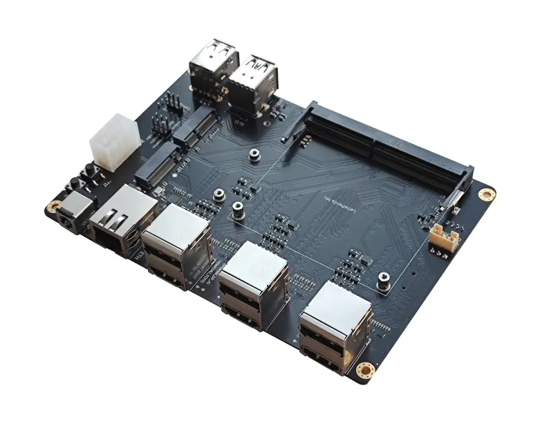
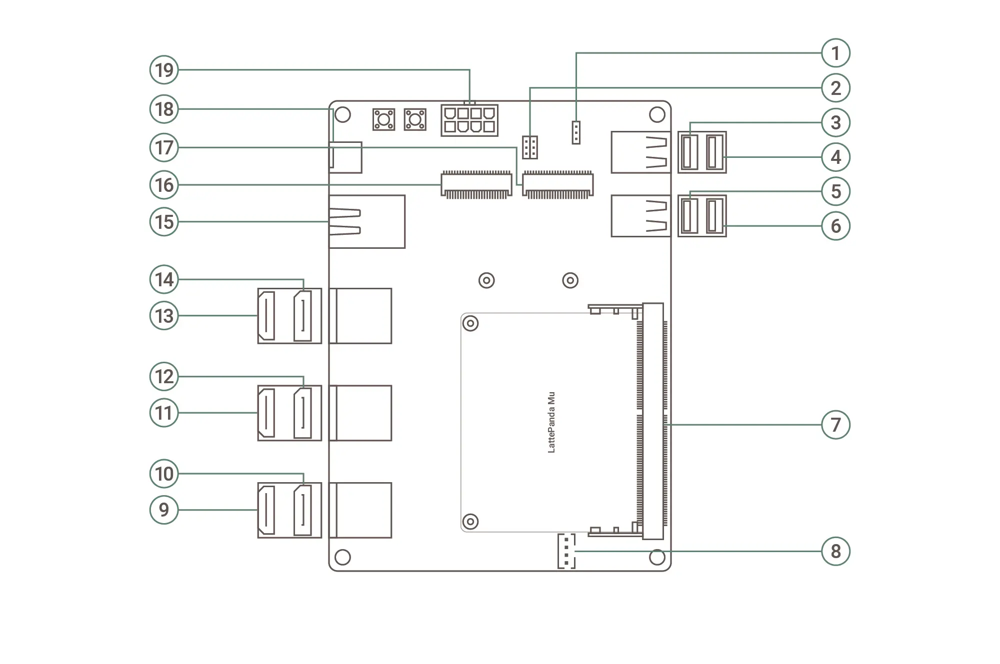
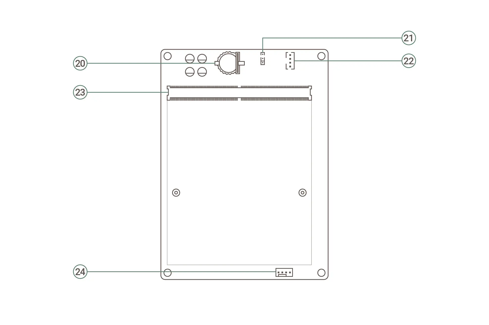

# KIT0206/KIT0207 MXM GPU Carrier Board Kit

{ width="600" }

## Introduction
The MXM GPU carrier board acts as a hardware bridge between the LattePanda Mu compute module and the MXM graphics card. Despite its compact footprint, it delivers scalable x86 performance, MXM discrete GPU support and six‑channel 4K display output, enabling rapid deployment of a highly integrated, ready‑to‑use compact modular x86 edge‑computing system.

!!! danger

    - 🔌 Power-Off Operation: Completely disconnect the power supply and wait for the power indicator on the mainboard to extinguish before plugging or unplugging the LattePanda Mu or MXM graphics card.
    - 🔥 Fan Voltage: The MXM graphics card cooler features a 12V/5V switchable voltage design. Please select the correct voltage based on the graphics card cooler you are using to avoid insufficient cooling or fan damage.
    - 📜 Compatibility Note: If you intend to use the **LattePanda Mu Ultra** compute module with the MXM GPU Carrier Kit, please carefully review the [Port and Function Compatibility](#port-and-function-compatibility) section.

## Get Started
- **KIT0206 (NVIDIA GeForce RTX 3060)**: Please assemble your kit by following the steps outlined in the [installation guide](https://wiki.dfrobot.com/kit0206/docs/24175).  
- **KIT0207 (Intel Arc A380)**: Please assemble your kit by following the steps outlined in the [installation guide](https://wiki.dfrobot.com/kit0207/docs/24198).

!!! Note 
    - Because the RTC loses power, the initial boot may be slow and the system may automatically restart 1-2 times. Please be patient. After the first boot, as long as the RTC remains powered, the boot speed will return to normal.
    -  When assembling a LattePanda Mu Ultra for the first time, the device may power on automatically as soon as the power supply is connected. This is not a malfunction. Simply complete one full power-on and power-off cycle, after which the power button will function normally.

## Board Layout¶
### Top Layout

| No.    | Description | No. | Description |
| ---    | ----------- | --- | ----------- |
| **1**  | SIO-UART Header                | **11** | HDMI (Mu_DDIB/Mu Ultra_TCP2，lower port) |
| **2**  | Front Panel Header             | **12** | DP (MXM_DP_B, upper port)           |
| **3**  | USB 2.0 Type-A (upper port)    | **13** | HDMI (Mu/Mu Ultra_TCP0, lower port) |
| **4**  | USB 2.0 Type-A (lower port)    | **14** | DP (MXM_DP_A, upper port)           |
| **5**  | USB 3.2 Gen2 Type-A (upper port) | **15** | 1Gb Ethernet Port                 |
| **6**  | USB 3.2 Gen2 Type-A (lower port) | **16** | M.2 M-Key Slot                 |
| **7**  | Compute Module Solt              | **17** | M.2 E-Key Slot                 |
| **8**  | CPU FAN Connector                | **18** | DC 5.5x2.5mm Power Jack        |
| **9**  | HDMI (MXM_DP_C, lower port)      | **19** | ATX 8‑pin Power Connector      |
| **10** | DP (MXM_DP_D, upper port)        |        |                                |

### Bottom Layout

| No.    | Description | No. | Description |
| ---    | ----------- | --- | ----------- |
| **20** | CR1220 Battery Holder (RTC)     | **23** | MXM GPU Module Slot              |
| **21** | 12V/5V Fan Jumper               | **24** | GPU FAN Connector (PH2.54, 4pin) |
| **22** | GPU FAN Connector (PH2.0, 4pin) |        | |

## Compatibility List
### Port and Function Compatibility
| Port / Function                            | LattePanda Mu (N100/N305) | LattePanda Mu Ultra(226V/256V) |
| ------------------------------------------ | ------------------------- | ------------------------------ |
| SIO-UART Header                            | 🟢                       | 🟢                             |
| Front Panel Header                         | 🟢                       | 🟢                             |
| USB 2.0 Type-A (upper port)                | 🟢                       | 🔴                             |
| USB 2.0 Type-A (lower port)                | 🟢                       | 🟢                             |
| USB 3.2 Gen2 Type-A (upper port)           | 🟢                       | 🔴                             |
| USB 3.2 Gen2 Type-A (lower port)           | 🟢                       | 🟢                             |
| Compute Module Solt                        | 🟢                       | 🟢                             |
| CPU FAN                                    | 🟢                       | 🟢                             |
| HDMI (MXM_DP_C, lower port)                | 🟢                       | 🟢                             |
| DP (MXM_DP_D, upper port)                  | 🟢                       | 🟢                             |
| HDMI (Mu_DDIB/Mu Ultra_TCP2，lower port) | 🟢                       | 🟢                             |
| DP (MXM_DP_B, upper port)                  | 🟢                       | 🟢                             |
| HDMI (Mu/Mu Ultra_TCP0, lower port)     | 🟢                       | ⚫                             |
| DP (MXM_DP_A, upper port)                  | 🟢                       | 🟢                             |
| 1Gb Ethernet Port                          | 🟢                       | 🟢                             |
| M.2 M-Key                                  | 🟢 (PCIe 3.0 x1)         | 🟢 (PCIe 4.0 x1)               |
| M.2 E-Key                                  | 🟢 (PCIe 3.0 x1 + USB)   | 🟢 (PCIe 4.0 x1 + USB)         |
| DC 5.5x2.5mm Power Jack                    | 🟢                       | 🟢                             |
| ATX 8‑pin Power Connector                  | 🟢                       | 🟢                             |
| CR1220 Battery Holder (RTC)                | 🟢                       | 🟢                             |
| 12V/5V Fan Jumper                          | 🟢                       | 🟢                             |
| GPU FAN Connector (PH2.0, 4pin)            | 🟢                       | 🟢                             |
| MXM GPU Module Slot                        | 🟢 (PCIe 3.0 x4)         | 🟢 (PCIe 4.0 x4)               |
| GPU FAN Connector (PH2.54, 4pin)           | 🟢                       | 🟢                             |

!!! Warning "voltage-warning"

    - **USB 2.0 Type-A (upper port)**: Functions as standard USB 2.0 on Mu, but carries PCIe signals on Mu Ultra. Do not use, as it may permanently damage the pins.
    - **USB 3.2 Gen2 Type-A (upper port)**: The USB 2.0 pins on this port are repurposed for PCIe on Mu Ultra. Do not use, as it may permanently damage the pins.
    - **HDMI**: This port is actually a TCP(supporting DisplayPort and USB 3.2) on LattePanda Mu Ultra with default BIOS firwmare — not HDMI TMDS. Please do not connect an HDMI cable.

!!! Note "Mark Pattern"

    - 🟢 **Supported**: The port functions normally. Transfer speeds and specifications may vary depending on the compute module.
    - ⚫ **Not Supported**: The port is non-functional, but inserting a device is safe and will not cause hardware damage.
    - 🔴 **Danger**: The port is electrically mismatched. **Do not plug in any device**, otherwise it may cause hardware damage!

### Power Supply Compatibility
The KIT0206/KIT0207 Kit supports two power supply methods:

- DC 5.5x2.5mm Power Jack

- ATX 8‑pin Power Connector

!!! Warning
    - ❗ Power Supply Selection: This KIT supports two power supply methods. Only one of the 5.5×2.5mm DC barrel connector or ATX 8Pin connector can be used at a time. Do not connect power adapters to both interfaces simultaneously.
    - ⚡️ Power Matching: Please select an appropriate power adapter based on the graphics card you are using. 

### M.2 WLAN Module Compatibility
Compatible with M.2 E Key 2230 WLAN network cards, supporting only the PCIe protocol, not the CNVio protocol.

Tested M.2 WLAN modules include:

- [Intel® Wi-Fi 6E AX210](https://www.dfrobot.com/product-2325.html)
- Intel® Wi-Fi 6 AX200
- Intel® Wireless-AC 9260
- [Intel® Dual Band Wireless-AC 8265](https://www.dfrobot.com/product-1998.html)
- Intel® Dual Band Wireless-AC 8260

This list includes only the modules we have verified. If you have successfully tested modules not listed here and they function properly, we encourage you to submit a pull request to include them.

### M.2 NVMe SSD Compatibility
Supports M.2 M‑Key NVMe SSDs in the 2230 form factor. The maximum supported speed depends on the installed compute module.

| Installed Compute Module | M.2 M-Key Max Supported Speed |
| ------------------------ | ----------------------------- |
| LattePanda Mu Ultra      | PCIe 4.0 x1                   |
| LattePanda Mu            | PCIe 3.0 x1                   |

## Driver Installation
1. Connect your monitor to any discrete graphics card output port and power on the system.

2. Select the corresponding MXM graphics card driver according to your KIT version.
    - Download the driver for the [NVIDIA RTX 3060 graphics](https://www.nvidia.cn/drivers/details/269273/) card.
    - Download the driver for the [Intel Arc A380 graphics](https://www.intel.com/content/www/us/en/products/sku/227959/intel-arc-a380-graphics/downloads.html) card.

3. After the download is completed, double-click to run the installer and follow the on-screen instructions to finish the installation.

4. To verify the installation, open Device Manager and expand Display adapters to confirm that the correct graphics card model is displayed. If Microsoft Basic Display Adapter is still shown, the driver has not taken effect and needs to be reinstalled.

!!! Warning
    - Hot‑plugging monitors on the discrete graphics card output ports is not supported until the driver installation is complete.
    - The screen may remain black for a long time (more than 10 minutes) during driver installation. This is a normal phenomenon, please wait patiently.

### Other MXM Graphics Cards
Please consult your MXM graphics card vendor for driver support information.

## BIOS Settings
### Setting Graphics Card Fan Temperature Control
1. Press the Del key during boot to enter the BIOS setup interface.
2. Navigate to: Advanced → Hardware Monitor.
3. Adjust the settings according to the table below:
4. Save and exit, the settings will take effect after restart.

| Setting Item          | Recommended Value | Description |
| ------------          | ----------------- | ----------- |
| SYS FAN Mode Setting  | Automatic         | Automatic fan speed control mode |

### Configuring Integrated Graphics
By default, the integrated graphics will automatically disable when a discrete graphics card is installed. If you wish to keep the integrated graphics running simultaneously, follow the steps below:

1. Press the Del key during boot to enter the BIOS setup interface.
2. Navigate to: Chipset → System Agent (SA) Configuration → Internal Graphics.
3. Select the desired mode according to the table below:
4. Save and exit, the settings will take effect after restart.

| Option    | Effect  | Applicable Scenario |
| ------    | ------  | ------------------- |
| Auto      | iGPU enabled by default; automatically disables when a dGPU is detected | Use only the discrete GPU, lowest power consumption |
| Disabled  | iGPU always disabled   | Use only the discrete GPU, no need for iGPU-assisted computing             |
| Enabled   | iGPU always enabled    | Requires iGPU for video encoding, multi-display output, or troubleshooting |

## Design Documentation
- The DFR1144 serves as the carrier board for the KIT0206 and KIT0207. You can download its complete design files from the [LattePanda Mu GitHub repository](https://github.com/LattePandaTeam/LattePanda-Mu/tree/main/Electricals/Examples).
- The project has been crafted using the open-source electronic design software KiCAD. For optimal compatibility, please open it with KiCAD version 9.0 or higher.