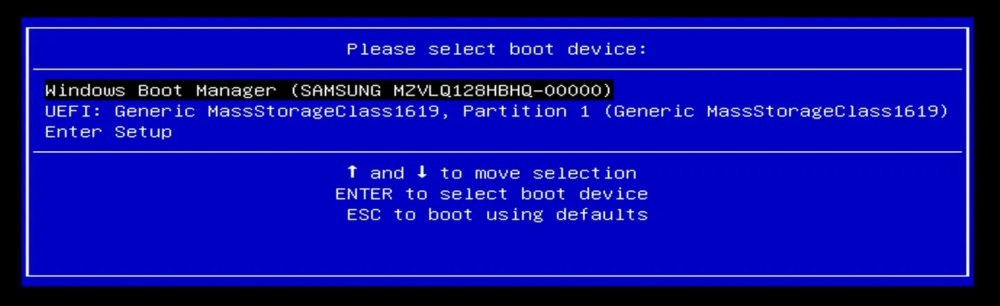
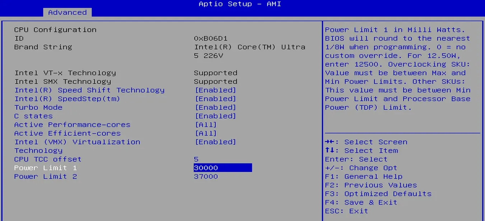
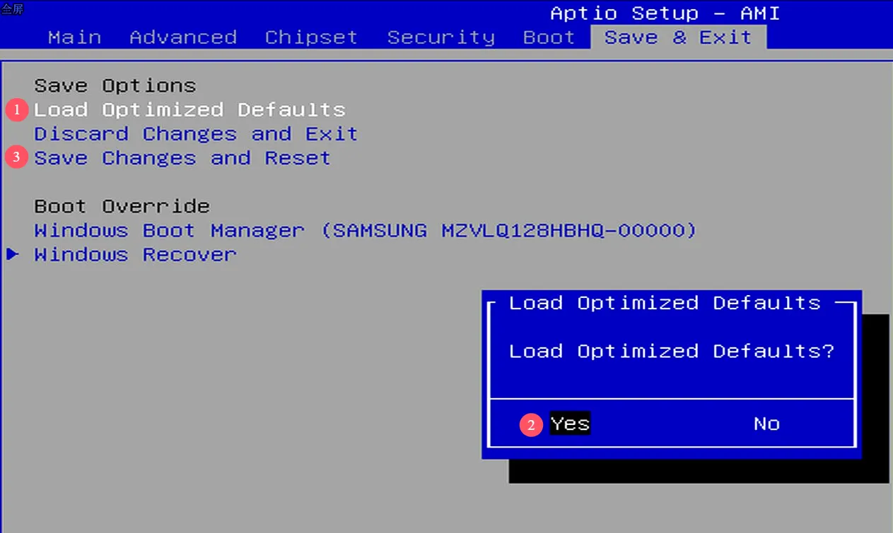

# BIOS Setup

## Entering BIOS Setting

* Power on or reboot LattePanda.

* Press **++del++** key continuously to enter into BIOS menu before you see the LattePanda logo on the splash screen. 

    
    

## Select Bootable Device

* Power on or reboot LattePanda.

* Press the **++f7++** key continuously before the bootable devices appear on the screen during the boot process.

* Press ++arrow-up++ or ++arrow-down++ key to select the bootable device, and press ++enter++ key to boot from it.

    

## Adjusting TDP Setting

The LattePanda Mu Ultra is a versatile compute module that features a configurable TDP (Thermal Design Power) ranging from `8W` to `37W`. This allows users to optimize the balance between power consumption and computational performance based on specific requirements.

To adjust the TDP, you can modify the PL1 (Power Limit 1) and PL2 (Power Limit 2) values in the BIOS.

!!! note "Understanding PL1 and PL2"

    - PL1 (Power Limit 1): The long-term power limit. This defines the sustained power consumption the processor maintains under continuous load.<br>
    - PL2 (Power Limit 2): The short-term burst power limit. It allows the processor to exceed PL1 for a brief period to handle instantaneous spikes in workload before scaling back to the PL1 level to manage thermals.


!!! Warning "TDP Value Limit"

    - According to the TDP parameters provided by Intel, the `PL1` and `PL2` value must not be lower than `8W`. Otherwise, it will cause the processor to operate at its minimum frequency, severely impacting performance.
    - For long-term full-load operation, it is recommended that the `PL1` value does not exceed `30W` (default value).


### Configuration Steps

- After entering the BIOS setup, navigate to the following path:

    ```Advanced -> CPU Configuration -> Power Limit 1 / 2```

- Set the Power Limit 1 and Power Limit 2. The unit for both values is milliwatts.

    Default Value: ```Power Limit 1: 30000;  Power Limit 2: 37000```
    
    {width="600" }

- After these settings, select `Save Changes and Reset` on the `Save & Exit` page to save the BIOS settings.

## Restore via BIOS Setup

- After entering the BIOS setup, navigate to the following path:

    ```Save & Exit --> Load Optimized Defaults```

- Press ++enter++ to select it, then in the pop-up dialog box, press ++enter++ again to select `Yes`.

- Select `Save Changes and Reset`, then in the pop-up dialog box, select `Yes`.

- After these settings, the BIOS will be restored to its factory default values.

    {width="600" }

