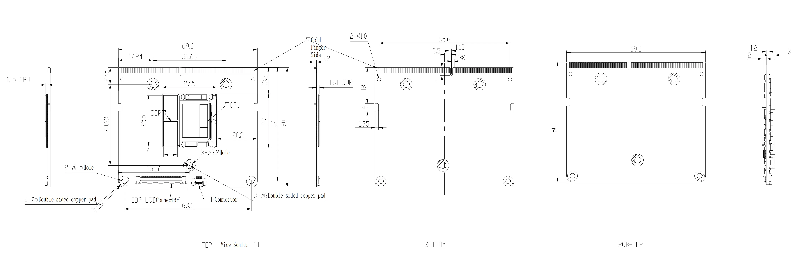
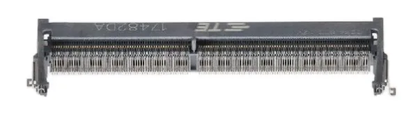
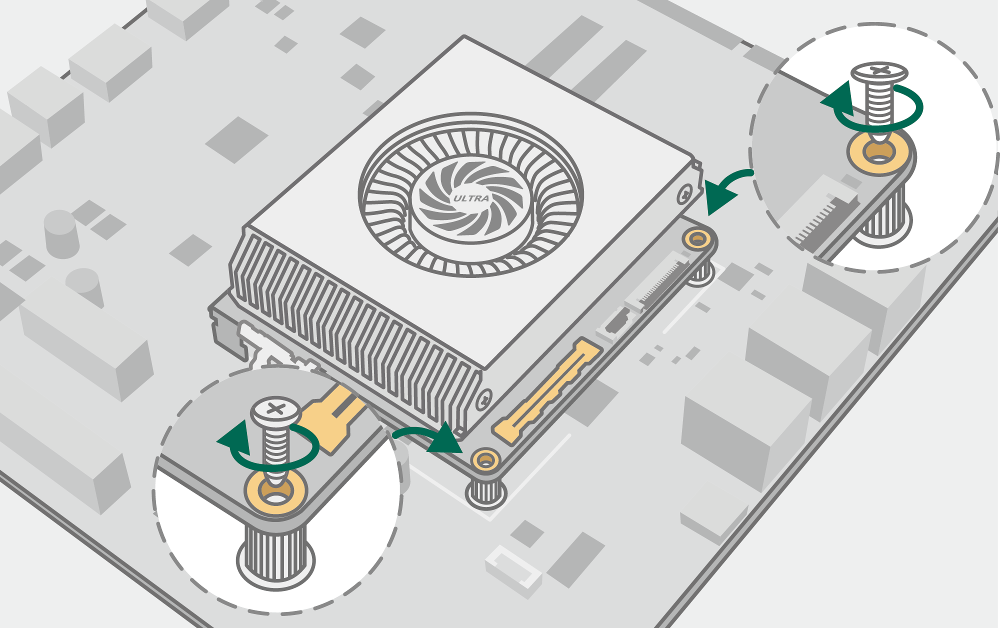
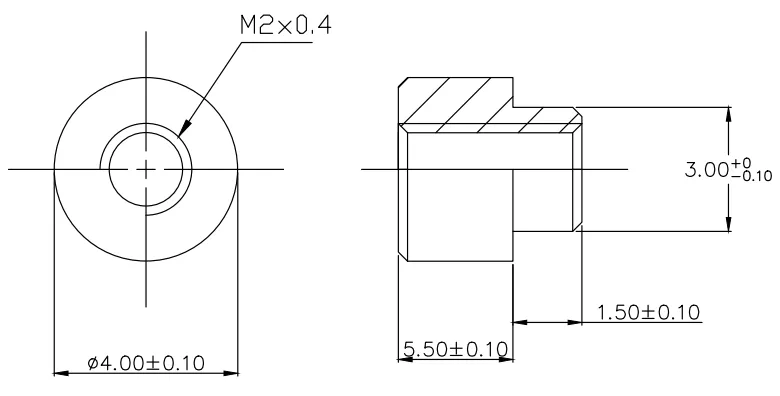

# Edge Connector

LattePanda Mu Ultra x86 compute module utilizes a **260-Pin Edge Connector**, physically compatible with standard laptop **DDR4 SODIMM** memory sockets — the same connector form factor as the LattePanda Mu.

!!! danger "Pinout Is Not a Standard DDR4 Slot"

    Although the LattePanda Mu Ultra physically fits a standard 260-pin SO-DIMM DDR4 slot, its pinout is uniquely defined by LattePanda. **Never install it in a standard DDR4 memory slot** or on carrier boards designed for other compute modules. Powering it on in an incompatible slot will cause permanent damage.

## Pinout

Given the high-density edge connector and the versatile pin definitions of the LattePanda Mu Ultra compute module, we provided the detailed pin introduction into the separate [**LattePanda Mu Ultra Pinout Documentation**](https://github.com/LattePandaTeam/LattePanda-Mu-Ultra/tree/main/Electricals/Pinouts).

## Mechanical Specs

- Height from PCB surface to the top of the processor thermal pad: 1.15 mm
- Height from PCB surface to the top of the processor memory chip: 1.61 mm
- Maximum component height on the top side (processor side): 3 mm
- Maximum component height on the bottom side: 2 mm

## Socket Selection Guidelines

While compatible with standard DDR4 sockets, strict adherence to the following selection rules is required to ensure proper mechanical fit and electrical connectivity.

### Critical Rules

- **Pin Count**: Must use a **260-Pin** DDR4 SODIMM socket.
- **Orientation**: Must use **Standard (STD)** type sockets, not Reverse (RVS) type sockets.

??? note "How to identify a Standard (STD) socket?"

    - **Marking**: Most sockets have "STD" stamped on the plastic body.
    - **Notch Position**: When facing the socket opening (as if inserting the module) with the pads facing down, the Keying Notch should be offset to the LEFT.
    

- **Height Requirement**: Socket height should be **≥ 5.2 mm** (while carrier board areas beneath the compute module without components)

    > Due to the retention screws and passive components on the back of the Compute Module, the socket must provide sufficient bottom clearance.

- **Recommended Parts**

    | Height | Brand           | Part Number      |
    | ------ | --------------- | ---------------- |
    | 8.0mm  | TE Connectivity | 2309411-1        |
    | 9.2mm  | FOXCONN         | ASAA821-EASB0-7H |
    | 9.2mm  | LOTES           | ADDR0110-P005A   |
    | 5.2mm  | LOTES           | ADDR0207-P001A   |

## Solderable Standoff Selection Guidelines

After inserting the LattePanda Mu Ultra into the SODIMM socket, it must be secured to the carrier board using screws and standoff.

{width="400"}

The height of the standoff on the carrier board must match the SODIMM socket height to ensure the compute module sits flat.

| SODIMM Socket Height | Recommended Standoff Height |
| -------------------- | --------------------------- |
| 8.0mm                | 5.5mm                       |
| 9.2mm                | 6.6mm                       |
| 5.2mm                | 2.6mm                       |

>- *Recommended Tolerance：±0.1mm*
>- *Standoff Height: The distance from the PCB surface to the top surface of the standoff.*

For example, on the DFR1142 Lite carrier board, the socket height is 8.0 mm; therefore, the standoff height is 5.5 mm (shown below), and the fixing screw diameter is 2 mm. 

{width="400"}

