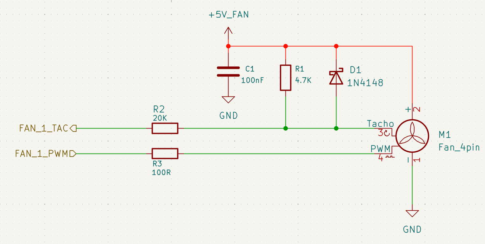
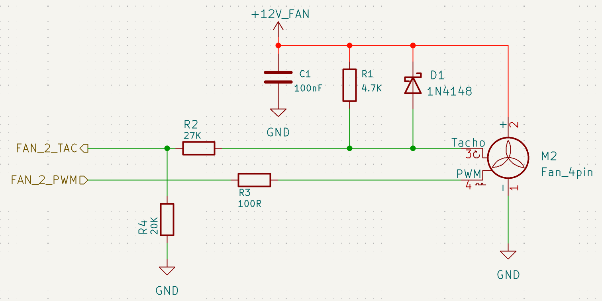

# Fan

LattePanda Mu Ultra x86 compute module provides **2 independent** fan ports, supporting PWM speed control and RPM monitoring (Tachometer).

- **CPU_FAN**: Dedicated for the CPU cooler.
- **SYS_FAN**: Generic system chassis fan.

## Design Guidelines

### Pin Definition

| Pin Name | Pin Number | Note          |
| :------- | :--------- | :------------ |
| FAN2_CTL | 2          | CPU Fan PWM   |
| FAN2_TAC | 4          | CPU Fan Tacho |
| FAN3_CTL | 6          | SYS Fan PWM   |
| FAN3_TAC | 8          | SYS Fan Tacho |

### PWM Signal

The PWM output pins on the module feature integrated **4.7kΩ pull-up resistors** (to 3.3V). No external pull-up is required on the carrier board.

It is recommended to place a 100Ω series resistor in the PWM signal path for current limiting.

### Tachometer Signal

A fan's TAC output is typically open-drain or open-collector. The module's TAC pins are 5V-tolerant inputs and require external pull-up and protection circuitry. The design varies depending on the fan voltage (5V vs. 12V).

!!! danger

    All TAC pins can tolerate only 5V!

### Critical Design Rules

1. **Pull-up Source**:
    - The TAC signal **should** be pulled up to the **Fan's Operating Voltage**. The typical value of this pull-up resistor is 4.7KΩ.
    - It is **NOT RECOMMENDED** to pull up a 12V fan's TAC signal to a 5V or 3.3V rail on the carrier board.

2. **Surge Protection**:
    - A **Diode** (e.g., 1N4148, 1N5819) is recommended in parallel with the pull-up resistor.
    - **Function**: Clamps voltage surges. If the TAC signal exceeds the supply voltage, the diode conducts, diverting the surge current to the power rail.

3. **Level Shifting**:
    - **12V Fan:** A resistive voltage divider (multiple resistors in series) is **MANDATORY** to step down the 12V tachometer signal to a safe logic level (≤ 5V) compatible with the compute module.
    - **5V Fan**: Since the voltage is within the safe range, the divider can be simplified.

4. **Power Control**
    - After the system successfully enters Modern Standby, the fan should stop spinning.

### Recommended Fan Circuit

#### 5V Fan

{width="600" }

In the image above, resistor R2 can be selected from 1K to 30K. If space is tight, this resistor can also be omitted.

#### 12V Fan

{width="600" }

In the image above, resistor **R4** is part of a voltage divider, ensuring that the voltage at the TAC input pin does not exceed 5V, and therefore **cannot be omitted**. Based on this principle, the specific resistance values of R2 and R4 can be adjusted according to actual conditions.

#### Power Control

After the system successfully enters Modern Standby, the `PWM` signal outputs LOW, turning the fan off. Therefore, the fan can be connected directly to the corresponding power rail, which is disabled after hibernation or shutdown, without the need for an external MOSFET to control the power.

If the system does not successfully enter Modern Standby, the fan may continue running. Brief fan activity during Modern Standby can also occur when background maintenance temporarily wakes the system; see [Power Control & Status](design_guide_pwctl_stat.md#faq).
