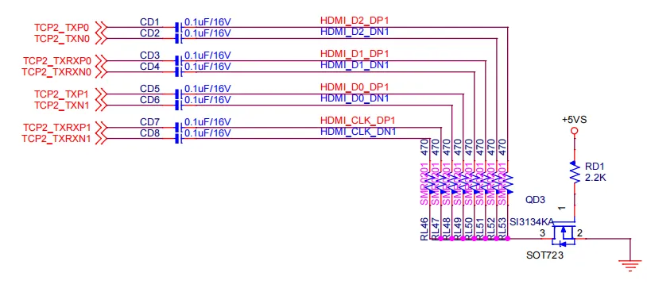
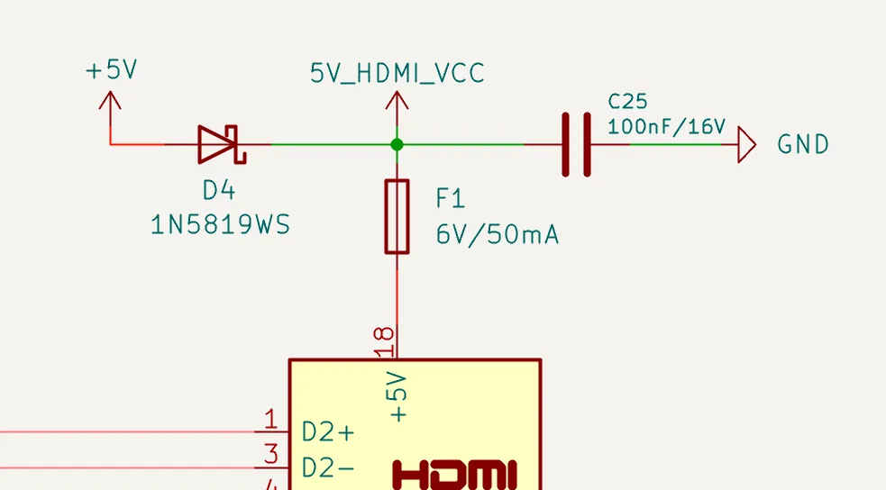

# HDMI 2.1

LattePanda Mu Ultra x86 compute module derives up to 3 HDMI outputs from the TCP0, TCP1, and TCP2 ports, supporting up to 4K @ 60Hz.

!!! note "Display Capabilities"

    LattePanda Mu Ultra supports up to 3 independent displays, each capable of running up to 4K@60Hz concurrently.

## Port Configuration

- HDMI signals (operating in TMDS mode) can **only** be configured from **TCP0**, **TCP1**, or **TCP2**. 
>TCP2 corresponds to the DDIB on the LattePanda Mu — same pin positions, same function.

- The [default BIOS firmware](https://github.com/LattePandaTeam/LattePanda-Mu-Ultra/tree/main/Softwares/BIOS/DFLT) enables TCP2 as HDMI. TCP0 and TCP1 are configured as USB Type-C ports by default.

- Support for up to three HDMI outputs describes the hardware capability, not the default firmware configuration. Configuring TCP0 or TCP1 for HDMI (TMDS mode) requires customized BIOS firmware and changes the default function of the corresponding port.

## Design Guidelines

### Pin Definition

| Port Name                     | Pin Number                             |
| ----------------------------- | -------------------------------------- |
| TCP0 (TMDS Differential Pair) | 227, 229, 233, 235, 239, 241, 245, 247 |
| TCP0 DDC & HPD                | 177, 179, 187                          |
| TCP1 (TMDS Differential Pair) | 220, 222, 226, 228, 232, 234, 238, 240 |
| TCP1 DDC & HPD                | 173, 175, 185                          |
| TCP2 (TMDS Differential Pair) | 197, 199, 203, 205, 209, 211, 215, 217 |
| TCP2 DDC & HPD                | 169, 171, 183                          |

### AC Coupling & Pull-down Bias

!!!note
    On LattePanda Mu Ultra compute module, TCP0, TCP1 and TCP2 signal lines do not integrate AC coupling capacitors.

Intel's reference design requires a specific **AC Coupling + Pull-down Bias** topology.

- **AC Coupling**: A 100nF (0.1uF) capacitor must be placed in series on all four TMDS differential pairs. 0402 or smaller package is recommended to minimize parasitics.
- **Pull-down Bias**: After the capacitor (connector side), each TMDS signal line must be pulled down to GND via a 470Ω resistor.
- **Switch Control**: The ground connection of all 470Ω resistors should be gathered and controlled by an NMOS.
    The NMOS turns ON (enabling the pull-downs) ONLY when the system is in the working (S0) state and sleep/suspend (modern standby) state.
    {width="800" }

!!! tip "Why are 470Ω pull-down resistors mandatory?"

    This is the standard design required by Intel. Omitting the 470Ω resistor will cause the signal eye diagram to fail and lead to compatibility issues.

### Polarity Check

HDMI TMDS differential pairs do not support polarity inversion.

Strict polarity matching must be implemented on the carrier board. Ensure that Positive (+) maps to Positive (+) and Negative (-) maps to Negative (-), as illustrated in the figure below.

```text
+---------------------+                            +---------------------+
|  Compute Module     |                            |   HDMI Connector    |
|                     |                            |                     |
|  [TMDS_DATA_P] (+) >O===========================>O  [TMDS_DATA_P] (+)  |
|                     |                            |                     |
|  [TMDS_DATA_N] (-) >O===========================>O  [TMDS_DATA_N] (-)  |
|                     |                            |                     |
+---------------------+                            +---------------------+
          ^                                                   ^
          |                                                   |
          +----------- STRICT 1:1 MAPPING REQUIRED -----------+
                        Do NOT Swap P & N Signals
 
```
(The diagram above emphasizes polarity; therefore, AC coupling capacitors and pull-down resistors are omitted.)

### Level Shifter

- `DDC` (I2C) and `HPD` signals from compute module are **3.3V**.
- HDMI standard requires **5V** logic levels.
- **Direct connection is prohibited.** A level shifting circuit (using NMOS or dedicated chips) must be implemented on the carrier board.

### No AUX Signal

When operating in TMDS mode, the AUX signals are unused, so they should be left not connected.

For example, when TCP2 is operating in TMDS mode, the following pins should be NC.
```text
Pin 191: TCP2_AUX_N 
Pin 193: TCP2_AUX_P
```

### Power Backflow Prevention

A diode must be connected in series between the system power and the 5V pin of the HDMI connector to prevent power conflict between the host and the device. **This diode cannot be omitted**.  As shown below, this diode is D4.

However, the resettable fuse (F1, as shown below) is optional if space is limited.

{width="600" }

### Pull-Down for Unused HPD

The HPD pin of an unused video port must be pulled down to GND through a **100kΩ resistor** to prevent a floating HPD input and false display detection. Use a separate resistor for each HPD pin.

For example, with the default BIOS firmware, `TCP2` is configured for HDMI (TMDS) output. If `TCP0` and `TCP1` are not used for video output, pull down `TCP0_HPD (pin 187)` and `TCP1_HPD (pin 185)` to GND through individual 100kΩ resistors.

### ESD Protection

Since HDMI ports are subject to frequent hot-plugging, they are vulnerable to Electrostatic Discharge (ESD). And TMDS signals are extremely sensitive to capacitance. So **Ultra-low capacitance** ESD protection diodes are mandatory.

| Signal Type         | Recommended Specs                                            |
| :------------------ | :----------------------------------------------------------- |
| High Speed (TMDS)   | Junction Capacitance: < 0.18 pF<br>Reverse Working Voltage: 3.3 V |
| Low Speed (DDC/HPD) | Junction Capacitance: < 3 pF<br>Reverse Working Voltage: 5.5V or 6 V |

### Layout Guidelines

| Parameter | Requirement |
| :--- | :--- |
| Differential Impedance | 100Ω |
| Intra-pair Skew | < 5 mil |
| Inter-pair Skew | < 13 mm |
| AC Cap for TMDS | 100nF nominal |
| Bias Resistor for TMDS | 470Ω nominal |
| AC Cap & Bias Resistor Placement | As close to HDMI connector as possible (<13 mm) |
| Reference Plane | Continuous GND Recommended |

#### Spacing & Crosstalk

- Trace Type: Microstrip Differential Pair

- Recommended Pair-to-Pair Spacing: ≥ 5W (where W is trace width).
> To ensure signal integrity for HDMI 2.1 (4K@60Hz), a spacing of at least 5W is required to strictly minimize crosstalk.

- Recommended General Spacing: Maintain at least 5W spacing between high-speed TMDS pairs and other signals (DDC, HPD, Power).

- [More details in *High-Speed Interface Layout Guidelines*](https://www.ti.com/lit/an/spraar7j/spraar7j.pdf?ts=1718105682488)

