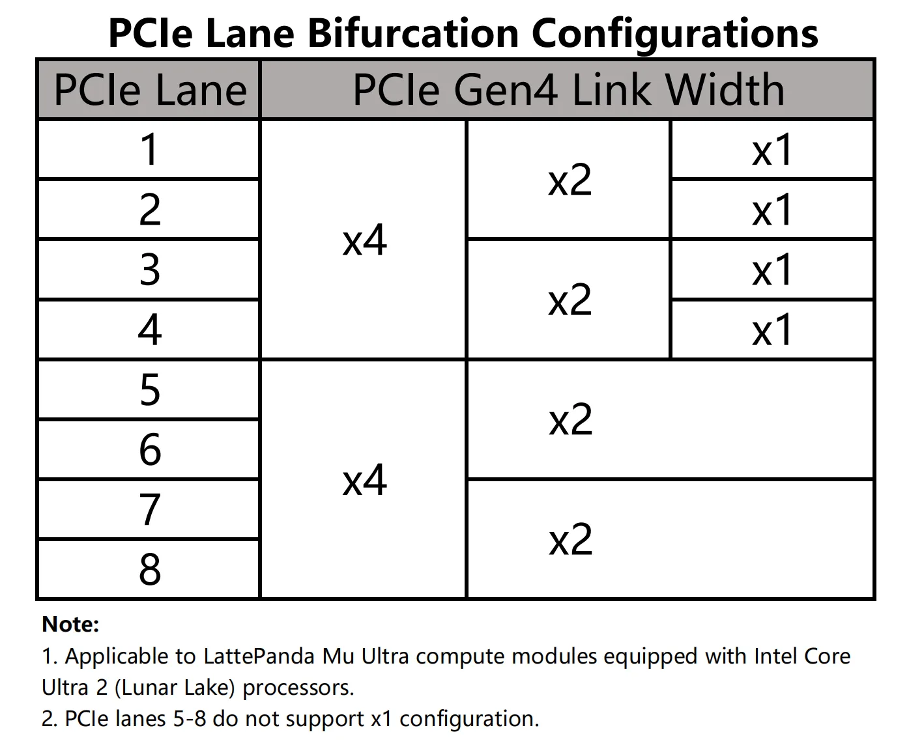
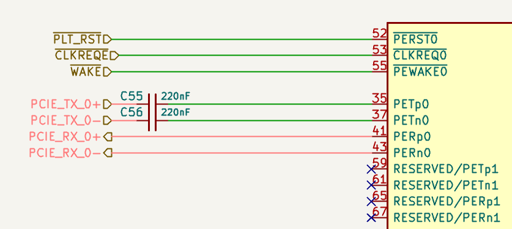

# PCIe 4.0

LattePanda Mu Ultra x86 compute module exposes **8 dedicated lanes** of PCIe 4.0 signals.

- Each lane supports speeds up to **16.0 GT/s**, and is backward compatible with PCIe 3.0 (8.0 GT/s), PCIe 2.0 (5.0 GT/s) and PCIe 1.0 (2.5 GT/s).

- All PCIe lanes operate only in **Root Complex** mode. Endpoint mode is not supported.

- The maximum configurable link width is **PCIe x4**. PCIe x8 is not supported.

!!! note "Why PCIe 4.0 Instead of PCIe 5.0?"

    The processor natively supports PCIe 5.0, but PCIe 5.0's extremely high signaling rate imposes strict limits on trace length and impedance. After passing through the module's edge fingers and the 260-pin SO-DIMM connector onto the carrier board, PCIe 5.0 signal integrity can no longer be guaranteed. To ensure stable operation, the BIOS limits these links to **PCIe 4.0**.

!!! warning

    - Hot-plugging is NOT supported on any PCIe lanes. Power off the system and disconnect the power supply before inserting or removing PCIe devices.
    - The LattePanda Mu Ultra has **no onboard eMMC**. At least one PCIe lane must be routed to a bootable storage device, typically an **M.2 M-Key NVMe SSD**. If the carrier board does not provide a boot storage device, the compute module cannot load an operating system.

## Lane Configuration

{width="400"}

- All 8 lanes are **PCIe only** — no multiplexing with USB 3.2 or SATA.
- For lane groups, bifurcation modes, and clock distribution, please read the [PCIe Bifurcation chapter](design_guide_pcie_bifurcation.md) first.
- For released BIOS firmware versions, please refer to our [GitHub repository](https://github.com/LattePandaTeam/LattePanda-Mu-Ultra/tree/main/Softwares/BIOS).
- Any change to PCIe bifurcation requires customized BIOS firmware. Dynamic switching via the BIOS menu is not supported.

## Design Guidelines

### Pin Definition

| Lane Name    | TX Pin Number | RX Pin Number |
| :----------- | :------------ | :------------ |
| PCIe Lane 1  | 61, 63        | 64, 66        |
| PCIe Lane 2  | 67, 69        | 70, 72        |
| PCIe Lane 3  | 25, 27        | 28, 30        |
| PCIe Lane 4  | 31, 33        | 34, 36        |
| PCIe Lane 5  | 37, 39        | 40, 42        |
| PCIe Lane 6  | 43, 45        | 46, 48        |
| PCIe Lane 7  | 49, 51        | 52, 54        |
| PCIe Lane 8  | 55, 57        | 58, 60        |
| REFCLK 0     | 85, 87        |               |
| REFCLK 1     | 91, 93        |               |
| REFCLK 2     | 97, 99        |               |
| REFCLK 3     | 88, 90        |               |
| REFCLK 4     | 94, 96        |               |
| REFCLK_REQ0# | 104           |               |
| REFCLK_REQ1# | 106           |               |
| REFCLK_REQ2# | 108           |               |
| REFCLK_REQ3# | 100           |               |
| REFCLK_REQ4# | 102           |               |
| PLT_RST#     | 105           |               |
| PCIE_WAKE#   | 103           |               |
| SUSCLK       | 131           |               |

!!! danger "Pins 67/69/70/72 — Shared Position with Mu's USB 2.0"

    PCIe Lane 2 is routed to pins 67/69 (TX) and 70/72 (RX), which are USB 2.0 ports on the LattePanda Mu. If you are adapting an existing Mu carrier board, make sure these pins are not connected to USB 2.0 devices — see the [Migration Guide](migration_guide_mu_to_mu_ultra.md#8-pcie-lane-2-occupies-the-mus-usb-20-pins-67697072) for details.

### AC Coupling

PCIe data links require AC coupling capacitors on the transmitter side.

- **Compute Module PCIe_TX**: Must place **0.22uF (220nF)** series capacitors — **except PCIe Lane 2**, which already integrates 220nF AC coupling capacitors on the compute module. 0402 or smaller package is recommended to minimize parasitics.
- **Compute Module PCIe_RX**: Whether additional AC coupling capacitors are required depends on whether the external PCIe device transmitter already includes AC coupling capacitors.
- **REFCLK**: No AC coupling capacitors are required.

#### Connecting to a PCIe Device

For PCIe devices such as standard PCIe cards and M.2 NVMe SSDs, AC coupling capacitors are usually already placed on the device TX side.

Therefore, on the carrier board:

- Place AC coupling capacitors only on the compute module PCIe_TX lanes (except Lane 2, which has them integrated).
- Place the capacitors as close to the PCIe connector or M.2 socket as possible, recommended distance **< 8 mm**.
- No additional AC coupling capacitors are required on the compute module PCIe_RX lanes.

```text
+---------------------+                         +---------------------+  
|  Compute Module     |                         |  PCIe Connector /   |  
|                     |                         |  M.2 Socket         |  
|                     |                         |                     |  
| PCIe_TX_P ----------o-->>-------||------------o--- PETp             |  
|                     |         0.22uF          |                     |  
| PCIe_TX_N ----------o-->>-------||------ -----o--- PETn             |  
|                     |         0.22uF          |                     |  
|                     |                         |                     |  
| PCIe_RX_P ----------o---------------------<<--o--- PERp             |  
|                     |        (NO CAP)         |                     |  
| PCIe_RX_N ----------o---------------------<<--o--- PERn             |  
|                     |        (NO CAP)         |                     |  
+---------------------+                         +---------------------+  
```

- The pinout of the PCIe connector in the figure above uses the host perspective. For details, see [Host's Perspective Section](#hosts-perspective).

#### Connecting to a PCIe Chip

For on-board PCIe chips, such as PCIe Ethernet controllers, the transmitter side does not integrate AC coupling capacitors inside the chip.

In this case, on the carrier board:

- Place AC coupling capacitors on the compute module PCIe_TX lanes and PCIe_RX lanes.

- Follow the PCIe chip vendor's reference design for capacitor placement. In general, place the capacitors close to the PCIe chip, recommended distance **< 8 mm**.

```text
+---------------------+                         +---------------------+
|  Compute Module     |                         |  On-board PCIe Chip |
|                     |                         |                     |
|                     |                         |                     |
| PCIe_TX_P ----------o-->>------||-------------o--- HSIP             |
|                     |        0.22uF           |                     |
| PCIe_TX_N ----------o-->>------||-------------o--- HSIN             |
|                     |        0.22uF           |                     |
|                     |                         |                     |
| PCIe_RX_P ----------o----------||---------<<--o--- HSOP             |
|                     |        0.22uF           |                     |
| PCIe_RX_N ----------o----------||---------<<--o--- HSIN             |
|                     |        0.22uF           |                     |
+---------------------+                         +---------------------+
```

### Polarity Inversion

The PCI Express Base Specification requires polarity inversion to be supported independently by all receivers across the Link where each differential pair within each Lane of the PCIe Link handles its own polarity inversion.

If the P/N signals of a PCIe data differential pair cross during layout, the P and N signals within the same differential pair can be swapped. The receiver will automatically handle polarity inversion, and no BIOS modification is required.

```text
- For PCIe Connector:
Host_PCIe_TX_P  --------  Connector_PCIe_TX_N
Host_PCIe_TX_N  --------  Connector_PCIe_TX_P

- For PCIe chip:
Host_PCIe_TX_P  --------  Device_PCIe_RX_N
Host_PCIe_TX_N  --------  Device_PCIe_RX_P
```

Polarity inversion only applies to P/N swapping within the same differential pair. It does not mean TX/RX direction swapping or lane order reversal.

For the PCIe REFCLK differential pair, polarity inversion is also supported.

### No Lane Reversal

Polarity inversion is not lane reversal, and it is not direction reversal. For multi-lane links, do not reverse the lane order.

- Allowed:

    - Swapping P/N within the same differential pair (Polarity Inversion).

- Not allowed:

    - Swapping TX and RX directions.
    - Swapping lane order.

### Host's Perspective

In our schematics, the PCIe connector pinout is defined from the host's perspective.

When routing, connect the host's TX signals directly to the connector's TX pins, and connect the host's RX signals directly to the connector's RX pins. Do not swap these signals.

{width="600"}

The figure above shows some of the pins of the M.2 M key socket. For M.2 sockets:

- `PET` usually indicates host transmit signals.
- `PER` usually indicates host receive signals.

### REFCLK_REQ# Signal (CLKREQ)

PCIe devices require the `CLKREQ#` signal, marked as `REFCLK_REQ#` in the LattePanda Mu Ultra compute module pinout. It is used to request and control the PCIe reference clock and is also required for ASPM or advanced power management features.

The LattePanda Mu Ultra exposes **all five** CLKREQ pins (`REFCLK_REQ0#`–`REFCLK_REQ4#`), each controlling its corresponding REFCLK output.

When using the [default BIOS firmware](https://github.com/LattePandaTeam/LattePanda-Mu-Ultra/tree/main/Softwares/BIOS/DFLT), it is recommended to follow the default Clock-to-Lane mapping table. For more details, please refer to [the Clock-to-Lane Mapping chapter](design_guide_pcie_bifurcation.md#clock-to-lane-mapping).

!!! warning "CLKREQ Is Required for Modern Standby"

    - On the Mu Ultra, **every PCIe device must have its CLKREQ pin connected** to the corresponding REFCLK_REQ pin. Entering Modern Standby requires PCIe peripherals to use CLKREQ to trigger their low-power state; a device without CLKREQ connected will prevent the system from entering Modern Standby (screen off, but the processor and fan keep running).
    - **Do NOT pull CLKREQ# permanently low** via a resistor to GND to force an always-on clock — on the Mu Ultra this also blocks Modern Standby. (This differs from the LattePanda Mu, where this practice was acceptable.)
    - Connectors that do not carry a CLKREQ pin (e.g., OCuLink connectors, standard PCIe slots) will block Modern Standby when a device is attached. If your product requires sleep, choose connectors with CLKREQ (such as M.2 sockets).

### PLT_RST# Signal

PCIe devices usually require a reset signal `PERST#`. In the LattePanda Mu Ultra compute module pinout, this signal is marked as `PLT_RST#`.

When designing the carrier board, connect `PLT_RST#` from the compute module to the PCIe connector or on-board PCIe chip.

For M.2 sockets, PCIe CEM connectors and PCIe chips, this signal must not be omitted.

If there are multiple PCIe connectors or PCIe chips on the carrier board, their `PERST#` signals should be connected together to the compute module's `PLT_RST#` pin.

### PCIE_WAKE# & SUSCLK Signals

`WAKE#` is an optional signal used by PCIe devices to wake the host from low-power states. If wake-up functionality, such as Wake-on-LAN, is required, connect the device `WAKE#` signal according to the device reference design.

`SUSCLK` is an optional 32.768 kHz clock signal with a **1.8V output level** on the Mu Ultra. Most PCIe devices integrate their own low-speed clock, but some devices, such as M.2 E-key wireless modules, require an external 32.768 kHz clock.

The 1.8V SUSCLK output can be connected directly to device SUSCLK inputs rated for 1.8V or 3.3V; no level-shifting circuit is required.

Whether `WAKE#` and `SUSCLK` should be connected depends on the PCIe device reference design and the required power management features.

If multiple devices are used, the `WAKE#` pins of the devices should be connected together to the compute module's `PCIE_WAKE#` pin; similarly, the `SUSCLK` pins of the devices should be connected together to the compute module's `SUSCLK` pin.

### Device Interoperability

Different PCIe endpoint devices can be directly recognized on the same PCIe lane.
> For example, replacing a PCIe Ethernet controller with an NVMe SSD on the same PCIe lane, which is similar to connecting different USB devices to the same USB port.

PCIe 3.0, 2.0 and 1.0 devices are also supported. The compute module will automatically negotiate the proper link speed.

Changing regular PCIe endpoint devices does not require BIOS firmware modification.

### Layout Guidelines

| Parameter              | Requirement                                                  |
| ---------------------- | ------------------------------------------------------------ |
| Differential Impedance | 85Ω for both Data Pair and REFCLK Pair                       |
| Intra-pair Skew        | < 5 mil for Data Pair<br>< 15 mil for REFCLK Pair            |
| Inter-pair Skew        | < 25 mm (TX-to-TX, RX-to-RX)                                 |
| AC Cap for Data Pair   | 220nF nominal (not required on PCIe Lane 2 — integrated on the compute module) |
| AC Cap Placement       | On host TX lanes: close to the PCIe connector or PCIe chip (<8 mm)<br>On host RX lanes: only required when connecting to a PCIe chip; close to the PCIe chip (< 8 mm) |
| Reference Plane        | Continuous GND Recommended                                   |

#### Spacing & Crosstalk

- Trace Type: Microstrip Differential Pair

- Recommended Pair-to-Pair Spacing: ≥ 5W (where W is trace width).

    > To ensure signal integrity for PCIe 4.0, a spacing of at least 5W is recommended to strictly minimize crosstalk.

- Recommended General Spacing: Maintain at least 5W spacing between PCIe Data Pairs, REFCLK Pair, and other signals.
- [More details in *High-Speed Interface Layout Guidelines*](https://www.ti.com/lit/an/spraar7j/spraar7j.pdf?ts=1718105682488)
