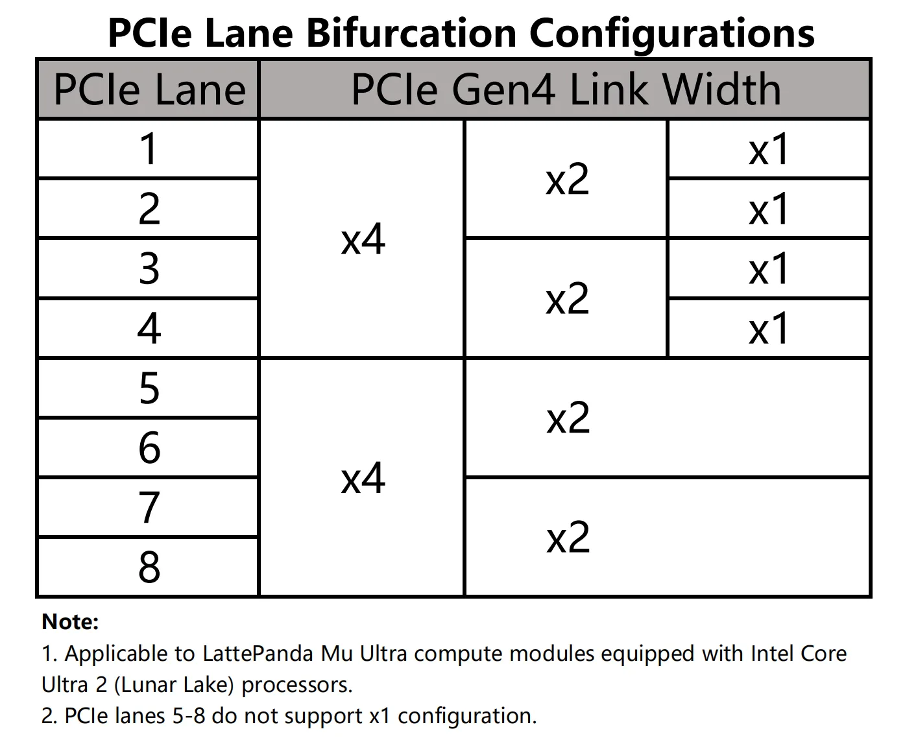

# PCIe Bifurcation

LattePanda Mu Ultra x86 compute module exposes **8 dedicated PCIe 4.0 lanes**. These lanes are **PCIe only** — they cannot be reconfigured as USB 3.2 or SATA.

{width="500"}

## Bifurcation Configuration

### Rules

The 8 PCIe lanes are divided into two groups with different bifurcation capabilities:

- **PCIe Lanes 1 ~ 4**: Support flexible bifurcation down to independent **x1** links.
- **PCIe Lanes 5 ~ 8**: Can only be bifurcated down to **x2** — **x1 is not supported** on these lanes.

Overall, the following configurations are supported:

- Up to **4× PCIe 4.0 x1**

    > Lane1 (x1) + Lane2 (x1) + Lane3 (x1) + Lane4 (x1)

- Up to **4× PCIe 4.0 x2**

    > Lane1+2 (x2) + Lane3+4 (x2) + Lane5+6 (x2)  + Lane7+8 (x2) 

- Up to **2× PCIe 4.0 x4**

    > Lane1+2+3+4 (x4) + Lane5+6+7+8 (x4) 

If your design requires multiple independent x1 devices (e.g., several PCIe Ethernet controllers), place them on **Lanes 1–4**.

### Key Differences from LattePanda Mu

|                          | LattePanda Mu                       | LattePanda Mu Ultra                |
| ------------------------ | ----------------------------------- | ---------------------------------- |
| Lane Source              | HSIO multiplexing (PCIe/USB 3.2/SATA) | Dedicated PCIe lanes               |
| PCIe Generation          | PCIe 3.0 (8.0 GT/s)                 | PCIe 4.0 (16 GT/s)                 |
| Number of Lanes          | 9                             | 8                                  |
| Bifurcation Limit        | Down to x1 on all lanes         | Lanes 1-4: down to x1 Lanes 5–8: down to x2 only |

## PCIe Clock Distribution

The LattePanda Mu Ultra compute module exposes 5 independent PCIe REFCLKs (`REFCLK0`–`REFCLK4`), and all five clock request pins (`REFCLK_REQ0#`–`REFCLK_REQ4#`) are available.

### CLKREQ Mapping & Control

These pins strictly control specific reference clock output:

- **Fixed Mapping:** There is a 1-to-1 correspondence, e.g. `CLKREQ3` controls only `REFCLK3`, and `CLKREQ4` controls only `REFCLK4`. This mapping is immutable, e.g., CLKREQ3 cannot be configured to control other clocks.
- **Control Logic:** When a PCIe device drives the `CLKREQ` pin low, the corresponding `REFCLK` output is enabled. If the pin is released high, the clock output stops.

### Clock-to-Lane Mapping

The [default BIOS](https://github.com/LattePandaTeam/LattePanda-Mu-Ultra/tree/main/Softwares/BIOS/DFLT) defines a specific binding between the PCIe Clock Outputs (REFCLK) and PCIe Lanes.

| PCIe Lane    | Link Width Configuration | Associated REFCLK   |
| ------------ | ------------------------ | ------------------- |
| PCIe Lane #3 | PCIe 4.0 x1              | REFCLK0             |
| PCIe Lane #4 | PCIe 4.0 x1              | REFCLK3             |
| PCIe Lane #5 | PCIe 4.0 x4 (Lane 0)     | REFCLK2             |
| PCIe Lane #6 | PCIe 4.0 x4 (Lane 1)     | Shared with REFCLK2 |
| PCIe Lane #7 | PCIe 4.0 x4 (Lane 2)     | Shared with REFCLK2 |
| PCIe Lane #8 | PCIe 4.0 x4 (Lane 3)     | Shared with REFCLK2 |
| PCIe Lane #1 | PCIe 4.0 x2 (Lane 0)     | REFCLK4             |
| PCIe Lane #2 | PCIe 4.0 x2 (Lane 1)     | Shared with REFCLK4 |

!!! note

    To modify the clock-to-lane mapping, customized BIOS firmware is required. It cannot be changed via the BIOS setup menu.

!!! warning "Strict Mapping Required for RTL8111H NIC"

    Our testing shows that the RTL8111H network controller (NIC) has strict requirements for Clock-to-Lane Mapping, and a mismatch can cause Blue Screen errors in Windows OS.
    
    Example: The RTL8111H chip is connected to `PCIe Lane #4`. When using the default BIOS firmware, it must use `REFCLK3`. Manually forcing a different REFCLK output may cause the system to crash.
    
    Action required: For such devices, strictly adhere to the Clock-to-Lane Mapping requirements, or use customized firmware that matches the actual mapping of your carrier board.

### CLKREQ Is Mandatory for Modern Standby

- **Every PCIe device must have its CLKREQ pin connected** to the corresponding REFCLK_REQ pin. Entering Modern Standby requires PCIe peripherals to use CLKREQ to trigger their low-power state; a device without CLKREQ connected will prevent the system from entering Modern Standby.

- **Do NOT pull CLKREQ permanently low** with a pull-down resistor to force an always-on clock (a practice sometimes used on the LattePanda Mu). On the Mu Ultra, a permanently asserted CLKREQ also blocks Modern Standby entry.

- Some connectors — such as OCuLink connectors or standard PCIe slots — do not carry a CLKREQ pin. Devices attached through these connectors will block Modern Standby.

## Applying Configuration Changes

Any change to the PCIe bifurcation configuration or the REFCLK-to-lane mapping requires customized BIOS firmware. These settings cannot be changed dynamically through the BIOS Setup menu. Ensure that the firmware configuration matches the carrier board's actual lane and clock connections.
