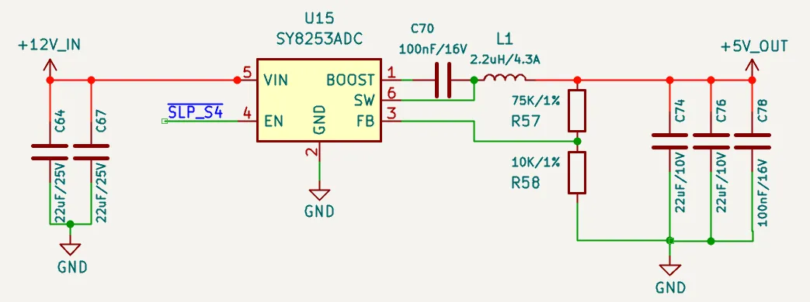
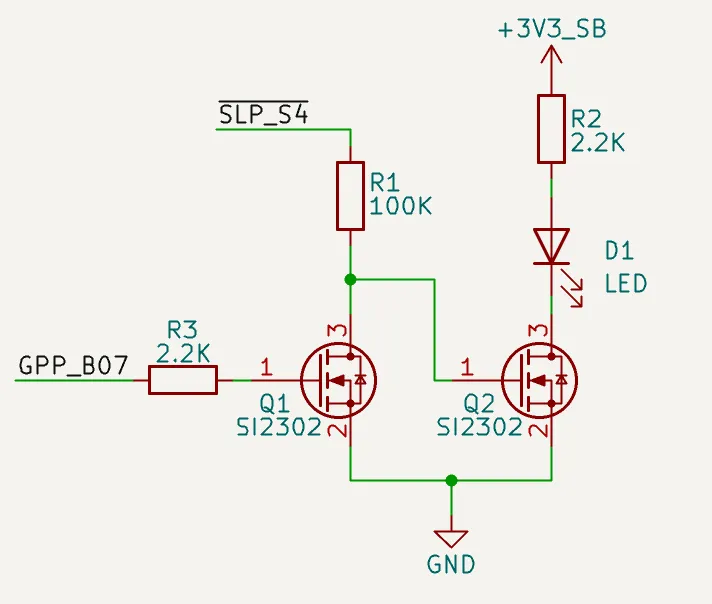

# Power Control & Status

## Status Indication

LattePanda Mu Ultra x86 compute module provides two status output pins, `SLP_S0_S3` and `SLP_S4`, to indicate the current system power state. These pins are dedicated to controlling the power enable lines for peripherals or to drive status LEDs.

!!! note "Different Semantics from LattePanda Mu"

    The processor of the LattePanda Mu Ultra does not support the traditional S3 sleep state — it supports **Modern Standby** only. As a result, the status pin behavior differs from the LattePanda Mu (which provides `PSON` on pin 5). On the Mu Ultra, pin 5 is `SLP_S0_S3`, and both status pins output HIGH in **both** the Working and Modern Standby states.

### Pin Definition

| Pin Name  | Pin Number | Note                                                              |
| --------- | ---------- | ----------------------------------------------------------------- |
| SLP_S0_S3 | 5          | Output HIGH (4.7kΩ pull-up) when Working or in Modern Standby |
| SLP_S4    | 7          | Output HIGH (4.7kΩ pull-up) when Working or in Modern Standby     |
| GPP_B07 (MS_BLINK) | 134 | Modern Standby breathing wave output (1.8V), available in the default BIOS |

### Status Logic Table

| System State        | `SLP_S0_S3` Level | `SLP_S4` Level | System State Note         |
| :------------------ | :---------------- | :------------- | :------------------------ |
| Working (S0)        | HIGH              | HIGH           | System running normally   |
| Modern Standby (MS) | HIGH              | HIGH           | Screen off; Sleep/Suspend |
| Hibernate (S4)      | LOW               | LOW            | Suspend to Disk           |
| Shutdown (S5)       | LOW               | LOW            | Soft OFF                  |
| Powered but Not Started (S5/G2) | LOW      | LOW            | Power applied; system not started |

!!! note

    Both status pins rely on weak pull-up resistors to output HIGH and cannot source significant current. An external NMOS is required to drive an LED indicator or other components that need higher current.

The above logic simplifies the power enable control of peripherals and the driving of status LEDs, and can be implemented purely in hardware.

Examples will be given separately below.

### Peripheral Power Control

{width="600" }

💡 During **Modern Standby**, the power rails of USB, PCIe and other peripherals should remain **ON**.

As shown in the schematic above, `SLP_S4` controls the EN pin of the DC-DC buck converter, keeping the 5V rail active during both working and modern standby states. In other states, such as shutdown, the 5V rail is disabled. This power-gating scheme is ideal for USB ports and similar ports.

A similar control logic can also be applied to 3.3V rails, such as those for M.2 slots.

### Status LED Drive

To indicate Modern Standby visually (e.g., with a breathing LED), use the dedicated `GPP_B07` output (pin 134, 1.8 V).

{width="400" }

As shown in the schematic above, the following behavior is achieved:

- When the system boots or in working mode, the LED turns ON.
- In sleep/suspend mode (Modern Standby), the LED breathes.
- In other states, such as when the system is shutdown, the LED turns OFF.

## Power Control

LattePanda Mu Ultra x86 compute module provides signal lines for power and reset buttons, which function exactly like those on a standard laptop or desktop computer.

### Pin Definition

| Pin Name | Pin Number | Note                                              |
| -------- | ---------- | ------------------------------------------------- |
| PWR_SW#  | 1          | For System Power Switch; Internally 10K Pulled Up |
| RST_SW#  | 3          | For System Reset Switch; Internally 10K Pulled Up |

### PWR_SW\#

- Connect to a physical power button. Active Low.
- A low pulse duration of ≥ 125ms is recommended for reliable detection.
- Holding Low for > 10 seconds will trigger a forced shutdown.

### RST_SW\#

- Connect to a physical hard reset button. Active Low.
- A low pulse duration of ≥ 16ms is recommended to ensure a successful reset.

### ESD Protection

Since buttons are frequently touched, they are vulnerable to electrostatic discharge (ESD). Adding ESD protection diodes is strongly recommended.

- Reverse Working Voltage: 5V

## FAQ

| Question                                                     | Potential Cause / Check Point                                | Explanation / Solution                                       |
| ------------------------------------------------------------ | ------------------------------------------------------------ | ------------------------------------------------------------ |
| CMOS Error appears after boot                                | Low RTC battery voltage                                      | Replace the RTC battery with a new one.                      |
|                                                              | First initialization after BIOS update                       | This is normal behavior. The message will disappear once initialization is complete. |
| The screen is off, but the fan is still spinning and OS won't sleep/suspend. | A PCIe device without CLKREQ connected (or with CLKREQ permanently pulled low) blocks Modern Standby entry. | Connect the CLKREQ pin of every PCIe device; see the [PCIe 4.0](design_guide_pcie.md) chapter. |
|                                                              | On Windows OS, this phenomenon is more likely to occur when connected to the internet. | Try again later or accept this.                              |
| Fan spins up briefly during Modern Standby, then stops       | Background maintenance tasks wake the system without turning on the display | This is normal Modern Standby behavior on Windows OS; once the tasks complete, the system re-enters Modern Standby automatically. |
