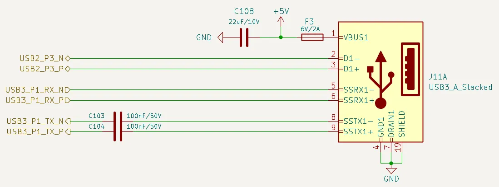

# USB 3.2

This chapter covers the **2 dedicated** USB 3.2 Gen 2 lanes (`USB3_P1` and `USB3_P2`) on the LattePanda Mu Ultra x86 compute module.

- Each supports SuperSpeed USB 10 Gbps, backward compatible with SuperSpeed USB 5Gbps.
- These lanes operate in **Host Mode ONLY**. USB OTG is NOT supported.

TCP0 and TCP1 also carry high-speed Type-C data lanes and are configured as USB Type-C ports in the default BIOS. Their Type-C circuitry and lane assignments are outside the scope of this chapter.

## Lane Configuration

The two dedicated USB 3.2 lanes (`USB3_P1` and `USB3_P2`) **cannot be multiplexed** into PCIe or any other function — unlike the HSIO lanes on the LattePanda Mu.

## Design Guidelines

### Pin Definition

| Lane Name | SSTX Pin Number | SSRX Pin Number |
| --------- | --------------- | --------------- |
| USB3_P1   | 13, 15          | 16, 18          |
| USB3_P2   | 19, 21          | 22, 24          |

### AC Coupling

!!! note

    On LattePanda Mu Ultra compute module, the USB 3.2 signal lines do not integrate AC coupling capacitors.

USB 3.2 links require AC coupling.

- **SSTX**: Must place **0.1uF (100nF)** series capacitors. 0402 or smaller package is recommended to minimize parasitics.

- **SSRX**: No capacitors required (they are included in the device side).

```
+--------------------+                               +---------------------+
|   Compute Module   |                               |   USB 3.2 Device    |
|                    |                               |                     |
|       SSTX+ ------>o--------------||-------------->o-------- SSRX+       |
|                    |             0.1uF             |                     |
|       SSTX- ------>o--------------||-------------->o-------- SSRX-       |
|                    |             0.1uF             |                     |
|                    |                               |                     |
|       SSRX+ ------<o------------------------------<o---||--- SSTX+       |
|                    |           (NO CAP)            |  0.1uF              |
|       SSRX- ------<o------------------------------<o---||--- SSTX-       |
|                    |           (NO CAP)            |  0.1uF              |
+--------------------+                               +---------------------+
```

### Polarity Check

Intel's reference design document does not explicitly confirm support for polarity inversion on USB 3.2 differential pairs.

Therefore, implement strict polarity matching on the carrier board. **Do NOT Swap P & N Signals**. As shown in the figure above.

### Pairing Requirement

A standard USB 3.2 Type-A connector consists of two parts:

- **SuperSpeed Signals**: USB 3.2 Lane (SSTX / SSRX).
- **HighSpeed Signals**: USB 2.0 Lane (D+ / D-).

For `USB3_P1` and `USB3_P2`, the USB 3.2 lane can be paired with **any of the 6 USB 2.0 lanes**; there is no fixed hardware binding between them. In the default BIOS configuration, `USB2_P1` and `USB2_P2` are associated with the Type-C ports, while `USB2_P6` is required for Bluetooth when a CNVio wireless module is installed, as noted in the [USB 2.0 chapter](design_guide_usb_20.md). If these lanes are already occupied by those functions, pair the USB 3.2 lane with one of the remaining USB 2.0 lanes.

### Host's Perspective

In our schematics, the USB 3.2 Type-A female connector pinout is defined from the host's perspective.

When routing, connect the host's TX signals directly to the connector's TX pins, and the RX signals to the RX pins. Do not swap these signals. As shown in the figure below.

{width="800" }

### Power Requirement

One USB 3.2 port (single device only): Recommended minimum current is 1.0A.

### ESD Protection

Since USB ports are subject to frequent hot-plugging, they are vulnerable to Electrostatic Discharge (ESD). And USB 3.2 10Gbps signals are extremely sensitive to capacitance. So **Ultra-low capacitance** ESD protection diodes are mandatory.

- Recommended Specs:
    - Junction Capacitance: < 0.18 pF
    - Reverse Working Voltage: 3.3V

### Layout Guidelines

| Parameter | Requirement |
| :--- | :--- |
| Differential Impedance | 90Ω |
| Intra-pair Skew | < 5 mil |
| Inter-pair Skew | Length matching between the SSTX pair and SSRX pair is **NOT** required. |
| SSTX AC Cap for USB 3.2 | 100nF nominal |
| SSTX AC Cap Placement | As close to USB connector as possible (<25 mm) |
| Reference Plane | Continuous GND Recommended |

#### Spacing & Crosstalk

- Trace Type: Microstrip Differential Pair

- Recommended Pair-to-Pair Spacing: ≥ 5W (where W is trace width).
> To ensure signal integrity for USB 3.2 (10Gbps), a spacing of at least 5W is recommended to strictly minimize crosstalk.

- Recommended General Spacing: Maintain at least 5W spacing between high-speed SSTX/SSRX pairs and other signals (USB 2.0 D+/D-, Power).

- [More details in *High-Speed Interface Layout Guidelines*](https://www.ti.com/lit/an/spraar7j/spraar7j.pdf?ts=1718105682488)
