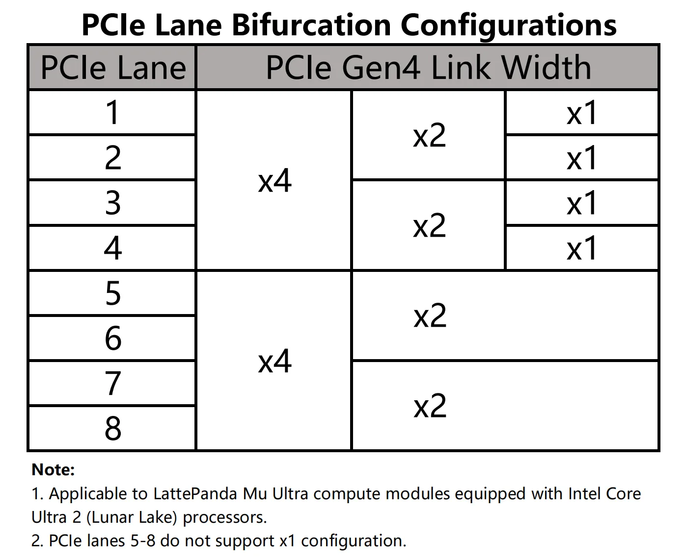

# FAQ

!!! question "What type of connector does the LattePanda Mu Ultra use?"
    **:bulb:** The LattePanda Mu Ultra utilizes a standard **260-pin SO-DIMM** form factor connector. The officially recommended connector part number for carrier board design is **TE Connectivity 2309411-1**.

!!! question "Is the LattePanda Mu Ultra compatible with standard 260-pin SO-DIMM DDR4 carrier boards?"
    **:bulb:** While the LattePanda Mu Ultra physically fits into a standard 260-pin SO-DIMM DDR4 slot, its pinout is uniquely defined by LattePanda. **It is NOT compatible** with standard DDR4 memory pin configurations or other compute modules that use the same physical slot. 
    

    Forcing the module into a standard DDR4 slot and powering it on will cause **permanent damage** to the board! Always ensure you are using a carrier board specifically designed for the LattePanda Mu Ultra series. You can refer to the [**LattePanda Mu Ultra Pinout Table**](https://github.com/LattePandaTeam/LattePanda-Mu-Ultra/tree/main/Electricals/Pinouts) for the exact pin definitions.

!!! question "Are the LattePanda Mu and LattePanda Mu Ultra identical in size?"
    **:bulb:** They share the same length and width (69.6 mm × 60 mm) and use the same 260-pin SO-DIMM edge connector, so a module can be swapped between carrier boards — provided the carrier board circuitry is designed to support both modules. The board height and the onboard fan mounting holes differ slightly; please refer to the respective mechanical drawings for details.

!!! question " LattePanda Mu and LattePanda Mu Ultra use the same DDR4 260P SODIMM edge connector, what are the specific differences in their pin definitions?"
    **:bulb:** We have provided a detailed pin comparison document, including comparisons of functions and voltage levels. Please refer to the [GitHub pinout repository](https://github.com/LattePandaTeam/LattePanda-Mu/blob/main/Electricals/Pinouts/LattePanda_Mu_and_Mu_Ultra_Pinout_Comparison.xlsx).

!!! question "Can the two USB 3.2 ports (USB3_P1 and USB3_P2) on the LattePanda Mu Ultra be multiplexed into other functions, such as PCIe — like the HSIO pins on the LattePanda Mu?"
    **:bulb:** No. These two ports support USB 3.2 only and cannot be reconfigured for other functions.

!!! question "Can the PCIe lanes on the LattePanda Mu Ultra be multiplexed into other functions, such as USB 3.2 or SATA?"
    **:bulb:** No. All PCIe lanes operate as PCIe only and cannot be reconfigured for other protocols.

!!! question "What PCIe bifurcation does the LattePanda Mu Ultra support?"
    **:bulb:** See the diagram below. Note in particular that **PCIe lanes #5 to #8 can only be bifurcated down to x2 — x1 is not supported**.

    { width="400" }

!!! question "The LattePanda Mu Ultra's processor supports PCIe 5.0. Why are the exposed pins limited to PCIe 4.0?"
    **:bulb:** PCIe 5.0 operates at extremely high signaling rates, imposing strict requirements on trace length and impedance control. After passing through the module's edge fingers and the 260-pin SO-DIMM connector onto the carrier board, PCIe 5.0 signals can no longer be guaranteed to work reliably. To ensure stable PCIe operation, the BIOS limits these links to PCIe 4.0.

!!! question "Which carrier boards are compatible with LattePanda Mu Ultra compute module?"
    **:bulb:** We maintain a full compatibility list covering every compute module and carrier board — see the [Compatibility List](../mu_edition/module_carrier_compatibility.md).

!!! question "Why does the LattePanda Mu Ultra sometimes fail to enter sleep mode — the screen turns off but the fan keeps spinning?"
    **:bulb:** The processor of the LattePanda Mu Ultra does not support the traditional S3 sleep state; it only supports Modern Standby. This behavior has existed on Windows systems since the S0ix era and is not specific to this product. Our testing shows the issue occurs more frequently when the system is connected to a network, and much less frequently on Linux.
    

    In addition, entering Modern Standby requires PCIe peripherals to use the CLKREQ pin to trigger their low-power state. Some PCIe connectors on carrier boards — such as the OCuLink connector, standard PCIe slot — do not provide a CLKREQ pin, so a device connected to these connectors will also prevent the system from entering Modern Standby.

!!! question "Why does the LattePanda Mu Ultra sometimes wake up briefly during Modern Standby — the fan spins up without the screen turning on — and then go back to sleep?"
    **:bulb:** During Modern Standby, background maintenance tasks and connected-standby updates can wake the system without turning on the display. Once the tasks are complete, the system automatically re-enters Modern Standby. This is why you may occasionally notice the fan suddenly spinning with no display output, then stopping again after a while.

!!! question "How do I deploy an LLM locally? Are there any tutorials?"
    **:bulb:** We recommend the **OpenVINO** framework with iGPU acceleration — please refer to the [Intel OpenVINO GenAI documentation](https://docs.openvino.ai/2026/openvino-workflow-generative/inference-with-genai.html#). Other popular tools such as llama.cpp and Ollama also run on this compute module.

---

## Need More Help?

If you encounter any issues while using the LattePanda Mu Ultra, please feel free to reach out to our community:

- Open a discussion or issue on the [**LattePanda Forum**](https://www.lattepanda.com/forum/).
- Join our [**Discord**](https://discord.com/invite/UHgtJbf978) server for real-time support and to connect with other makers.

## Contribute to the Documentation

We highly appreciate your contributions to improving our documentation! If you find any errors, have suggestions for enhancement, or want to submit tutorial updates, please feel free to contribute to our [**Docs Repository**](https://github.com/LattePandaTeam/Docs). 

Thank you for your great support, and happy tinkering!

------

[**:simple-discord: Join our Discord**](https://discord.gg/k6YPYQgmHt){ .md-button .md-button--primary }
