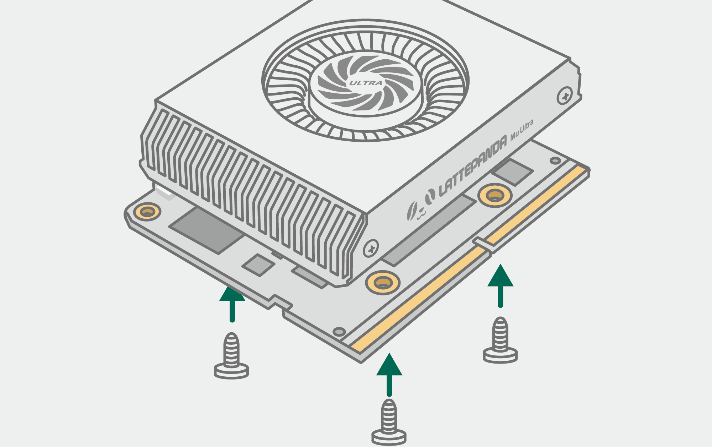
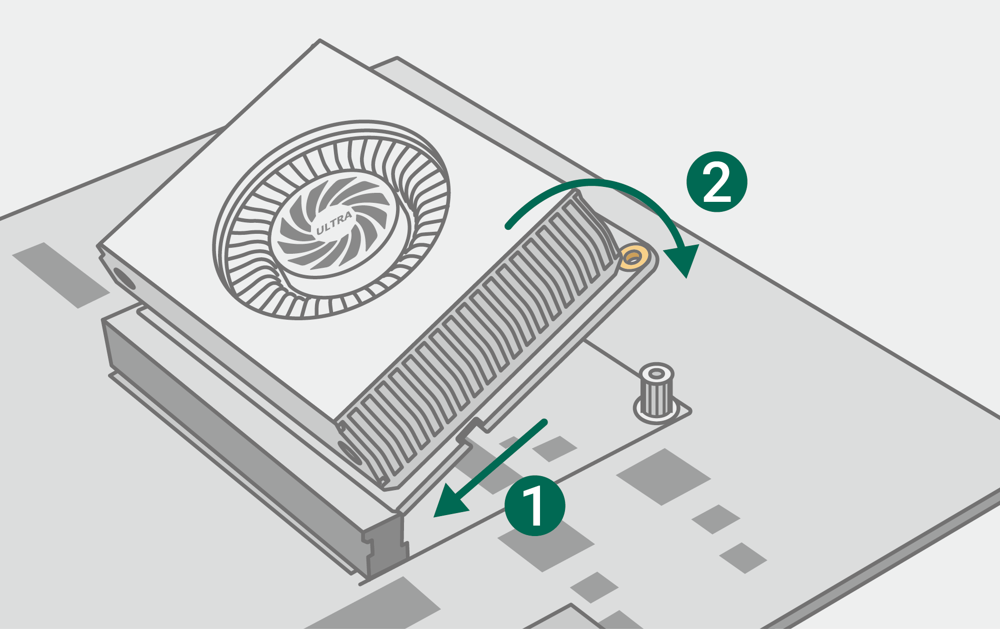
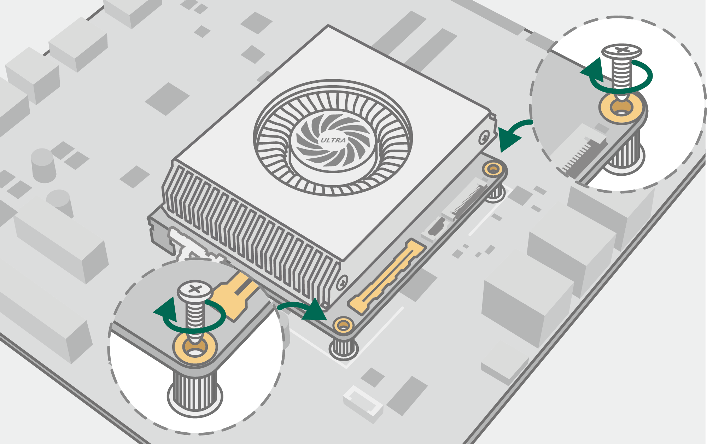

# Initial Setup

This chapter will guide you through the initial setup, hardware installation, and first boot of your LattePanda Mu Ultra.

!!! danger "Important Safety Warning"
    **Always completely disconnect all power sources** before plugging or unplugging the LattePanda Mu Ultra. Failure to do so may result in permanent damage to the module or the carrier board.

## Install the Heatsink

The LattePanda Mu Ultra compute module delivers high performance in a compact form factor, resulting in high heat density. Therefore, using an appropriate **heatsink is mandatory** for stable and safe operation, even in lower power configurations.

1. Remove the mounting screws from the heatsink and carefully peel off the protective film from the thermal pads.
2. Place the heatsink flat on a clean table. Align the mounting holes of the LattePanda Mu Ultra with the threaded standoffs (nut posts) on the heatsink, and hold them in place by hand.
3. Install the mounting screws. Turn each screw a single turn at a time, cycling among them until each is seated.

!!! warning "Avoid Uneven Pressure"
    Do not fully tighten any one screw at once, as uneven pressure may damage the processor.

## Mount onto the Carrier Board

Once the heatsink is securely attached, you can mount the module onto your chosen carrier board.

1. Remove the securing screws from the standoffs at the designated mounting area on the carrier board.
2. Insert the module at a slight angle (about 30 degrees), then gently press it down until it sits flat and parallel to the carrier board.  
    
3. Secure the LattePanda Mu Ultra module by reinstalling the screws.  
    

## Install SSD

Since the LattePanda Mu Ultra compute module does not include built-in storage, you must install an SSD on the carrier board and install an operating system before use. 

Please insert an M.2 NVMe SSD into the M.2 M-Key slot on the carrier board and secure it with the mounting screw.

## Power On and First Boot

1. Connect the appropriate power supply to the carrier board. Please ensure it strictly meets the voltage and current requirements.

2. Connect your display, keyboard, mouse, and other peripherals as needed.

3. Click the power button, then the system start to boot.

    > During the first startup, a longer initialization process is required. It is normal for the power indicator to turn off once and then back on after lighting up. Please wait patiently.

!!! tip "Need Help?"
    If the system fails to boot or the display remains blank, please double-check your power supply specifications, ensure the LattePanda Mu Ultra module is fully seated in the slot, and verify that your SSD is properly installed and recognized. For further troubleshooting, please refer to the [**FAQ**](../../content/mu_ultra_edition/faq.md) chapter.

## Install Operating System

Install your preferred operating system onto the SSD.

- **Official Windows 11 Recovery Image**: If you want to install our official Windows 11 recovery image with preinstalled drivers, please follow the guide [**here**](./os_windows.md).
- **Different version or a clean install of Windows OS:** If you want to install other versions of Windows or perform a clean installation of the OS, please remember to install drivers after the OS installation is complete. Download the drivers [**here**](./download_resources.md).
- **Linux OS**: For Linux OS installation, please refer to the [**Linux OS Installation Guide**](./os_linux.md).

------
[**:simple-discord: Join our Discord**](https://discord.gg/RkSvc9g7eU){ .md-button .md-button--primary }