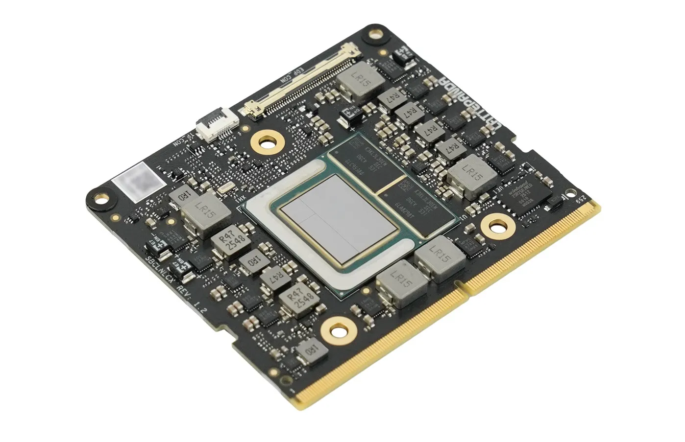

# Introduction

Welcome to **LattePanda Mu Ultra** — **A Micro x86 Compute Module For On-Device AI**.

Powered by the Intel Core Ultra 200V series (Lunar Lake) processor, LattePanda Mu Ultra delivers up to 115 TOPS (Int8) of AI compute through a heterogeneous CPU, GPU and NPU architecture, paired with up to 16GB of high-speed memory. All packed into a credit-card form factor, ready to power local LLMs, vision workloads and compute-intensive applications—wherever your product demands on-device AI or high-performance computing.

{ width="600" }

!!! danger
    **Completely disconnect the power input before plugging or unplugging the LattePanda Mu Ultra module.** Hot-plugging will cause permanent hardware damage.

## For User

- **[▶️ Getting Started](./get_started.md)** — Step-by-step setup to power on your LattePanda Mu Ultra compute module with a carrier board.
- **[💾 OS Image,Drivers, BIOS Updates](./download_resources.md)** — Download the OS image, drivers and BIOS firmware.
- **📘 Carrier Board Docs** — Detailed user guides for official carrier boards:
    - [Check compatibility between compute modules and carrier boards](../mu_edition/module_carrier_compatibility.md)
    - [Mini Carrier board for LattePanda Mu / Mu Ultra](../mu_ultra_edition/mini_carrier.md)

## For Developer

- **[📊 Block Diagram & Specs](./specification.md)** — Comprehensive hardware architecture and specifications.

- **[📐 Open-Source Carrier Board Design Files](https://github.com/LattePandaTeam/LattePanda-Mu/tree/main/Electricals/Examples)** — Download the reference schematics and PCB layouts of carrier boards.

- **[🧬 BIOS Branches](https://github.com/LattePandaTeam/LattePanda-Mu-Ultra/tree/main/Softwares/BIOS)** — Download default and specialized BIOS firmware.

- **[📍 Pinout Documentation](https://github.com/LattePandaTeam/LattePanda-Mu-Ultra/tree/main/Electricals/Pinouts)** — Detailed pin definitions for the LattePanda Mu Ultra edge connector.

- **📘 Carrier Board Design Guide(Coming Soon)** —  Guidelines for carrier board design and electrical characteristic requirements.

- **:simple-github: [LattePanda Mu Ultra Github Repository](https://github.com/LattePandaTeam/LattePanda-Mu-Ultra)**

------

[**:simple-discord: Join our Discord**](https://discord.gg/RkSvc9g7eU){ .md-button .md-button--primary }
