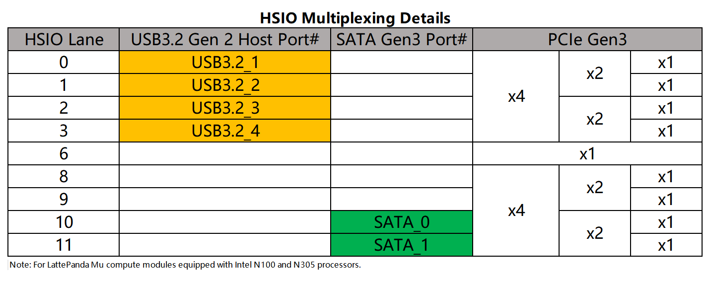

# Migration Guide from LattePanda Mu to LattePanda Mu Ultra

This guide is written for existing LattePanda Mu users who are evaluating migration to the LattePanda Mu Ultra AI compute module.

## Overview

The LattePanda Mu Ultra keeps the **same 260-pin SO-DIMM (DDR4 260P) edge connector, length × width**, and **maximum component height** as the LattePanda Mu. Therefore, as long as your carrier board is electrically compatible, the two modules can be swapped in the same slot, allowing much of the existing carrier-board design—such as the power input, USB 3.2, HDMI circuitry—to be reused directly.

However, these two compute modules are **not 100% pin-compatible**: several pins have changed function or dropped I/O level from 3.3V to 1.8V, the HSIO multiplexing scheme is different, and the power budget, cooling solution, and sleep behavior requirements have changed.

This document walks through **what stays the same** and **what is different**, so you know exactly which parts of your carrier board must be adjusted before plugging in a LattePanda Mu Ultra.

!!! danger "Never Hot-Plug the Compute Module"
    Completely disconnect the power input before plugging or unplugging the compute module. Hot-plugging will cause permanent hardware damage.

!!! warning "Pinout Is Not a Standard DDR4 Slot"
    Although both compute modules physically fit a standard 260-pin SO-DIMM DDR4 slot, the pinout is uniquely defined by LattePanda. Never install them in a standard DDR4 memory slot or on carrier boards designed for other modules.

## Why Upgrade to LattePanda Mu Ultra?

The LattePanda Mu (N100 / N305) has been widely adopted in portable devices, edge gateways, mobile robotics, and embedded HMIs thanks to its compact form factor and flexible HSIO multiplexing.

The LattePanda Mu Ultra is built for the next generation of these applications — the ones that need on-device AI or substantially more compute without changing the product's mechanical design:

- **On-Device AI**: Powered by the Intel Core Ultra 200V series processor with a heterogeneous CPU + GPU + NPU architecture, delivering up to 115 TOPS (Int8) of AI compute — enough to run local LLMs and vision workloads directly on your device, with no cloud dependency.
- **Much Faster Memory**: 16GB LPDDR5X 8533 MT/s, versus LPDDR5 4800 MT/s on the LattePanda Mu.
- **Stronger Graphics**: Intel Arc 130V/140V GPU — a major step up from Intel UHD Graphics.
- **Faster PCIe**: PCIe lanes upgraded from PCIe 3.0 to PCIe 4.0, doubling bandwidth for NVMe SSDs and AI accelerators.
- **CNVio Support**: A dedicated CNVio port for Intel wireless modules that does not occupy a PCIe lane.

If your product's enclosure and most of the carrier board design already work with the LattePanda Mu, the Mu Ultra lets you move to an AI-capable platform with a **partial carrier board revision** instead of a full redesign.

## Specifications Comparison

|                       | **LattePanda Mu**                                            | **LattePanda Mu Ultra**                                      |
| --------------------- | ------------------------------------------------------------ | ------------------------------------------------------------ |
| **Processor**         | Intel N100  Intel Core i3-N305                            | Intel Core Ultra 5 226V Intel Core Ultra 7 256V           |
| **Cores / Threads**   | 4C/4T  8C/8T                                              | 8C/8T                                                        |
| **Max Frequency**     | 3.4 GHz / 3.8 GHz                                            | 4.5 GHz / 4.8 GHz                                            |
| **GPU**               | Intel UHD Graphics (24 / 32 EUs)                             | Intel Arc 130V (7 Xe-cores)   Intel Arc 140V (8 Xe-cores) |
| **NPU**               | None                                                         | Intel AI Boost, 40 / 47 TOPS (Int8)                          |
| **Overall Peak TOPS** | —                                                            | 97 / 115 TOPS (Int8)                                         |
| **Memory**            | 8GB / 16GB LPDDR5 4800 MT/s                                  | 16GB LPDDR5X 8533 MT/s                                       |
| **Onboard Storage**   | 64GB eMMC 5.1                                                | None (boot from PCIe storage on the carrier board)           |
| **PCIe**              | Up to 9× PCIe 3.0 lanes (HSIO multiplexed)                   | Up to 8× PCIe 4.0 lanes (dedicated, not multiplexed)         |
| **USB 3.2**           | Up to 4× USB 3.2 10Gbps (HSIO multiplexed)                   | 2× USB 3.2 Gen2 10Gbps (dedicated, not multiplexed)          |
| **USB 2.0**           | 8× USB 2.0                                                   | 6× USB 2.0                                                   |
| **SATA**              | Up to 2× SATA 6Gbps (HSIO multiplexed)                       | None                                                         |
| **Display**           | Up to 3× HDMI / DP  1× eDP up to 3 independent displays | Up to 3× HDMI / DP  1× eDP  up to 3 independent displays |
| **Wireless**          | PCIe + USB2.0                                                | PCIe + CNVio + USB2.0                                        |
| **BIOS**              | AMI UEFI 128Mbit SPI BIOS (3.3V flash)                       | AMI UEFI 256Mbit SPI BIOS (1.8V flash)                       |
| **Sleep States**      | Traditional S3 sleep only                                    | Modern Standby only (no S3)                                  |
| **Power Supply**      | DC 9–20V, 30W+ power budget                                  | DC 9–20V, 50W+ power budget                                  |
| **OS Support**        | Windows 10 / 11, Ubuntu 22.04(HWE) or later                  | Windows 11, Ubuntu 24.04(HWE) or later                       |
| **Dimension (L × W)** | 69.6mm × 60mm                                                | 69.6mm × 60mm                                                |
| **Operating Temp.**   | 0°C ~ 60°C                                                   | 0°C ~ 60°C                                                   |

## What Stays the Same

The following aspects are consistent between the two compute modules. If your carrier board only uses these resources, it can be reused with little to no modification.

### 1. Edge Connector & Module Footprint

- **Connector**: Both modules use the same `260-pin SO-DIMM (DDR4 260P) edge connector`. The officially recommended carrier board connector is `TE Connectivity 2309411-1` — the same part used for the LattePanda Mu.
- **Length × Width**: Both modules measure 69.6mm × 60mm, so the board outline and connector position in your layout are unchanged.
- **Board Thickness & Component Height**: The bare-board PCB thickness and the maximum component height on both sides are identical between the two modules, so standoff heights in your structure design remain valid.
- **Ground & Power Pin Positions**: All GND pin positions and the main power input pins (VIN, pins 250–260, DC 9–20V) are identical.

This means the connector footprint, keep-out areas, standoffs, and power input section of your existing carrier board can be reused as-is.

### 2. Power Control & Status Indication Pins

With the default BIOS / hardware configuration, the following low-speed pins are **identical in position, direction, voltage level, and function**:

| Pin  | Signal      | Function                                     |
| ---- | ----------- | -------------------------------------------- |
| 1    | PWR_SW#     | System power switch (active low)             |
| 3    | RST_SW#     | System reset switch (active low)             |
| 9    | TSENSE      | NTC temperature sensor input                 |
| 115  | VBAT        | RTC battery input (3V)                       |
| 125  | PMCALERT#   | USB Type-C PD controller / re-timer alert    |
| 133  | BIOS_SEL(#) | BIOS ROM select (integrated vs. carrier ROM) |

Your power button, reset button, RTC battery, and BIOS flash-selection circuits can be reused directly.

The two status pins (Pin 5 and Pin 7) keep the same position and IO level, but their state behavior differs between the two modules.  For details, see *What's Different* — [Sleep Behavior](#5-sleep-behavior-modern-standby-only-and-clkreq-is-mandatory).

### 3. High-Speed Lanes: USB 3.2, Display & PCIe

- **USB 3.2**: In the default BIOS configuration, the two USB 3.2 ports of the LattePanda Mu (HSIO0/HSIO1, pins 13–21 / 16–24) map to USB3_P1 / USB3_P2 on the Mu Ultra at the **same pin positions**, still requiring external AC coupling capacitors. Carrier boards that expose these two ports as USB 3.2 Type-A can reuse the routing directly.
- **Display Lanes**: The TCP0 and TCP1 port lanes (DP/HDMI lanes, AUX channels, HPD, and CTRL CLK/DATA) are **completely identical** between the two modules. The DDIB port of the Mu is changed to TCP2 on the Mu Ultra, but all lane positions, voltage levels, and functions are the same. With the default BIOS firmware, the HDMI output on this port (DDIB on Mu / TCP2 on Mu Ultra) works out of the box.
- **USB 2.0 (Partial)**: The USB 2.0 differential pairs on pins 73/75, 79/81, and 76/78 are identical in position, voltage level, and direction on both modules — only the port numbers differ (Mu USB2_P2/P3/P7 → Mu Ultra USB2_P3/P4/P5). The carrier board routing for these ports can be reused as-is; no circuit changes are needed. (Note: the remaining USB 2.0 pins are remapped or have special default assignments — see [USB 2.0 Port Remapping & Bound Ports](#10-usb-20-port-remapping-bound-ports) in *What's Different*.)
- **PCIe Lanes (Conditional)**: If your carrier board used the Mu's HSIO lanes **purely as PCIe** (i.e., you did not multiplex any of them into USB 3.2 or SATA), the routing is electrically compatible with the Mu Ultra — same pin positions, same signaling level, and the same external AC coupling requirement. Only the lane numbering and PCIe generation (3.0 → 4.0) change:

    | TX / RX Pins      | LattePanda Mu (as PCIe) | LattePanda Mu Ultra |
    | ----------------- | ----------------------- | ------------------- |
    | 61/63, 64/66      | HSIO6                   | PCIe Lane 1         |
    | 25/27, 28/30      | HSIO2                   | PCIe Lane 3         |
    | 31/33, 34/36      | HSIO3                   | PCIe Lane 4         |
    | 37/39, 40/42      | HSIO8                   | PCIe Lane 5         |
    | 43/45, 46/48      | HSIO9                   | PCIe Lane 6         |
    | 49/51, 52/54      | HSIO10                  | PCIe Lane 7         |
    | 55/57, 58/60      | HSIO11                  | PCIe Lane 8         |

    Five things still need attention even in this "compatible" case:
    
    - verify signal integrity against **PCIe 4.0** requirements (the links now run at twice the speed); 
    - connect the **CLKREQ** pin for every PCIe device if you need Modern Standby (see *What's Different* — [Sleep Behavior](#5-sleep-behavior-modern-standby-only-and-clkreq-is-mandatory)); 
    - HSIO10/11 can no longer serve as SATA — PCIe only on the Mu Ultra; 
    - The Mu Ultra additionally exposes **PCIe Lane 2** on pins 67/69/70/72, which are USB 2.0 pins on the Mu — check for conflicts in *What's Different* — [PCIe Lane 2 Occupies the Mu's USB 2.0 Pins](#8-pcie-lane-2-occupies-the-mus-usb-20-pins-67697072).
    - LattePanda Mu Ultra's PCle lanes 5-8 do not support x1 configuration.

### 4. Fan Control & Miscellaneous

- **Fan Ports**: FAN2/FAN3 PWM control (3.3V) and tachometer inputs (5V-tolerant) are unchanged (pins 2/4/6/8).
- **SuperIO UART**: SIO_UART_TX/RX (pins 10/12, 3.3V) are unchanged.
- **PCIe Reference Clocks & Reset**: REFCLK0–REFCLK4 differential pairs, PCIE_WAKE#, and PLT_RST# keep the same pin positions and functions.
- **SMLink1 Bus**: SML1_DATA (pin 145) and SML1_CLK (pin 147) are unchanged (3.3V, internal 2.2kΩ pull-ups). Only the SML1_ALERT# pin (149) is no longer available on the Mu Ultra — designs that do not rely on the alert line can reuse the SMLink1 circuit directly.
- **Operating System Family**: Both modules run **Windows and Linux**. Your OS deployment workflow (image installation, drivers) is conceptually the same.

## What's Different

The differences below **require carrier board design reviews or changes**. Items marked with ⚠️ are electrical-compatibility risks that can damage the compute module or peripherals if overlooked.

### 1. Cooling Solution Changed

The bare-board PCB thickness and the maximum component height on both sides are the same between the two compute modules.

**Cooler Mounting Holes & Processor Height**: The heatsink mounting hole positions and the processor package height are **different**, so the two compute modules require **different coolers — they are not interchangeable**.

The officially supported coolers for each module are:

| Compute Module      | Cooler                    | SKU     |
| ------------------- | ------------------------- | ------- |
| LattePanda Mu       | Active Cooler             | FIT0981 |
|                     | Aluminum Fanless Heatsink | FIT0989 |
| LattePanda Mu Ultra | Active Cooler             | FIT1049 |

!!! danger "Cooling Solution Required"
    - Do not power on the LattePanda Mu Ultra without its cooler installed.
    - If your enclosure reserves space for the Mu cooler, re-verify the mechanical fit, standoff heights, and airflow for the Mu Ultra cooler before mass production.

### 2. No Onboard Storage

The LattePanda Mu is integrated with **64GB of onboard eMMC** — you can install the OS directly on the module. The LattePanda Mu Ultra has **no onboard storage**: the system must boot from a storage device connected through the carrier board, typically an **NVMe SSD on one of the PCIe lanes**.

Please note:

- Your carrier board **must route at least one PCIe lane to a storage connector** (e.g., M.2 M-Key) for the boot drive — otherwise the Mu Ultra has nothing to boot from.
- If your existing Mu carrier board does not expose any PCIe storage connector, this is a mandatory addition, not an optional one.
- The LattePanda Mu Ultra does not directly support SATA storage devices.

### 3. Higher Power Budget

|                         | LattePanda Mu | LattePanda Mu Ultra |
| ----------------------- | ------------- | ------------------- |
| Acceptable Power Input  | DC 9–20V      | DC 9–20V            |
| Recommended Power Input | DC 12–20V     | DC 12–20V           |
| Recommended Budget      | 30W or above  | 50W or above        |

The input voltage range is the same, but the Mu Ultra consumes significantly more power under load. Please verify that:

- Your carrier board's power path (connector, traces, protection circuits) can handle the higher current.
- Your external power adapter is rated for at least 50W.

### 4. Operating System & Software Migration

- **Windows 11 Recommended**: The Intel Core Ultra 200V series processor uses a hybrid architecture (P-cores + E-cores) that relies on Intel Thread Director for task scheduling. Windows 11 has native, optimized support for this scheduling model, while Windows 10 does not — running Windows 10 may result in suboptimal performance and power efficiency. 

- **GPIO Number Changes**: GPIO and I2C pins are renumbered on the Mu Ultra (and their voltage levels changed to **1.8V**). Any application, script, or service that references the Mu's GPIO/I2C numbering must be updated to the new mapping.

- **BIOS Firmware & Customizations Must Be Re-Applied**: The BIOS firmware of the Mu and Mu Ultra is not interchangeable — custom BIOS branches from the Mu cannot be flashed onto the Mu Ultra. The Mu Ultra has its own [BIOS branches](https://github.com/LattePandaTeam/LattePanda-Mu-Ultra/tree/main/Softwares/BIOS) — re-apply your customizations there and re-flash.

### 5. Sleep Behavior: Modern Standby Only, and CLKREQ Is Mandatory

|                            | LattePanda Mu        | LattePanda Mu Ultra         |
| -------------------------- | -------------------- | --------------------------- |
| Supported Sleep States     | Traditional S3 only  | Modern Standby only (no S3) |
| CLKREQ Pins Exposed        | 2 (REFCLK_REQ3-4)    | All 5 (REFCLK_REQ0–4)       |
| PCIe Device Without CLKREQ | Does not block sleep | Blocks Modern Standby entry |

On the Mu Ultra, **every PCIe device must have its CLKREQ pin connected** to the corresponding REFCLK_REQ pin on the compute module. Entering Modern Standby requires PCIe peripherals to use CLKREQ to trigger their low-power state. A PCIe device **without CLKREQ connected, or with CLKREQ permanently pulled low by a pull-down resistor, will prevent the system from entering Modern Standby** (the screen is off, but the processor and fan continue running).

!!! note
    Some PCIe connectors commonly used on carrier boards — such as OCuLink connectors or standard PCIe slots — do not carry a CLKREQ pin. A device attached through these connectors will prevent the Mu Ultra from entering Modern Standby. When migrating, either connect CLKREQ where the connector allows, or accept that sleep may be blocked (only the screen turns off).

Note that the three new CLKREQ pins on the Mu Ultra (REFCLK_REQ0-2) sit where the LattePanda Mu exposes its SMBus. The pin mapping is as follows:

| Pins    | LattePanda Mu | LattePanda Mu Ultra |
| ------- | ------------- | ------------------- |
| 100/102 | REFCLK_REQ3-4 | REFCLK_REQ3-4 (unchanged) |
| 104     | SMB_ALERT    | REFCLK_REQ0        |
| 106     | SMB_CLK       | REFCLK_REQ1        |
| 108     | SMB_DATA      | REFCLK_REQ2        |

If your carrier board uses the Mu's SMBus, those connections must be removed — the SMBus is no longer available on the Mu Ultra.

Related status-pin change: pin 5 (PSON on Mu) is now SLP_S0_S3. It keeps the same position and 3.3V level, but its state semantics follow Modern Standby, and a dedicated Modern Standby blink output (pin 134, GPP_B07) is available in the default BIOS.

- **LattePanda Mu:**

| Pin Name | Pin Number | Behavior                                                     |
| :------- | :--------- | :----------------------------------------------------------- |
| PSON     | 5          | Output HIGH (10kΩ pull-up) only when Working (S0)            |
| SLP_S4   | 7          | Output HIGH only when Working (S0) or Sleeping (S3)          |

- **LattePanda Mu Ultra:**

| Pin Name  | Pin Number | Behavior                                                     |
| :-------- | :--------- | :----------------------------------------------------------- |
| SLP_S0_S3 | 5          | Output HIGH (4.7kΩ pull-up) when Working or in Modern Standby |
| SLP_S4    | 7          | Output HIGH (4.7kΩ pull-up) when Working or in Modern Standby |
| MS_Blink  | 134        | Output Blink Signal when in Modern Standby                   |

!!! note
    During Modern Standby, the power rails of PCIe and other peripherals should remain **on** — do not switch them off.

### 6. Carrier Board's BIOS SPI Flash: Different Voltage and Capacity ⚠️

|                   | LattePanda Mu | LattePanda Mu Ultra |
| ----------------- | ------------- | ------------------- |
| BIOS Flash Chip   | W25Q128JVSIQ  | W25R256JWEIQ        |
| Capacity          | 128Mbit       | 256Mbit             |
| Operating Voltage | 3.3V          | **1.8V**            |
| SPI Bus Level     | 3.3V          | **1.8V**            |

The entire SPI bus for the BIOS flash chip (pins 153, 155, 157, 159, 161, 163, 165) runs at **1.8V** on the Mu Ultra, including the SPI chip selects for the carrier BIOS flash chip.

The BIOS_SEL pin (pin 133) is **3.3V-tolerant** on both modules. If your carrier board pulls this pin up to 3.3V, you can keep the original design unchanged.

!!! danger "Carrier BIOS Flash Chip Must Be 1.8V"
    - If your carrier board equips a BIOS flash chip designed for the Mu's 3.3V bus, it **must be replaced with a 1.8V part**. Connecting a 3.3V flash chip for a long time will damage the pins.
    - SPI_CS (pin 165) typically has a pull-up resistor connected to the Flash chip's power rail. If you plan to only remove the flash chip, do not forget to remove this pull-up resistor as well.

!!! note

    Our testing shows that even when the 3.3V flash chip on the carrier board is **not powered**, its presence on the SPI bus still prevents the Mu Ultra from booting. Simply depowering the chip is not enough — it must be removed or replaced with a 1.8V part.

### 7. HSIO Allocation: No More Multiplexing

On the LattePanda Mu, HSIO lanes can be flexibly multiplexed between PCIe, USB 3.2, and SATA via the BIOS. On the LattePanda Mu Ultra, this multiplexing no longer exists:

- **USB 3.2 is USB 3.2 only** — the two USB 3.2 ports cannot be reconfigured as PCIe or anything else.

- **PCIe is PCIe only** — all PCIe lanes cannot be reconfigured as USB 3.2 or SATA.

- **SATA is no longer available.** If your carrier board used the Mu's SATA function, you must switch to a PCIe-based solution (e.g., NVMe SSD or a PCIe-to-SATA bridge chip).

The high-speed lanes that can carry USB 3.2 on the Mu, and their fixed functions on the Mu Ultra, are compared below:

| TX / RX Pins      | LattePanda Mu                    | LattePanda Mu Ultra            |
| ----------------- | -------------------------------- | ------------------------------ |
| 13/15, 16/18      | HSIO0 — USB 3.2 **or** PCIe      | USB3_P1 — **USB 3.2 only**     |
| 19/21, 22/24      | HSIO1 — USB 3.2 **or** PCIe      | USB3_P2 — **USB 3.2 only**     |
| 25/27, 28/30      | HSIO2 — USB 3.2 **or** PCIe      | PCIe Lane 3 — **PCIe only**    |
| 31/33, 34/36      | HSIO3 — USB 3.2 **or** PCIe      | PCIe Lane 4 — **PCIe only**    |
| 61/63, 64/66      | HSIO6 — PCIe only                | PCIe Lane 1 — **PCIe only**    |
| 37/39–55/57 (TX), 40/42–58/60 (RX) | HSIO8–11 — PCIe **or** SATA (HSIO10/11 only) | PCIe Lanes 5–8 — **PCIe only** |

- **LattePanda Mu:**

    

- **LattePanda Mu Ultra:**

    { width="400" }

### 8. PCIe Lane 2 Occupies the Mu's USB 2.0 Pins (67/69/70/72) ⚠️

The PCIe lane assignment has also been re-mapped. In particular, **PCIe Lane 2 on the Mu Ultra is routed to pins 67/69 (TX) and 70/72 (RX)** — which are **USB 2.0 Port 1 and Port 4 on the LattePanda Mu**:

| Pins  | LattePanda Mu   | LattePanda Mu Ultra              |
| ----- | --------------- | -------------------------------- |
| 67/69 | USB2_P1_N/P     | PCIE_TX2_P/N (PCIe Lane 2 TX)    |
| 70/72 | USB2_P4_P/N     | PCIE_RX2_P/N (PCIe Lane 2 RX)    |

Whether this conflict is dangerous depends on what your carrier board connects to these pins:

- **USB 2.0 devices connected (e.g., routed to a USB Type-A port)** — 🔴 **Dangerous.** USB 2.0 data lines sit at 3.3V (pull-ups on the D+/D− lines). If a Mu Ultra is installed on such a carrier board, 3.3V will be present on these **1.8V-tolerant** PCIe pins. Although the Mu Ultra integrates 220nF AC coupling capacitors on PCIe Lane 2 that can tolerate brief over-voltage, **never operate in this condition for an extended period** — re-route or remove these connections before installing a Mu Ultra.
- **PCIe devices connected** — 🟢 **Safe.** PCIe differential pairs never carry 3.3V, and the Mu's USB 2.0 host side does not actively drive 3.3V onto these pins either. In this case, swapping between the Mu and Mu Ultra is electrically safe.

### 9. Large-Scale Pin Changes: 1.8V Levels, Removed and New Ports

Beyond the items above, many low-speed pins have changed voltage level, function, or been removed/added. A detailed pin-by-pin comparison (with color-coded risk levels) is available in the [**LattePanda Mu & Mu Ultra Pinout Comparison**](https://github.com/LattePandaTeam/LattePanda-Mu-Ultra/blob/main/Electricals/Pinouts/LattePanda_Mu_and_Mu_Ultra_Pinout_Comparison.xlsx).

**Key changes to review:**

#### 9.1 GPIO Pins Dropped from 3.3V to 1.8V ⚠️

The following ports moved from 3.3V on the Mu to **1.8V** on the Mu Ultra. Connecting 3.3V logic to these pins may damage the pins:

- **GPIO pins** 118–134 (GPP_E11–E22, GPP_B04–B07 — also renumbered vs. the Mu's GPP_F/D pins)

- **UART0 / UART1** (pins 137–143)

- **I2C buses** (pins 146–156, renumbered as I2C3/I2C2/I2C1)

- **HD Audio** port (pins 172–180)

Since too many pins are affected to list in a table here, please refer to the **yellow-highlighted rows** in the [Pinout Comparison xlsx](https://github.com/LattePandaTeam/LattePanda-Mu-Ultra/blob/main/Electricals/Pinouts/LattePanda_Mu_and_Mu_Ultra_Pinout_Comparison.xlsx) for the complete list of voltage-level changes.

!!! danger "Level Shifters Required"
    Any 3.3V peripheral connected to these pins on your Mu carrier board — MCUs, sensors, UART adapters, audio codecs, I2C devices — needs a **level shifter** (or a 1.8V-native replacement) before it can be used with the Mu Ultra!

#### 9.2 Ports Removed on the Mu Ultra

| Pins    | LattePanda Mu          | LattePanda Mu Ultra |
| ------- | ---------------------- | ------------------- |
| 104–108 | SMBus (ALERT/CLK/DATA) | REFCLK_REQ0-2       |
| 138–144 | UART2 + I2C5           | CNVi BRI/RGI bus    |
| 149     | SML1_ALERT#            | No connect (RSVD)   |
| 160–168 | I2S audio              | No connect (RSVD)   |
| 184–216 | MIPI CSI (Ports C & D) | CNVio WT/WR bus     |
| 136     | GND                    | No connect (RSVD)   |

If your design uses the Mu's **MIPI CSI camera** or **I2S audio** ports, these functions cannot be migrated directly — consider USB cameras and HD Audio / USB audio alternatives.

#### 9.3 New Ports on the Mu Ultra

The new ports on the Mu Ultra, compared with the original functions at the same pins on the Mu:

| Pins    | LattePanda Mu                | LattePanda Mu Ultra                     |
| ------- | ---------------------------- | --------------------------------------- |
| 184–216 | MIPI CSI (Ports C & D)       | CNVio WT/WR lanes                       |
| 138–144 | UART2 + I2C5                 | CNVi BRI/RGI bus                        |
| 121     | GPP_A12 (GPIO)               | CRF_CLKREQ                              |
| 123     | SATA_LED#                    | CNV_RF_RESET#                           |
| 134     | GPP_D3 (GPIO, 3.3V)          | GPP_B07 — Modern Standby blink (1.8V)   |

- **CNVio**: The CNVio WT/WR lanes, CNV_BRI/RGI bus, CRF_CLKREQ, and CNV_RF_RESET# together form a complete CNVio port for Intel CNVi Wi-Fi companion RF modules. If you don't use CNVi Wi-Fi, simply leave these pins unconnected.
- **Modern Standby Blink Output**: Pin 134 (GPP_B07, 1.8V) — can drive a breathing/blinking status LED during Modern Standby.

#### 9.4 Other Items to Verify

- **Wireless Module & Antennas**: Your existing PCIe/USB Wi-Fi modules remain usable, but if you plan to take advantage of the new CNVio port you will need an Intel CNVi companion RF (CRF) module (e.g. AX201, AX211) instead, and its Bluetooth function must be connected to USB2_P6 (pins 82/84). Wi-Fi modules usually require dual antennas — reserve the extra antenna opening in your enclosure if you route antennas externally.
- **eDP Display Cabling**: Both modules provide an onboard eDP port for embedded panels — you can continue using the original 7-inch (FIT0950) or 11.6-inch (FIT0955) eDP displays.

### 10. USB 2.0 Port Remapping & Bound Ports

The USB 2.0 port numbering has changed between the two modules. Check every USB 2.0 connection on your carrier board against the new pinout:

| Pins    | LattePanda Mu                               | LattePanda Mu Ultra               |
| ------- | ------------------------------------------- | --------------------------------- |
| 73/75   | USB2_P2                                     | USB2_P3                           |
| 79/81   | USB2_P3                                     | USB2_P4                           |
| 76/78   | USB2_P7                                     | USB2_P5                           |
| 82/84   | USB2_P8                                     | USB2_P6 — Bluetooth for wireless modules (also usable as generic USB 2.0) |
| 109/111 | USB2_P5                                     | USB2_P1 — bound to TCP1           |
| 112/114 | USB2_P6 — bound to TCP1; Must use with TCP1 | USB2_P2 — bound to TCP0           |

!!! note "Dedicated USB 2.0 Port for Bluetooth on the Mu Ultra"
    - **Pins 82/84 (USB2_P6)**: If you are using the CNVio wireless module, you must use this port. It can also be used directly as a generic USB 2.0 port.

!!! note "USB 2.0 Ports Bound to Type-C in the Default BIOS"
    - **Pins 109/111 (USB2_P1) and 112/114 (USB2_P2)**: In the default BIOS firmware, these two ports are associated with TCP1 / TCP0 (USB Type-C ports). Unlike the LattePanda Mu, however, they can also be used directly as generic USB 2.0 ports when the Type-C function is not in use.

## Migration Recommendations & Steps

The steps below follow the same order as the *What's Different* section — from electrical safety to final validation. Steps 1–3 prevent hardware damage; steps 4–7 cover the redesign work; steps 8–9 are validation.

1. **Audit Every Pin Against the Comparison Table**

    - Open the [Pinout Comparison xlsx](https://github.com/LattePandaTeam/LattePanda-Mu-Ultra/blob/main/Electricals/Pinouts/LattePanda_Mu_and_Mu_Ultra_Pinout_Comparison.xlsx) and audit **every pin your carrier board uses**. Pay special attention to the **yellow-highlighted rows** (3.3V → 1.8V level changes) and the white rows (function changes).

    - Classify each affected pin: *must re-route*, *needs level shifter*, *leave unconnected*, or *reuse as-is*.

2. **Electrical Safety Rework (Do This First)**

    - Add **level shifters** (or 1.8V-native replacements) for any 3.3V peripheral on the pins that are now 1.8V: GPIO (118–134), UART0/1 (137–143), I2C (146–156), HD Audio (172–180), and the BIOS SPI bus (153–165).

    - **BIOS flash chip**: replace any 3.3V carrier flash chip with a 1.8V part — and if you only remove the chip, also remove the **SPI_CS pull-up resistor** (pin 165). Remember: even an unpowered 3.3V chip on the bus prevents the Mu Ultra from booting. The BIOS_SEL pin (133) is 3.3V-tolerant, so its pull-up design can stay.

    - **Pins 67/69/70/72** (USB 2.0 on Mu, PCIe Lane 2 on Mu Ultra): if these connect to USB 2.0 devices (e.g., a Type-A port), re-route or depopulate them — 3.3V on the data lines will stress the 1.8V-tolerant PCIe pins. If they connect to a PCIe device, no change is needed.

    - Remove any connections to the former **SMBus** pins (104/106/108, now REFCLK_REQ0–2).

    - Check the **USB 2.0 port map**: keep only the reusable ports (73/75, 79/81, 76/78, 109/111, 112/114) — note the port numbers change; pay attention to the Bluetooth port (82/84) when using a CNVio wireless module.

3. **Mechanical & Thermal Adaptation**
    - The bare-board thickness, component heights, and standoff positions remain valid — but the **cooler mounting holes and processor height changed**, so the Mu cooler cannot be reused. Re-verify mechanical fit, standoff heights, and airflow with the Mu Ultra's Active Cooler (FIT1049).
    
    - Confirm your power path (connector, traces, protection) and adapter support **50W or above** (recommended input DC 12–20V).
    
4. **Boot Storage (Mandatory)**

    - The Mu Ultra has **no onboard eMMC** — route at least one PCIe lane group to a storage connector (e.g., M.2 M-Key NVMe). This is a hard requirement, not an option.
    - Plan how to re-deploy OS images, data, and licenses from the Mu's eMMC to the new boot drive.

5. **PCIe & High-Speed Redesign**

    - Re-map PCIe devices to the **fixed lane assignment** (no more HSIO multiplexing); if you relied on SATA, migrate to NVMe or a PCIe-to-SATA bridge.

    - Verify signal integrity against **PCIe 4.0** requirements.

    - Note the bifurcation limit: **PCIe lanes 5–8 can only split down to x2, not x1**.

    - Connect **CLKREQ for every PCIe device** that should allow Modern Standby — and do **not** tie CLKREQ permanently low with a pull-down resistor; both mistakes block sleep. Avoid CLKREQ-less connectors (OCuLink, standard PCIe slots) if sleep matters.

6. **Peripheral & Interface Adjustments**

    - **MIPI CSI cameras / I2S audio**: no direct migration path — plan for USB cameras and HD Audio / USB audio alternatives.

    - **Wireless**: PCIe/USB Wi-Fi modules keep working. To use the new CNVio port, switch to an Intel CRF module, use the USB2_P6 (82/84) for Bluetooth and reserve dual-antenna openings.

    - **eDP panels**: the original 7-inch (FIT0950) and 11.6-inch (FIT0955) displays remain usable.

    - If your design uses **SMLink1**, note that only SML1_ALERT# (pin 149) is gone; the data/clock lines are unchanged.

7. **Software & Firmware Migration**
    - Move the OS baseline to **Windows 11 or Ubuntu 24.04 (HWE) or later**; Windows 10 runs but is not recommended due to suboptimal hybrid-core scheduling.
    
    - Update applications that reference the Mu's **GPIO/I2C numbering** (pins were renumbered and are now 1.8V).
    
    - Re-apply BIOS customizations on the [Mu Ultra BIOS branches](https://github.com/LattePandaTeam/LattePanda-Mu-Ultra/tree/main/Softwares/BIOS) — Mu BIOS assets are not portable.
    
8. **Functional Re-Test**

    - Verify power/reset buttons, RTC, USB 3.2, HDMI/DP, and fan control — these should work unchanged.

    - Check anything driven by the **status pins (5/7)**: their semantics now follow Modern Standby (HIGH in both Working and Modern Standby), so carrier-side LED or power-gating logic designed around S3/S4 behavior may need adjustment. Optionally use the Modern Standby blink output (pin 134) for a sleep indicator.

     - Test **Modern Standby entry/wake** with your full peripheral set: confirm the system actually enters low power (fan stops, not just screen off).

9. **Full-Load Validation Before Deployment**

    - Run thermal and power stress tests, checking module temperature, adapter headroom (≥50W), and sleep/resume stability over repeated cycles.

:handshake: **We Are Here to Support Your Migration**

We understand that carrier board revisions involve multi-party coordination and validation cycles. For B2B customers, we offer:

- 📚 Migration Technical Support
- 🧪 Sample Request Service
- 🤝 Dedicated Account Manager
- 🔧 BIOS Customization Support

📩 **Contact our support team**: [solution@lattepanda.com](mailto:solution@lattepanda.com)

------

[**:simple-discord: Join our Discord**](https://discord.gg/RkSvc9g7eU){ .md-button .md-button--primary }
