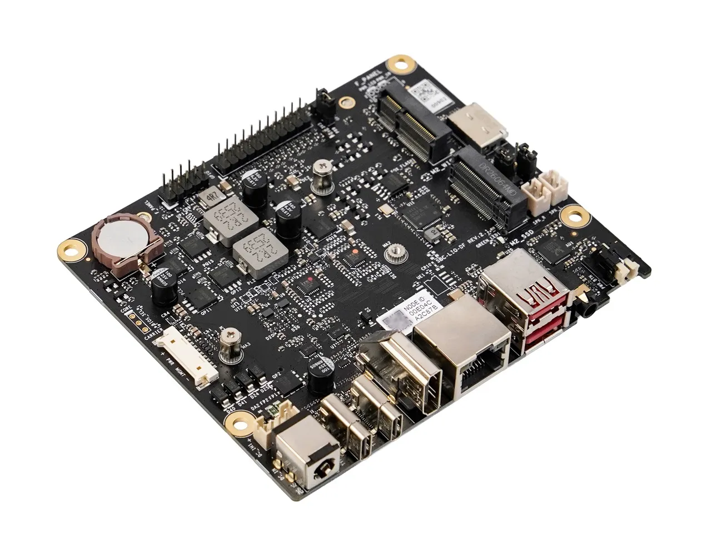
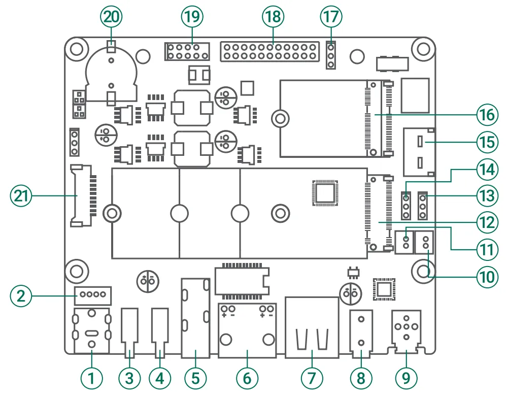
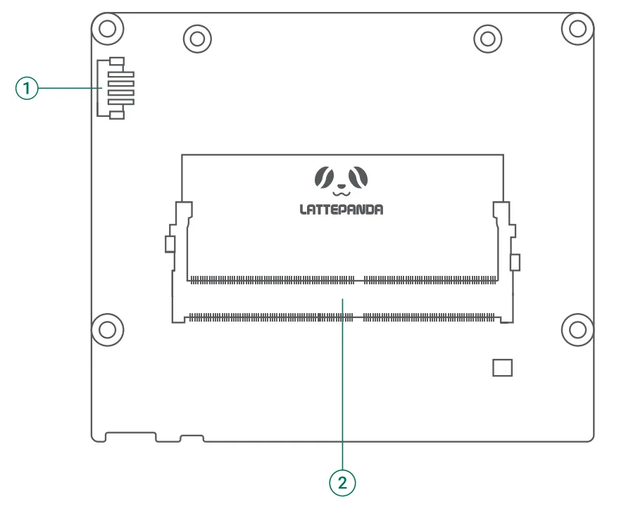
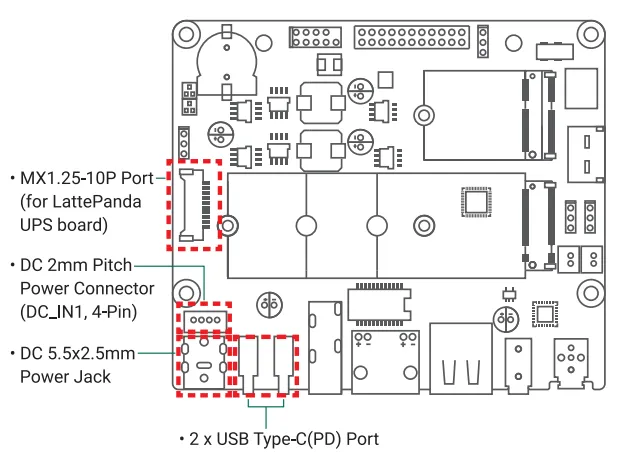
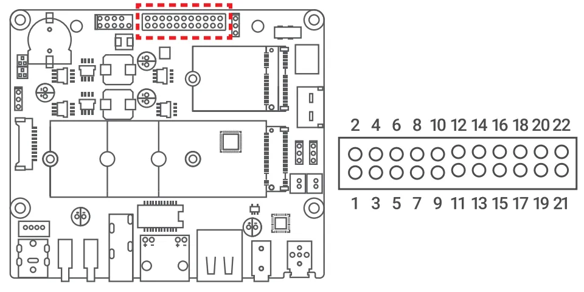

# DFR1293 Mini Carrier Board

{ width="600" }

## Introduction

The mini carrier board is a compact, highly expandable development platform designed for the LattePanda Mu and Mu Ultra compute module. It integrates commonly used ports such as two full-featured Type-C, 2.5G Ethernet, USB 3.2 Gen2, OCuLink, M.2 M Key, M.2 E Key, HDMI, and GPIO. This enables users to connect a wide variety of external devices and modules, allowing them to rapidly build prototypes, test different design solutions, and shorten product development cycles.

!!! danger

    🔌 Before inserting/removing the LattePanda Mu/Mu Ultra or connecting/disconnecting any type of ribbon cable and internal port, ensure that the power is completely disconnected and wait for the power indicator light on the carrier board to turn off.

## Get Started

### Hardware Assembly

1. Please refer to the *Initial Setup* section of LattePanda Mu or LattePanda Mu Ultra for guidance on hardware assembly and first boot.

    - View the [Initial Setup for LattePanda Mu](./../mu_edition/get_started.md)
    - View the [Initial Setup for LattePanda Mu Ultra](./get_started.md)

2. You can power this carrier board using a Type-C PD power supply, or a 12–20V power supply with a DC 5.5x2.5mm male connector.
    Minimum power requirement: 
    - With LattePanda Mu: 30W
    - With LattePanda Mu Ultra: 50W

!!!note

    The first boot may be slow and the system may automatically restart 1-2 times. Please be patient. After the first boot, as long as the RTC remains powered, the boot speed will return to normal.

### BIOS Firmware Reflash

- If you are using the **LattePanda Mu Ultra** compute module, **skip** this step directly. The default BIOS firmware is already compatible with all ports.

- If you are using the **LattePanda Mu** compute module (with N100 or N305 processor), please **reflash** the BIOS firmware so that the two full-featured USB Type-C ports, headphone jack, speaker output, and button LED can work properly.

    - Download the [**dedicated BIOS firmware**](https://github.com/LattePandaTeam/LattePanda-Mu/tree/main/Softwares/BIOS/MiniCarrier) matching the mini carrier board.
    - Follow the [**BIOS firmware flashing guide**](./../mu_edition/bios_setup.md#update-bios-firmware).

## Board Layout

### Top Layout

| No. | Description | No. | Description |
| :---: | :--- | ---- | ---- |
| **1** | DC 5.5x2.5mm Power Jack | **12** | M.2 M Key Slot (up to PCIe 4.0 x2, 2230/2280) |
| **2** | DC 2mm Pitch Power Connector (DC_IN1, PH2.0-4Pin) | **13** | Auto Power-On Jumper (AUTO_PWR) |
| **3** | USB Type-C Port 2 (USB 3.2 Gen2, USB 2.0, PD, DisplayPort) | **14** | USB Type A Power Control Jumper (R_USB_PWR) |
| **4** | USB Type-C Port 1 (USB 3.2 Gen2, USB 2.0, PD, DisplayPort) | **15** | OCuLink Port (up to PCIe 4.0 x4) |
| **5** | HDMI 2.1 Port (4K@60Hz) | **16** | M.2 E Key Slot (PCIe x1, USB 2.0, option CNVio, 2230) |
| **6** | RJ45 (2.5Gb Ethernet Port) | **17** | GPIO_LEVEL Jumper |
| **7** | Dual USB Type A Port (USB 3.2 Gen2 10Gbps) | **18** | GPIO Header |
| **8** | 3.5mm Microphone Headphone Combo Jack | **19** | Front Panel Header (F_PANEL) |
| **9** | Power Button with LED | **20** | CR1220 Battery Holder (RTC) |
| **10** | Speaker Output Connector (Left Channel) | **21** | MX1.25-10P Port (for LattePanda UPS Board) |
| **11** | Speaker Output Connector (Right Channel) |  |  |

### Bottom Layout

{ width="600" }

|  No.  | Description                                                  |
| :---: | :----------------------------------------------------------- |
| **1** | CPU FAN Connector(5V, PWM)                                   |
| **2** | Compute Module Slot(Compatible with LattePanda Mu and LattePanda Mu Ultra) |

## Port Introduction and User Guide

- Please refer to the [**Mini Carrier Board User Manual**](../../assets/images/mu_ultra_edition/Mini_Carrier_Board_User_Manual.pdf).

## Compatibility List

### Port and Function Compatibility

| Port / Function                            | LattePanda Mu (N100/N305) | LattePanda Mu Ultra(226V/256V) |
| ------------------------------------------ | ------------------------- | ------------------------------ |
| Full-featured USB Type-C Port 1            | 🟢[^1] (10Gbps)            | 🟢 (20Gbps)                     |
| Full-featured USB Type-C Port 2            | 🟢[^1]  (10Gbps)           | 🟢 (20Gbps)                     |
| USB 3.2 Gen 2 Type-A                       | 🟢                         | 🟢                              |
| HDMI                                       | 🟢                         | 🟢                              |
| 2.5Gb Ethernet RJ45                        | 🟢                         | 🟢                              |
| OCuLink                                    | 🟢 (PCIe 3.0 x4)           | 🟢 (PCIe 4.0 x4)                |
| M.2 M-Key                                  | 🟢 (PCIe 3.0 x1)           | 🟢 (PCIe 4.0 x2)                |
| M.2 E-Key                                  | 🟢 (PCIe + USB)            | 🟢 (PCIe/CNVio +USB)            |
| - 3.5mm Headphone Jack - Speaker Output | 🟢[^1]                     | 🟢                              |
| GPIO Header                                | 🟢                         | 🟢                              |
| Power Button with LED                      | 🟢[^1]                     | 🟢                              |
| Front Panel Header                         | 🟢                         | 🟢                              |
| MX1.25-10P PWR MGMT                        | 🟢                         | 🟢                              |
| CPU FAN                                    | 🟢                         | 🟢                              |
| - R_USB_PWR Header - Auto_PWR Header    | 🟢                         | 🟢                              |

!!! Note "Mark Pattern"

    - 🟢 **Supported**: The port functions normally. Transfer speeds and specifications may vary depending on the compute module.
    - ⚫ **Not Supported**: The port is non-functional, but inserting a device is safe and will not cause hardware damage.
    - 🔴 **Danger**: The port is electrically mismatched. **Do not plug in any device**, otherwise it may cause hardware damage!

[^1]: Dedicated BIOS firmware is required. See [BIOS Firmware Reflash](#bios-firmware-reflash)

### Power Supply Compatibility

This mini carrier board provides four power input options, each accepting a wide input voltage range from 12V to 20V. You may use any one of them to power the board:

- **MX1.25-10P Port**: Compatible with [LattePanda Smart UPS Expansion Board](https://www.dfrobot.com/product-2983.html).
- **DC 2mm Pitch Power Connector**: Accepts 12–20V DC power supply, internally hardwired with DC 5.5x2.5mm power jack.
- **DC 5.5x2.5mm Power Jack**: Accepts 12–20V DC power supply.
- **USB Type C Port**: Both Type-C ports support 20V PD input.

The power requirements for this carrier board depend on the module installed:

- With LattePanda Mu: Minimum **30W**. 
- With LattePanda Mu Ultra: Minimum **50W**.

If additional hardware is connected to the carrier board, the power supply capacity must be increased accordingly.

!!!warning "Power Input Caution"

    - You may use any one of the available power input ports. If multiple sources are connected simultaneously, the board will automatically default to the source with the higher voltage. 
    - If both Type-C ports are connected to PD power supplies, the power supply connected to Type-C port 1 will be prioritized. 
    - The DC 5.5x2.5mm power jack and the DC 2mm Pitch Power Connector (DC_IN1,4-Pin) are internally hardwired. Strictly avoid connecting different power sources to these two ports at the same time to prevent hardware damage.

### M.2 WLAN Module Compatibility

This mini carrier supports M.2 E Key 2230 WLAN cards. Compatibility with PCIe or CNVi depends on the installed compute module. Our test results are provided below for your reference.

| M.2 WLAN Module                                              | LattePanda Mu Ultra | LattePanda Mu |
| ------------------------------------------------------------ | ------------------- | ------------- |
| [Intel WiFi 7 BE200](https://www.dfrobot.com/product-2877.html)(PCIe) | √                   | √             |
| [Intel Wi-Fi 6E AX210](https://www.dfrobot.com/product-2325.html)(PCIe) | √                   | √             |
| Intel Wi-Fi 6E AX211(CNVio)                                  | √                   | ×             |
| Intel Wi-Fi 6 AX200(PCIe)                                    | √                   | √             |
| Intel Wi-Fi 6 AX201(CNVio)                                   | √                   | ×             |
| [Intel Wi-Fi 5 8265](https://www.dfrobot.com/product-1998.html)(PCIe) | √                   | √             |

This list includes only the modules we have verified. If you have successfully tested modules not listed here and they function properly, we encourage you to submit a pull request to include them.

### M.2 NVMe SSD Compatibility

This mini carrier supports M.2 M-Key NVMe SSDs in 2230 and 2280 form factors. The maximum supported speed depends on the installed compute module.

| Installed Compute Module | M.2 M-Key Max Supported Speed |
| ------------------------ | ----------------------------- |
| LattePanda Mu Ultra      | PCIe 4.0 x2                   |
| LattePanda Mu            | PCIe 3.0 x1                   |

### OCuLink Port Compatibility

This mini carrier board is equipped with an SFF-8611 OCuLink port, which allows for the convenient external expansion of devices such as dedicated graphics cards. The maximum speed supported by this port depends on the installed compute module.

| Installed Compute Module | OCuLink Port Max Supported Speed |
| ------------------------ | -------------------------------- |
| LattePanda Mu Ultra      | PCIe 4.0 x4                      |
| LattePanda Mu            | PCIe 3.0 x4                      |

!!! warning "No Hot-Plugging"

    Standard OCuLink does not support hot-plugging. Always power off the LattePanda board before connecting or disconnecting any OCuLink device to prevent hardware damage.

!!! note "Sleep Limitation"

    LattePanda Mu Ultra is powered by an Intel Lunar Lake processor, which supports only Modern Standby (traditional S3 sleep is not supported) and requires a CLKREQ pin for PCIe devices. However, the OCuLink connector lacks this pin; connecting PCIe devices via OCuLink prevents the system from entering Modern Standby, causing only the display to turn off while the fan keeps running.

### USB Type C Port Compatibility

This mini carrier board is equipped with two full-featured USB Type-C ports, supporting PD power input, USB 3.2 Gen2 data, and DP video transmission. The maximum rate supported by USB 3.2 Gen 2 depends on the installed compute module.

| Installed Compute Module | USB 3.2 Gen 2 Max Supported Speed |
| ------------------------ | --------------------------------- |
| LattePanda Mu Ultra      | 20Gbps (USB 3.2 Gen2 x2)          |
| LattePanda Mu            | 10Gbps (USB 3.2 Gen2 x1)          |

### GPIO Pin Header Compatibility

This mini carrier board breaks out GPIO pin headers, which can be used for UART, I2C, or general-purpose I/O. Since the GPIO pin assignments vary among different compute modules, the actual function of the GPIO pin headers depends on the installed compute module.

- LattePanda Mu Ultra

  |  Pin   | Function           |  Pin   | Function           |
  | :----: | :----------------- | :----: | :----------------- |
  | **1**  | GND                | **2**  | GND                |
  | **3**  | SIO_UART_TX        | **4**  | SIO_UART_RX        |
  | **5**  | UART0_TXD / GPP_H9 | **6**  | UART0_RXD / GPP_H8 |
  | **7**  | UART1_TXD / GPP_H7 | **8**  | UART1_RXD / GPP_H6 |
  | **9**  | I2C2_SCL           | **10** | I2C2_SDA           |
  | **11** | I2C3_SCL           | **12** | I2C3_SDA           |
  | **13** | GPP_E11            | **14** | GPP_E12            |
  | **15** | GPP_E13            | **16** | GPP_E14            |
  | **17** | GPP_E17            | **18** | GPP_B06            |
  | **19** | GPP_B07            | **20** | GND                |
  | **21** | GPIO_PWR           | **22** | GPIO_PWR           |

- LattePanda Mu

  | Pin    | Function            | Pin    | Function            |
  | ------ | ------------------- | ------ | ------------------- |
  | **1**  | GND                 | **2**  | GND                 |
  | **3**  | SIO_UART_TX         | **4**  | SIO_UART_RX         |
  | **5**  | UART0_TXD / GPP_H11 | **6**  | UART0_RXD / GPP_H10 |
  | **7**  | UART1_TXD / GPP_H18 | **8**  | UART1_RXD / GPP_H17 |
  | **9**  | I2C3_SCL            | **10** | I2C3_SDA            |
  | **11** | I2C4_SCL            | **12** | I2C4_SDA            |
  | **13** | GPP_F16             | **14** | GPP_F12             |
  | **15** | GPP_F14             | **16** | GPP_F15             |
  | **17** | GPP_F13             | **18** | GPP_D2              |
  | **19** | GPP_D3              | **20** | GND                 |
  | **21** | GPIO_PWR            | **22** | GPIO_PWR            |

- The GPIO_LEVEL jumper determines the logic level and output voltage for the GPIO pins and GPIO_PWR Pins.

    > Excluding the fixed 3.3V pins: SIO_UART (Pin 3-4) and I2C (Pin 9-12).

## Design Documentation

This mini carrier provides schematic PDF. You can download it at [LattePanda GitHub repository](https://github.com/LattePandaTeam/LattePanda-Mu/tree/main/Electricals/Examples).
