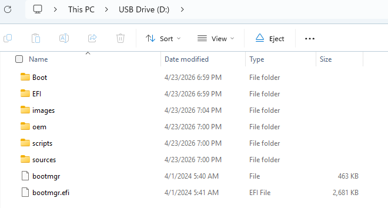
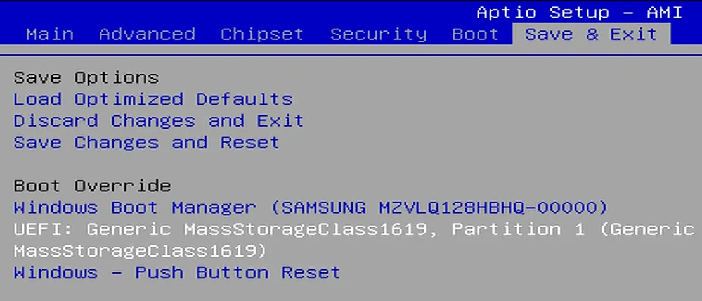
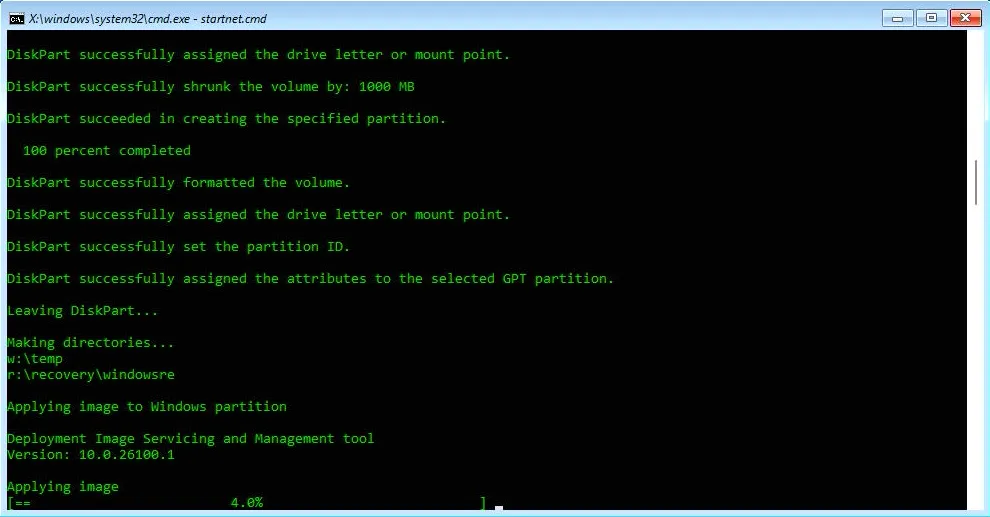
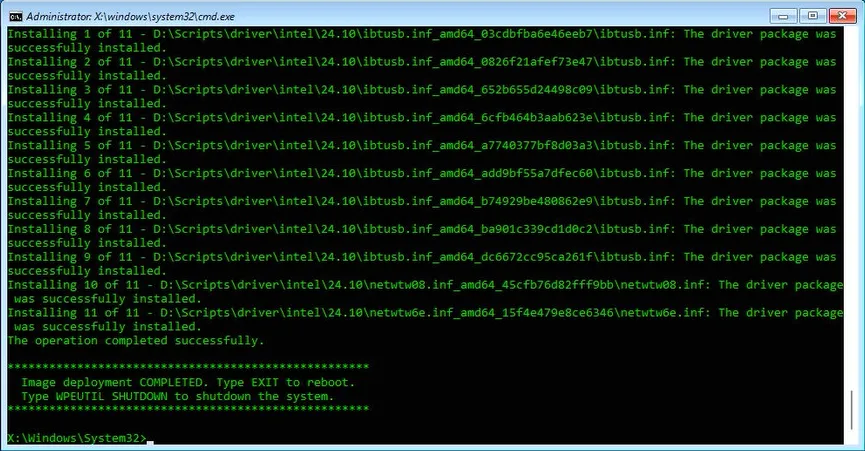

# Windows Installation

This guide will walk you through the process of installing Windows on your LattePanda Mu Ultra.

!!! note "Windows 11 Recommended"

    As the LattePanda Mu Ultra features a hybrid processor architecture with Performance-cores and Low Power Efficient-cores, Windows 11 is recommended for more optimized thread scheduling and improved performance and power efficiency.

## Official Windows 11 Recovery Image

This image comes with all hardware drivers and is ready to use, providing you with a fast and ultimate experience.

It does not update in real-time. Therefore, if you need to install the latest version of the Windows OS, you will need to download it yourself and install the drivers.

### Preparations

* :material-usb-flash-drive-outline: Empty USB flash drive (8 GB or larger)
* 💿 OS Disc Image File for the LattePanda Mu Ultra: Download from [:material-dropbox:Dropbox](https://www.dropbox.com/scl/fo/4ieyf2tf2f1bsf4jj61eo/ANr83AdwO3NGWXORKCAk5TY?rlkey=9ad6xqunj2kyn6crdbhrbg1nf&st=7n3suwj9&dl=0) or [:material-google-drive:Google Drive](https://drive.google.com/drive/folders/1satoGiJN8G_zlrocMnXUKvyAvTzBa13F?usp=sharing)

!!! note "Storage Requirement"
    Since the LattePanda Mu Ultra does not include built-in storage, please ensure you have already installed an M.2 SSD on your carrier board before proceeding with the OS installation.

### Installation Steps

1. Download the Windows disc image file for LattePanda Mu Ultra from the links provided above.
   
2. Format your USB flash drive to **NTFS** format.
   
3. Extract the downloaded Windows disc image file (.7z format), then copy **all** extracted files and folders to the root directory of your USB flash drive.
   
    The file structure on your USB drive should look like this:

    

4. Insert the USB flash drive into your LattePanda Mu Ultra (via the carrier board's USB port) and power on the device.
   
5. Immediately after powering on, press the **++del++** key repeatedly to enter the BIOS setup utility.
   
6. Navigate to the `Save & Exit` page. You will find a `Boot Override` option. Use the **++arrow-up++** or **++arrow-down++** keys to select your USB flash drive from the list, then press **++enter++**.
   
    

7. It will boot into the OS installation terminal. The installation process is **fully automatic** and requires no user intervention. Please wait patiently for approximately **5-8 minutes**.
   
    

8. After 5-8 minutes, the installation will complete, and you will see a confirmation message in the terminal similar to the image below.
   
    Then **remove the USB flash drive**, type `EXIT` to **reboot** the LattePanda Mu Ultra.

    

9. The system will begin the Windows initialization process. After **2~3 minutes**, you will be greeted with the Windows desktop.

**Congratulations! Your LattePanda Mu Ultra is now ready to use.**

---

## Standard Windows Installation

If you prefer to install a different version of Windows or perform a clean installation, you can follow the standard Windows installation procedure. The LattePanda Mu Ultra runs a full version of Windows, so the installation process is similar to that of a regular laptop or desktop computer.

### Installation Steps

1. **Download Windows OS Image**

    Visit the [**Microsoft Software Download**](https://www.microsoft.com/software-download) page and download the Windows ISO file for the version you need.

2. **Create Bootable USB Drive**

    Use a tool like [**Rufus**](https://rufus.ie/) to create a bootable USB drive from the Windows ISO file.
    
    - Launch Rufus
    - Select your USB drive
    - Choose the Windows ISO file
    - Click **START** and wait for the process to complete

3. **Boot from USB**

     Insert the bootable USB drive into your LattePanda Mu Ultra (via the carrier board's USB port) and power on the device. Press **++del++** repeatedly to enter the BIOS settings. Navigate to the boot menu and configure the system to boot from the USB drive.

4. **Install Windows**

    Follow the on-screen instructions to complete the Windows installation process.

5. **Install Drivers**

    After Windows is installed, you will need to install the necessary drivers for optimal performance. Please refer to our [**Download Resources**](../mu_ultra_edition/download_resources.md) section to download and install all required drivers.
    
    !!! tip "Driver Installation Order"
        We recommend installing the chipset driver first, followed by other drivers. After installing all drivers, restart your system to ensure all changes take effect properly.

------
[**:simple-discord: Join our Discord**](https://discord.gg/k6YPYQgmHt){ .md-button .md-button--primary }