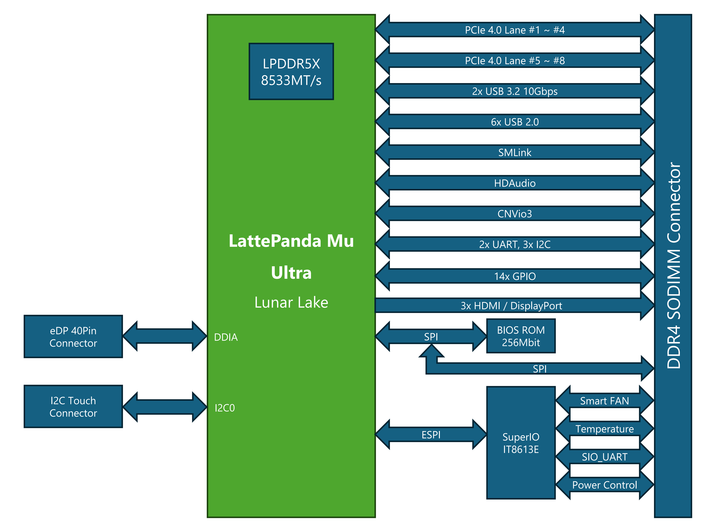

# Tech Specs

## Block Diagram

## Specifications

| Product | LattePanda Mu Ultra 226V | LattePanda Mu Ultra 256V |
| :--- | :--- | :--- |
| **SKU** | DFR1294 | DFR1295 |
| **Processor** | Intel® Core™ Ultra 5 Processor **226V** | Intel® Core™ Ultra 7 Processor **256V** |
| **CPU** | 8 Cores, 8 Threads Up to **4.5** GHz | 8 Cores, 8 Threads Up to **4.8** GHz |
| **Memory** | **16GB** LPDDR5X 8533 MT/s | **16GB** LPDDR5X 8533 MT/s |
| **GPU** | Intel® Arc™ **130V** GPU **7** Xe-cores, Up to **1.85** GHz up to **53** TOPS (Int8) | Intel® Arc™ **140V** GPU **8** Xe-cores, Up to **1.95** GHz up to **64** TOPS (Int8) |
| **NPU** | Intel® AI Boost up to **40** TOPS (Int8) | Intel® AI Boost up to **47** TOPS (Int8) |
| **Overall Peak TOPS (Int8)** | **97** | **115** |
| **Operating System** | Windows 11, Ubuntu 24.04 or later | Windows 11, Ubuntu 24.04 or later |
| **BIOS** | AMI UEFI 256Mbit SPI BIOS | AMI UEFI 256Mbit SPI BIOS |
| **Expansion** | • Up to 4 PCIe 4.0 x1 • Up to 4 PCIe 4.0 x2 • Up to 2 PCIe 4.0 x4 • 2x USB 3.2 Gen2 • 6x USB 2.0 • 3x UART • 3x I2C • 14x GPIO • 1x CNVio3 | • Up to 4 PCIe 4.0 x1 • Up to 4 PCIe 4.0 x2 • Up to 2 PCIe 4.0 x4 • 2x USB 3.2 Gen2 • 6x USB 2.0 • 3x UART • 3x I2C • 14x GPIO • 1x CNVio3 |
| **Display** | • 3x HDMI or DisplayPort • 1x eDP • Supports up to 3 independent displays simultaneously. | • 3x HDMI or DisplayPort • 1x eDP • Supports up to 3 independent displays simultaneously. |
| **Power Supply** | DC 9-20V | DC 9-20V |
| **Environment** | Operating Temperature: 0~60°C Relative Humidity: 0%~80%RH | Operating Temperature: 0~60°C Relative Humidity: 0%~80%RH |
| **Dimension** | 60mm * 69.6mm | 60mm * 69.6mm |

------

[**:simple-discord: Join our Discord**](https://discord.gg/RkSvc9g7eU){ .md-button .md-button--primary }
