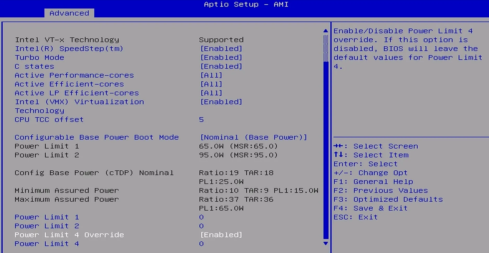
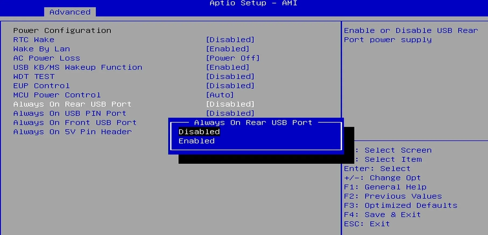
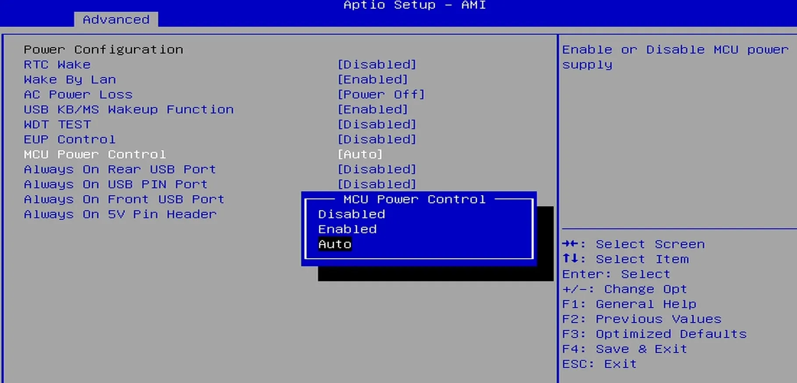
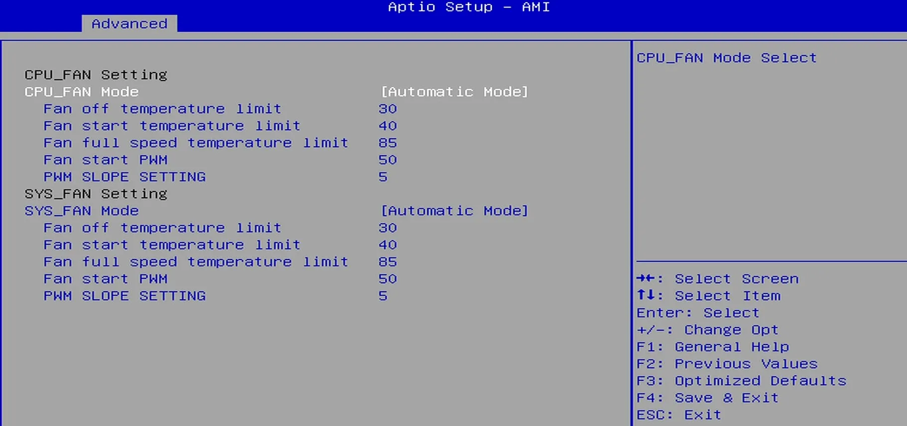
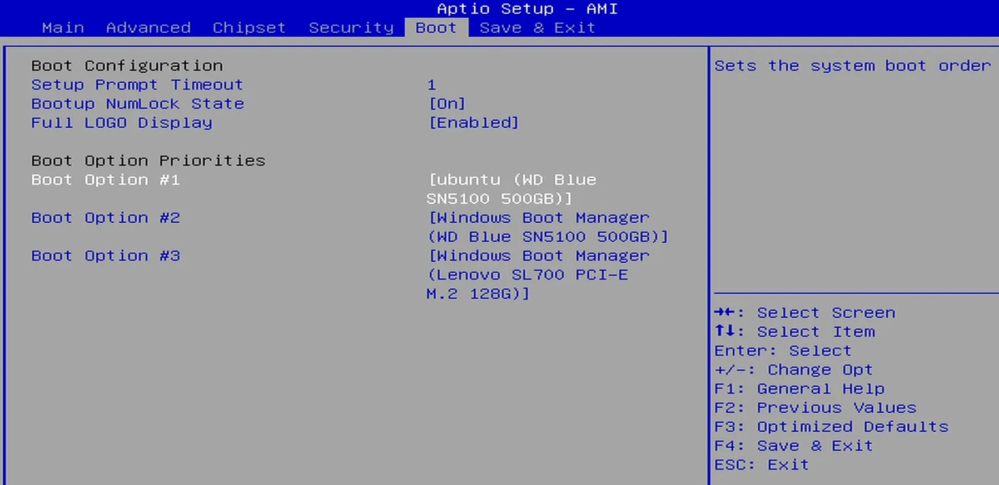
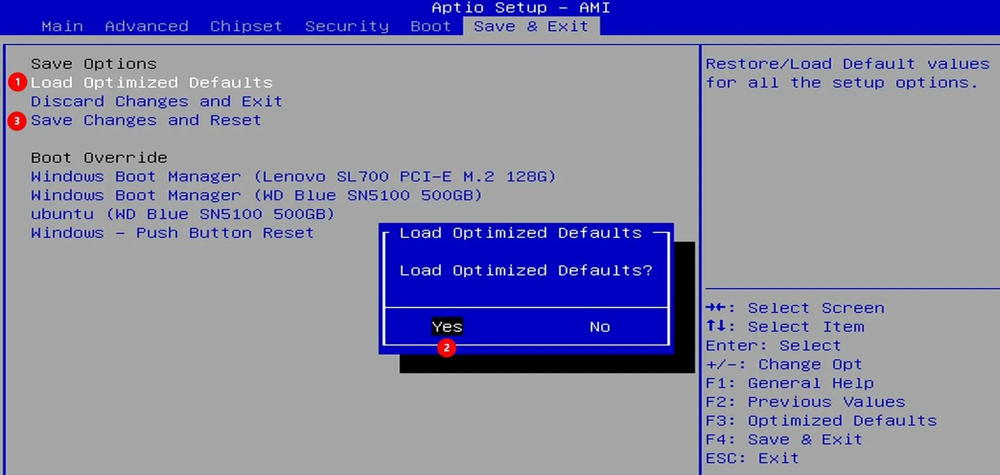

# BIOS Setup

## Enter into BIOS Menu

* Power on or reboot LattePanda.

* Press the **++del++** key repeatedly before the LattePanda logo appears on the screen during the boot process.

## Select Bootable Device

* Power on or reboot LattePanda.
* Press the **++f7++** key repeatedly until the bootable devices appear on the screen.
* Press **++arrow-up++** or **++arrow-down++** key to select the bootable device, and press **++enter++** key to boot from it.

## TDP / Power Limit Settings

!!! note "Understanding PL1 and PL2"

    - PL1 (Power Limit 1): The long-term power limit. This defines the sustained power consumption the processor maintains under continuous load.
    - PL2 (Power Limit 2): The short-term burst power limit. It allows the processor to exceed PL1 for a brief period to handle instantaneous spikes in workload before scaling back to the PL1 level to manage thermals.

LattePanda Sigma 2 automatically manages the processor's power limits (PL1 / PL2) according to the power source:

- When powered via the **DC jack**, full performance is released by default: PL1 = 65W, PL2 = 95W.
- When powered via a **USB Type-C PD adapter**, Sigma 2 detects the adapter's maximum wattage at power-on and adjusts PL1 / PL2 accordingly (100W / 65W / 45W PD adapters map to PL1/PL2 = 65W / 40W / 30W respectively).

For details, please refer to the [DC Adapter Wattage and Performance](powering.md#dc-adapter-wattage-and-performance) and [PD Adapter Wattage and Performance](powering.md#pd-adapter-wattage-and-performance) sections.

Manual configuration options are also available in the BIOS settings, and their values take precedence over the defaults.

Path: `Advanced` -> `CPU Configuration` -> `Power Limit 1`, `Power Limit 2`, `Power Limit 4 Override`

{width="800"}

The default value is 0, which means the automatic values described above are used. The unit is mW. 

> For example, if you want to set both PL1 and PL2 to `65W`, enter `65000` for both values in the BIOS menu.

To manually set `Power Limit 4`, enable `Power Limit 4 Override`, then configure the `Power Limit 4` option that appears.

!!! warning "Minimum Assured Power"

    According to the `Minimum Assured Power` parameter provided by Intel, the PL1 and PL2 value must not be lower than `15W`. Otherwise, it will cause the processor to operate at its minimum frequency, severely impacting performance.

## USB Ports Power Control

All four USB Type-A ports support power control via the `Always On USB` setting in the BIOS, which determines whether the ports keep outputting 5V power when the system is in hibernate or shutdown state.

Path: `Advanced` -> `Power Configuration` -> `Always On Rear USB Port`, `Always On Front USB Port`, `Always On USB PIN Port`

{width="800"}

The default value is `Disabled`, that is, the default behavior is as follows:

| OS State                         | USB Port Power Output |
| :------------------------------- | :-------------------- |
| Run                              | Enabled               |
| Sleep / Suspend (Modern Standby) | Enabled               |
| Hibernate                        | Disabled              |
| Shut Down                        | Disabled              |

> Enabled means the USB port can output 5V power; Disabled means the USB port cannot output 5V power.

If the option is set to `Enable`, the port will continue to output 5V power even when the system is in `hibernate` or `shutdown` state.

Regardless of the settings mentioned above, when the LattePanda is disconnected from the power supply and then reconnected without being turned on, the USB-A ports remain unpowered.

!!! note

    The USB-A double-deck connector contains two USB ports, and the power supply to both ports can only be controlled together, not individually.

## MCU Power Control

The power supply of the onboard RP2350 co-processor is controlled jointly by the BIOS and the DIP switch:

- When the LattePanda board is `connected to power but not turned on`, the RP2350's power supply is controlled by the `MCU actuator of the DIP switch` — please refer to the [DIP Switch](io_playability_internal.md#dip-switch) section.

- When the system is `running`, in `sleep/suspend`, `hibernate`, or `shutdown`, the RP2350's power supply is controlled by the `MCU Power Control` setting in the BIOS. 

    Path: `Advanced` -> `Power Configuration` -> `MCU Power Control`. The default setting is `Auto`.

    {width="800"}
    
    | MCU Power Control | OS State                         | Power Supply to the RP2350 MCU |
    | ----------------- | -------------------------------- | ------------------------------ |
    | Enabled           | Run                              | Enabled                        |
    |                   | Sleep / Suspend (Modern Standby) | Enabled                        |
    |                   | Hibernate                        | Enabled                        |
    |                   | Shut Down                        | Enabled                        |
    | Auto              | Run                              | Enabled                        |
    |                   | Sleep / Suspend (Modern Standby) | Enabled                        |
    |                   | Hibernate                        | Disabled                       |
    |                   | Shut Down                        | Disabled                       |
    | Disabled          | Run                              | Disabled                       |
    |                   | Sleep / Suspend (Modern Standby) | Disabled                       |
    |                   | Hibernate                        | Disabled                       |
    |                   | Shut Down                        | Disabled                       |

    > Enabled means the RP2350 MCU is powered on; Disabled means the P2350 MCU is powered off.

## Cooling Fan Settings

You can modify the CPU and SYS fan settings in the BIOS.

Path: `Advanced` -> `Hardware Monitor` -> `Smart Fan Function`

{width="800"}

## Configure Bootable Device Order

If the default boot order priorities don't meet your requirement, you can change them manually in the BIOS.

Path: `Boot` -> `Boot Option Priorities`

{width="800"}

## Restore Default Settings

You can remove the RTC battery to restore the BIOS to its default settings.

Alternatively, you can load the default settings from the BIOS menu as follows:

{width="800"}

------

[**:simple-discord: Join our Discord**](https://discord.gg/k6YPYQgmHt){ .md-button .md-button--primary }
