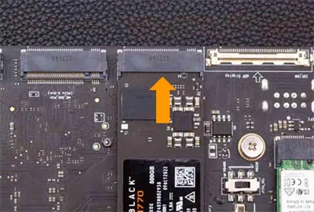
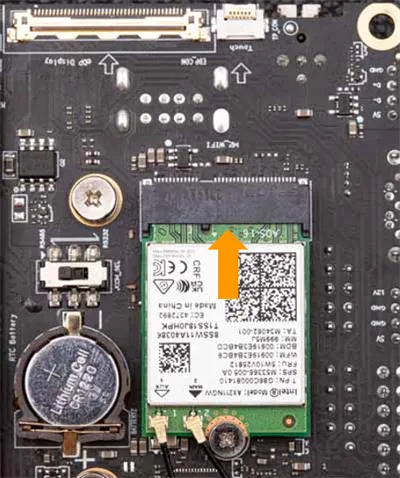
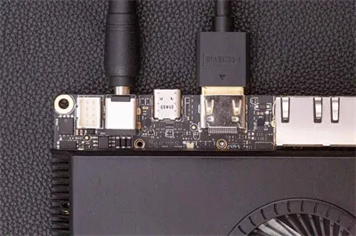
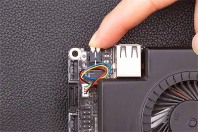

# Initial Setup

This chapter will show you how to get started with your LattePanda Sigma 2 for the first time: what you need, and how to boot it up.

## Booting the LattePanda

### Preparations

Before booting your LattePanda Sigma 2, you will need the extra following accessories:

- :fontawesome-regular-hdd:      M.2 NVMe SSD (Optional)
- :material-monitor:     An HDMI Display
- :material-cable-data:     HDMI Cable
- :material-keyboard:    Keyboard and a Mouse
- :material-power-plug-battery:    The Attached Power Adapter
- :material-wifi:     [M.2 WiFi Module with Antennas (Optional)](https://www.dfrobot.com/product-2325.html)
- :material-shield-outline:     Protective Backplate (Attached in the package)

!!! warning "Electrostatic Warning"

    Please note that the LattePanda is a uniquely designed, pocket-sized device that offers endless possibilities for embedded developments and IoT innovations. As with all CPU-related products, the LattePanda is electrostatically sensitive. Although we have implemented an anti-static design, it is crucial to be cautious when handling the device. Please ensure that you remove any static electricity from your body before touching the LattePanda. Failure to do so may result in potential static discharge and damage to your device.

!!! note "Attach Backplate to Protect LattePanda"

    After assembling the components, please attach the metal backplate to safeguard the LattePanda board's bottom components from short-circuit damage due to small metallic objects.

### Instructions

The cooling fan, a 1TB NVMe SSD and the RTC battery are already assembled on the board. The pre-installed 1TB SSD comes with Ubuntu OS, GPU/NPU drivers, and local AI models pre-installed, so you can boot directly into a ready-to-use system without any setup.

- **(Optional) Install additional M.2 NVMe SSDs to unused M.2 M-Key slots.**

    - Skip this step if you only use the pre-installed 1TB SSD. This step is for adding other SSDs.

    - Before using the M.2 slots, if a metal backplate has been installed, uninstall the metal backplate first.

    - The LattePanda Sigma 2 is only compatible with NVMe PCIe SSDs.

        

- **(Optional) Install a compatible wireless network module to the M.2 E key slot. Then assemble the WiFi/BT Antennas.**

    - Commonly Used Module: Intel AX210, AX211, BE200.
    - Please refer to [Multiple Internet Connections](connectivity.md#compatible-modules) section for a list of compatible modules. 
    - If you don't need a wireless connection, skip this step.

        

- **Connect a keyboard and mouse to the USB ports on LattePanda.**

- **Connect a display.**
  
    * The fastest way is to connect an HDMI display to the onboard HDMI port.
    * Please refer to the [Display Connections](touch_and_display.md) section for instructions on using different displays (USB Type-C / eDP) with your LattePanda.
    
- **Connect the attached power adapter to LattePanda.**

    Please refer to the [Power Options](powering.md) section for instructions on the different ways to power your LattePanda.

    

- **Press the power button and the LED indicator will light up.**

    The preinstalled Ubuntu OS will boot directly to the desktop (auto-login enabled, no password required).

    

## First Local AI Experience

The LattePanda Sigma 2 comes with a complete local AI environment pre-installed on the SSD — including GPU/NPU drivers, OVMS (OpenVINO Model Server), the OpenClaw AI agent, and local AI models.

Once the system boots up, head over to the [**Local AI Quick Start**](local_ai_getting_started.md) chapter to launch the local inference service and run your first on-device AI agent — no cloud API required.

## Installing a Different Operating System

If you want to install Windows or reinstall a clean OS, please refer to the [Multiple OS Support](os.md) section.

------

[**:simple-discord: Join our Discord**](https://discord.gg/k6YPYQgmHt){ .md-button .md-button--primary }
