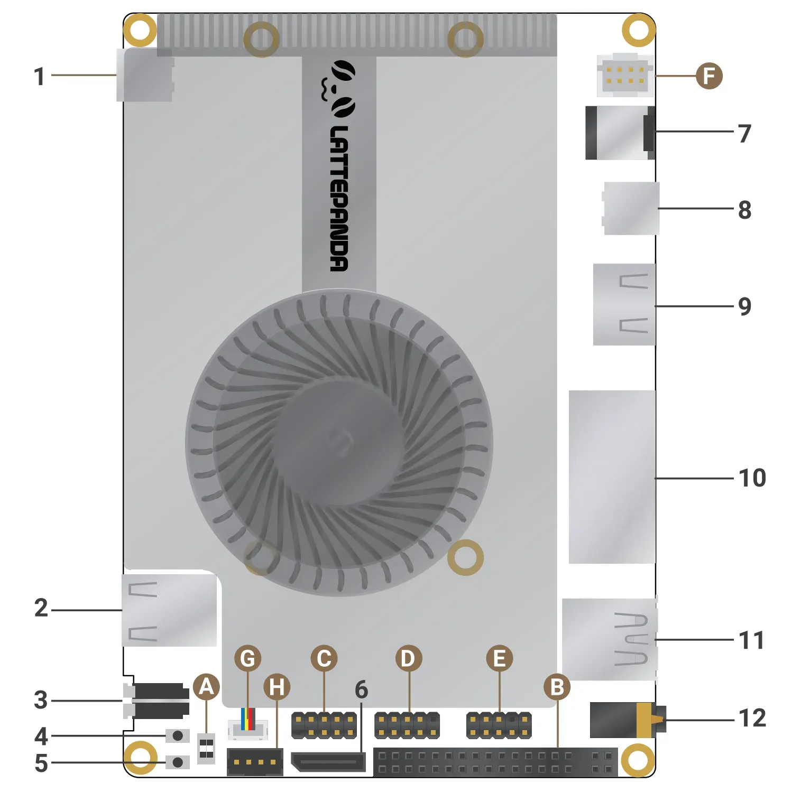
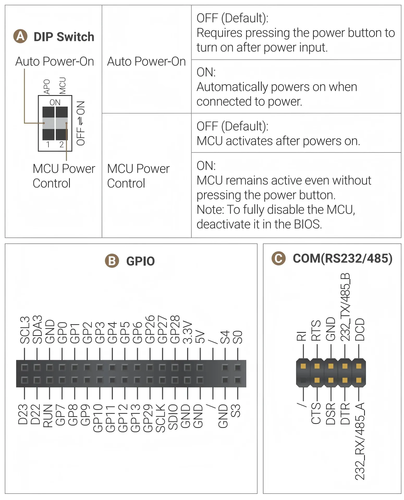
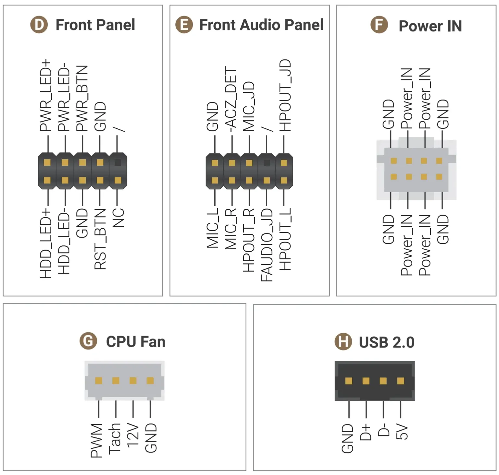
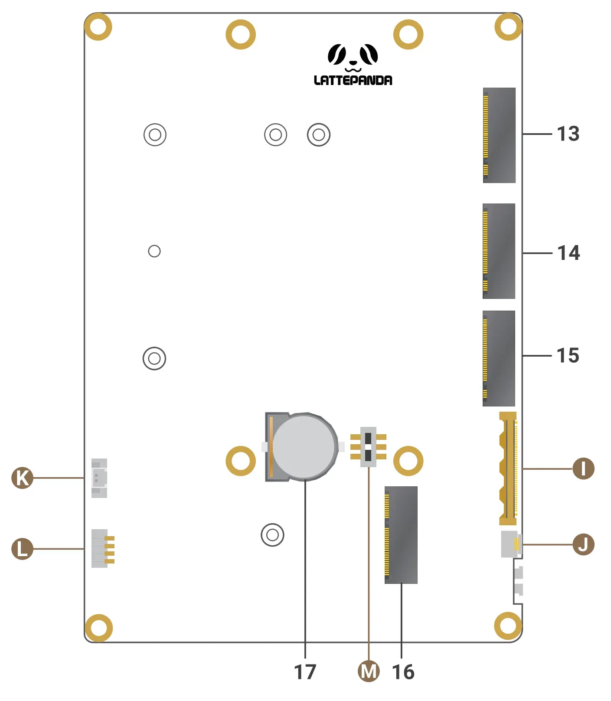
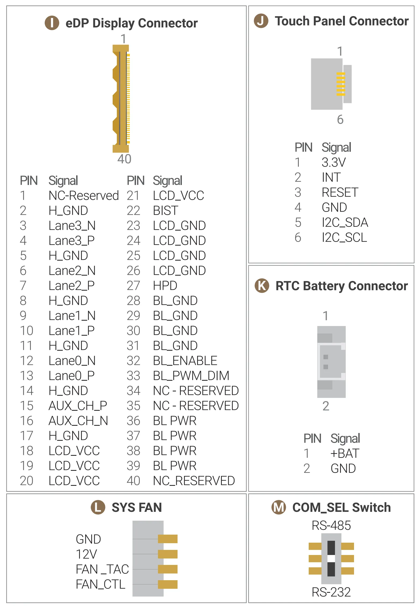

# Pinout and Layout

## Top Layout

{width="600"}

| Item | Description                              | Item | Description                              |
| ---- | ---------------------------------------- | ---- | ---------------------------------------- |
| 1    | Full-Featured USB Type-C (Thunderbolt 4) | 7    | DC 5.5x2.5mm Power Jack                  |
| 2    | 2 x USB 2.0 Type-A                       | 8    | Full-Featured USB Type-C (Thunderbolt 4) |
| 3    | Power Button with LED                    | 9    | HDMI 2.1                                 |
| 4    | MCU_BOOT Button (for RP2350)             | 10   | 2 x 10Gb Ethernet RJ45                   |
| 5    | MCU_RST Button (for RP2350)              | 11   | 2 x USB 3.2 Gen 2 (10Gbps) Type-A        |
| 6    | OCuLink (SFF-8611, PCIe 4.0 x2)          | 12   | 3.5mm Microphone Headphone Combo Jack    |

{width="600"}

{width="600"}

## Bottom Layout

{width="600"}

| Item | Description |
|---|---|
| 13 | M.2 M-Key (PCIe 4.0 x1, Type 2230 / 2280) |
| 14 | M.2 M-Key (PCIe 4.0 x4, Type 2280) |
| 15 | M.2 M-Key (PCIe 5.0 x2, Type 2280) |
| 16 | M.2 E-Key (PCIe 4.0 x1, CNVio3, USB 2.0, Type 2230) |
| 17 | CR1220 Battery Holder |

{width="600"}

## Maximum Current Output per Port

To ensure stable operation when powering external devices directly from the board's USB ports, headers, and M.2 slots, do not exceed the following current limits.

!!! note

    All values listed below represent continuous (sustained) current limits.

- **5V Output (USB Ports & Headers)**

    | Port / Header              | Max Output Current | Notes                     |
    | :------------------------- | :----------------- | :------------------------ |
    | Front USB Type-A (2 ports) | 2.1 A              | Shared between both ports |
    | Rear USB Type-A (2 ports)  | 2.1 A              | Shared between both ports |
    | USB 2.0 Header             | 2.1 A              | —                         |
    | Front USB Type-C           | 3.0 A              | —                         |
    | Rear USB Type-C            | 3.0 A              | —                         |

    **Total 5V Current Limit:** The combined current draw across all above 5V outputs must not exceed **8 A**.

- **3.3V Output (M.2 Slots)**

    | Slot                | Max Output Current | Notes                |
    | ------------------- | ------------------ | -------------------- |
    | M.2 M-Key (3 slots) | 6.0 A              | Up to 6.0 A per slot |
    | M.2 E-Key (1 slot)  | 2.0 A              | —                    |

    **Total 3.3V Current Limit:** The combined current draw across all four M.2 slots must not exceed **8 A**.

------

[**:simple-discord: Join our Discord**](https://discord.gg/k6YPYQgmHt){ .md-button .md-button--primary }
