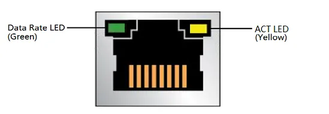

# External Port

## USB Type-A Port

There are four USB Type-A ports on the LattePanda Sigma 2: two USB 3.2 Gen 2 ports delivering **up to 10Gbps** throughput, and two USB 2.0 ports with a maximum throughput of 480Mbps each.

These connectors are standard Type-A receptacles, allowing them to be connected to all types of USB devices using standard-A USB plugs.

All four USB Type-A ports support power control via the `Always On USB` settings in the BIOS, which determine whether the ports keep outputting 5V power when the system is in hibernate or shutdown state. Please refer to the [BIOS Setup](bios_setup.md#usb-ports-power-control) section.

The default configuration is as follows:

| OS State                         | USB Port Power Control |
| :------------------------------- | :--------------------- |
| Run                              | Enabled                |
| Sleep / Suspend (Modern Standby) | Enabled                |
| Hibernate                        | Disabled               |
| Shut Down                        | Disabled               |

> Enabled means the USB port can output 5V power; Disabled means the USB port cannot output 5V power.

When the LattePanda is disconnected from the power supply, then reconnected to the power supply but not turned on, the USB-A port power control remains disabled.

## USB Type-C Port (Thunderbolt 4)

Both of the two USB Type-C ports on LattePanda Sigma 2 are full-featured Thunderbolt 4 ports, which support power, USB data, video and PCIe, with 40Gbps bidirectional bandwidth.

The following devices can be connected to Thunderbolt 4 ports:

- Thunderbolt devices (bearing the Thunderbolt logo). Thunderbolt 3 devices and cables are compatible with Thunderbolt 4 ports. 
- External monitors. Connect high-resolution displays directly or through a compatible dock or adapter.
- Storage. Connect a high-speed external Thunderbolt SSD to expand the storage capacity of your system and achieve speeds on par with internal drives.
- USB peripherals. Connect USB devices such as mouse, keyboard, storage, etc.
- PCI Express (PCIe) devices. Utilize a thunderbolt dock to access compatible PCIe device, such as external GPU.
- Networking. Connect to a high-speed Ethernet network via an adapter, or use a Thunderbolt cable to connect two computers over a peer-to-peer network.

!!! note "USB Type-C Power Output"
    The USB Type-C ports output 5V power only when a USB Type-C device is attached and detected — as required by the USB Type-C specification, power output starts after the connection is negotiated. This works in **any system state**, including sleep/suspend and shutdown: as long as the main power supply is connected, plugging in a USB Type-C device gets it powered.

## OCuLink Connector

LattePanda Sigma 2 provides an **OCuLink connector (PCIe 4.0 x2)**, offering a direct, low-cost PCIe link for external devices.

A typical use case is connecting an external GPU dock:

- Recommended accessory: [OCuLink eGPU Dock (DFR1298)](https://www.dfrobot.com/product-3146.html)

- **No hot-plug support.** Use an SFF-8611 cable, and make sure the OCuLink device (such as an eGPU dock) is securely connected while the board is powered off; power on the board only after the connection is in place.

!!! note

    LattePanda Sigma 2 is powered by an Intel Panther Lake processor, which supports only **Modern Standby** (traditional S3 sleep is not supported) and requires a **CLKREQ** pin for PCIe devices. Since the OCuLink connector does not provide this pin, PCIe devices connected via OCuLink may prevent the system from entering Modern Standby — in that case, only the display turns off while the fan keeps running.

## RJ45 Connector (10GbE)

The LattePanda Sigma 2 features two 10 Gigabit Ethernet ports driven by RTL8127 controllers, supporting 10/100/1000/2500/5000/10000 Mbps speeds — ideal for high-speed networking, NAS, and data-intensive local AI workloads. **Wake-On-LAN (WOL)** is also supported for remote device management.

Two LEDs are built into the RJ-45 LAN connector:

| LED           | LED Color | LED State | Meaning                                        |
| :------------ | :-------- | :-------- | :--------------------------------------------- |
| ACT LED       | Yellow    | Blinking  | LAN activity is occurring.                      |
| Data Rate LED | Green     | OFF       | No LAN Link.  |
|               |           | Green     | 10/100/1000/2500/5000/10000 Mb/s data rate is established. |

## HDMI Port

The onboard HDMI 2.1 connector supports up to 4096 x 2304 @ 60Hz video output. See [Display Connections](touch_and_display.md) for details.

## Audio Jack

The 3.5mm microphone headphone combo connector allows you to connect a headset or speakers directly.

This port has a higher priority than the front panel audio header. In other words, when audio devices are connected to both this port and the front panel audio header, audio will output from this port, while the front panel audio header will be muted.

## DC Power Jack

LattePanda Sigma 2 has a DC 5.5 x 2.5mm power jack onboard, and a 20V 180W power adapter is included in the package — this is the recommended way to power the board, as it releases the maximum performance by default (PL1=65W, PL2=95W).

For input specifications, jack pinout, and alternative power options (USB Type-C PD adapter, DC-IN 8-pin connector), please refer to the [Power Options](powering.md#powered-by-dc-jack-recommended) section.

## Power Button with LED

Press the power button to turn on or off the LattePanda Sigma 2. The built-in LED indicates the power status:

| LED State | Meaning |
| :--- | :--- |
| OFF | The system is shut down, in hibernate, or not powered on. |
| ON | The system is running. |
| Breathing | The system is in sleep / suspend (Modern Standby). |

------

[**:simple-discord: Join our Discord**](https://discord.gg/k6YPYQgmHt){ .md-button .md-button--primary }
