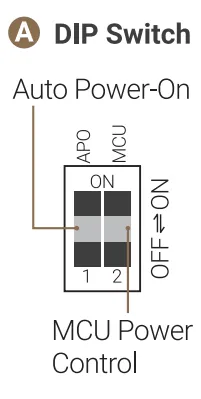
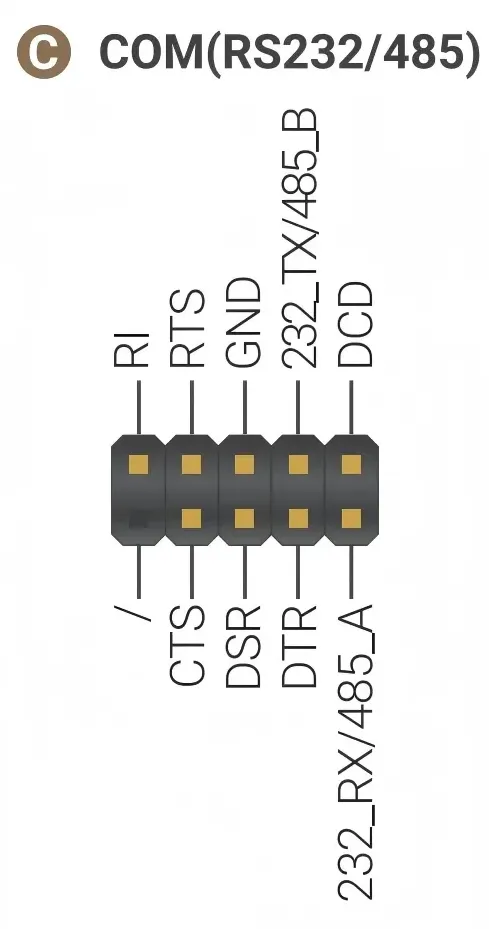
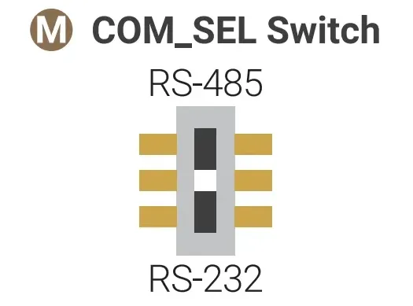
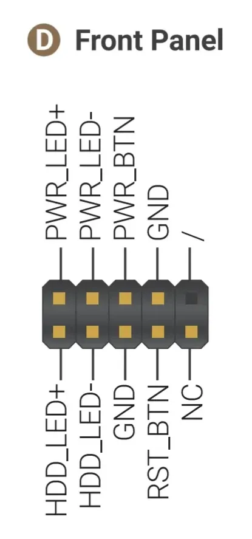
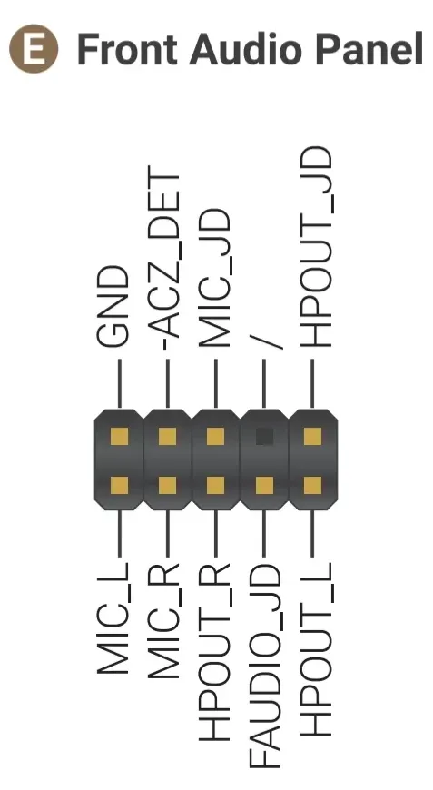
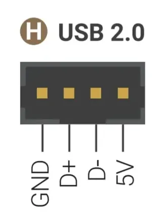
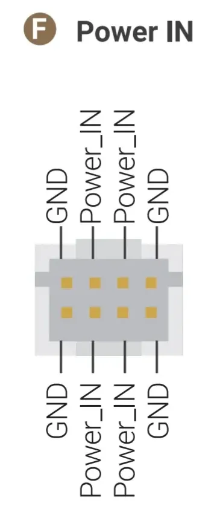
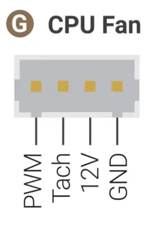
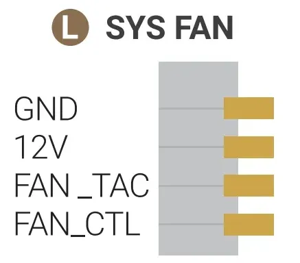
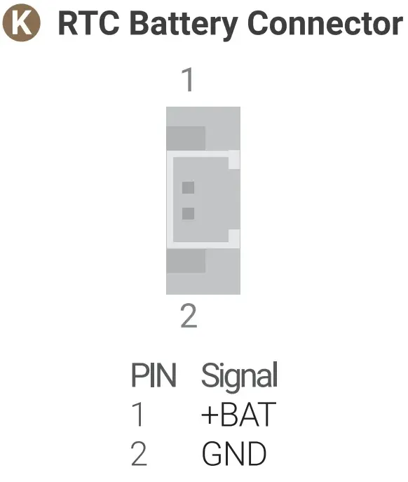

# Internal Port

## M.2 Slots

There are four M.2 slots on LattePanda Sigma 2: 

=== "M.2 M-Key (PCIe 5.0 x2)"

    !!! note ""
        This M.2 M-Key slot allows **PCIe 5.0 x2**, Type 2280.
    
        :material-check-circle: **Compatible Devices**
    
          - **Storage:** M.2 NVMe SSD, Type 2280
          - **Other Devices:** AI accelerators or other PCIe devices with an M.2 M-Key connector

=== "M.2 M-Key (PCIe 4.0 x4)"

    !!! note ""
        This M.2 M-Key slot allows **PCIe 4.0 x4**, Type 2280.
    
        :material-check-circle: **Compatible Devices**
    
          - **Storage:** M.2 NVMe SSD, Type 2280
          - **Other Devices:** AI accelerators or other PCIe devices with an M.2 M-Key connector

=== "M.2 M-Key (PCIe 4.0 x1)"

    !!! note ""
        This M.2 M-Key slot allows **PCIe 4.0 x1**, Type 2230/2280.
    
        :material-check-circle: **Compatible Devices**
    
          - **Storage:** M.2 NVMe SSD, Type 2230/2280
          - **Other Devices:** AI accelerators or other PCIe devices with an M.2 M-Key connector
          - **Usage Tip**: If using a 2280-size device, first remove the 2230 fixing screw and standoff.

=== "M.2 E-Key"

    !!! note ""
        The M.2 E-Key slot allows **PCIe 4.0 x1, USB 2.0, CNVio3**, Type 2230.
    
        :material-check-circle: **Compatible Devices**
    
          - **Wireless Devices** (tested on LattePanda Sigma 2)
            * M.2 WiFi Module via CNVio3, Type 2230, e.g. Intel AX211.
            * M.2 WiFi Module via PCIe, Type 2230, e.g. Intel AX210, Intel BE200.
    
    !!! note "Antennas and Drivers"
        - M.2 wireless modules require external antennas to function correctly. Remember to connect the antennas to the module before use.
        - After assembling the module, install the appropriate driver for your operating system, which can typically be downloaded from the module manufacturer's website.

!!! note "M.2 Slot Power Supply"
    The four M.2 slots (three M-Key + one E-Key) share a 3.3V power supply with a combined current limit of **8A** — up to **6A** per M-Key slot and **2A** for the E-Key slot. See [Maximum Current Output per Port](io_playability.md#maximum-current-output-per-port) for details.

## DIP Switch

The onboard DIP switch provides hardware-level control for **[Auto Power-On](auto_power_on.md)** and **MCU Power Control**:

{width="200" }

| Actuator | Function | Position | Behavior |
| :------- | :------- | :------- | :------- |
| **APO** | Auto Power-On | OFF *(Default)* | Requires pressing the power button to turn on after power input. |
| | | ON | Automatically powers on when connected to power. |
| **MCU** | MCU Power Control | OFF *(Default)* | The MCU (RP2350) activates after the system powers on. |
| | | ON | The MCU remains active even without pressing the power button. To fully disable the MCU, deactivate it in the BIOS. |

!!! note

    The `MCU Power Control` setting on this DIP switch only controls the power supply to the MCU after power is applied but before the system is turned on. The MCU's power supply in other states must be configured in the BIOS; please refer to the [MCU Power Control](bios_setup.md#mcu-power-control) for details.

## GPIO Header

The LattePanda Sigma 2 features a **34-pin GPIO header (2.54mm pitch)** connected to the onboard RP2350 co-processor and Intel processor's GPIO, allowing your local AI applications and agents to interact with physical hardware.

- Header Specification

    - Pitch: 2.54mm (0.1 inch)
    - Total Available Pins: 34 (the header footprint has 36 positions, 2 of which are plugged and not connected)

### Pinout Definition

{width="600"}

- **First Row**

| Pin Name | Type         | I/O Level | Description                                                  |
| :------- | :----------- | :-------- | :----------------------------------------------------------- |
| SCL3     | Output       | 3.3V      | SCL Pin of Intel Processor's I2C3 Port Integrated 2.2K pull-up resistor |
| SDA3     | Input/Output | 3.3V      | SDA Pin of Intel Processor's I2C3 Port Integrated  2.2K pull-up resistor |
| GND      | Power        |           | Ground                                                       |
| GP0~6    | Input/Output | 3.3V      | RP2350 GPIO 0~6                                              |
| GP26~28  | Input/Output | 3.3V      | RP2350 GPIO 26~28 Multiplexed as: ADC Input each pin in parallel with a 100nF capacitor |
| 3.3V     | Power        |           | RP2350's 3.3V Power Output Current Limit: 1.2A            |
| 5V       | Power        |           | 5V Power Output  Current Limit: 1.2A                      |
| S4       | Input/Output | 3.3V      | Hibernating State Indicator Output HIGH only when OS is Hibernating Integrated 1K Current-limiting Resistor |
| S0       | Output       | 3.3V      | Running State Indicator Output HIGH only when OS is running Integrated 1K Current-limiting Resistor |

- **Second Row**

| Pin Name | Type         | I/O Level | Description                                                  |
| :------- | :----------- | :-------- | :----------------------------------------------------------- |
| D23      | Input/Output | 3.3V      | GPP_D23 Pin from Intel Processor Integrated  4.7K pull-up resistor |
| D22      | Input/Output | 3.3V      | GPP_D22 Pin from Intel Processor Integrated  4.7K pull-up resistor |
| RUN      | Input        | 3.3V      | RP2350 Reset, Active Low                                   |
| GP7~13   | Input/Output | 3.3V      | RP2350 GPIO 7~13                                             |
| GP29     | Input/Output | 3.3V      | RP2350 GPIO 29 Multiplexed as: ADC Input In parallel with a 100nF capacitor |
| SCLK     | Input/Output | 3.3V      | RP2350 SWCLK                                                 |
| SDIO     | Input/Output | 3.3V      | RP2350 SWDIO                                                 |
| GND      | Power        |           | Ground                                                       |
| GND      | Power        |           | Ground                                                       |
| GND      | Power        |           | Ground                                                       |
| S3       | Output       | 3.3V      | Modern standby Indicator Output HIGH only when OS is in modern standby Integrated 1K Current-limiting Resistor |

!!! note

    GPIO26 to GPIO29 of the RP2350 can be muxed as ADC input. To ensure stable ADC sampling values, these pins are paralleled with 100nF capacitors, which can affect rapidly changing signals such as I2C. If using I2C, please avoid these four GPIO pins and choose alternative GPIO pins instead.

For programming the RP2350, please refer to the [RP2350 GPIO Programming](rp2350_programming.md) section.

### Status Indication Pins

The S0, S3, S4 pins can indicate the current state of operating system through different output voltages. So the OS status can be obtained by reading these voltages or connecting LED indicators.

The voltage of these pins in different states are shown as follows:

|        | Powered but not turned on | Run  | Sleep/Suspend | Hibernate | Shut Down |
| :----- | ------------------------- | :--- | :------------ | :-------- | :-------- |
| S0 Pin | Low                       | High | Low           | Low       | Low       |
| S3 Pin | Low                       | Low  | High          | Low       | Low       |
| S4 Pin | Low                       | Low  | Low           | High      | Low       |

## RS-232/485 Header

The LattePanda Sigma 2 provides a **9-pin RS-232/485 header (2.54mm pitch)** for industrial communication, exposing full RS-232 signals (TX / RX / RTS / CTS / DTR / DSR / DCD / RI) or an RS-485 A/B pair:

{width="200"}

This port is typically mapped as `COM1` in Windows or `/dev/ttyS0` in Linux.

The RS-232 and RS-485 functions are switched by the **COM_SEL switch** located on the bottom side of the board — slide it to the **RS-232** or **RS-485** position as needed:

{width="200"}

## Front Panel Header

The 9-pin front panel header (2.54mm pitch) supports connecting an external power switch, reset switch, power LED and HDD LED — useful when the board is embedded inside an enclosure.

{width="200"}

- **Power Switch** (PWR_BTN / GND): short these pins to turn the LattePanda on or off.
- **Reset Switch** (RST_BTN / GND): short these pins to reset the LattePanda.
- **Power LED** (PWR_LED+ / PWR_LED-): connect an LED as the system power indicator.
- **HDD LED** (HDD_LED+ / HDD_LED-): connect an LED that illuminates whenever the storage is accessed.

## Front Audio Panel Header

The 9-pin front audio panel header (2.54mm pitch) supports High Definition Audio output and input for chassis front-panel audio ports.

{width="200"}

## USB 2.0 Header

The 4-pin USB 2.0 header (2mm pitch) provides an internal USB 2.0 (480Mbps) connection (GND / D+ / D- / 5V) for embedded peripherals such as USB-to-serial converters or custom HID devices. The 5V power output of this header is controlled by the `Always On USB PIN Port` setting in the BIOS — please refer to the [USB Ports Power Control](bios_setup.md#usb-ports-power-control) section.

{width="200"}

## eDP Display Connector

The LattePanda Sigma 2 provides a 40-pin eDP display connector (0.5mm pitch FPC, 4-lane, eDP 1.5), supporting up to 3840 x 2400 @ 120Hz — ideal for embedded display integration.

For display compatibility, connection steps, and the pin definition, please refer to the [eDP (Embedded DisplayPort)](touch_and_display.md#edp-embedded-displayport) section.

## Touch Panel Connector

The LattePanda Sigma 2 provides a 6-pin touch panel connector (0.5mm pitch FPC, I2C), commonly used for eDP touchscreens in embedded applications.

For the pin definition and touch connection options (USB / I2C), please refer to the [Touch Panel](touch_and_display.md#touch-panel) section.

## DC-IN Power Input Connector

The 8-pin DC-IN connector (2mm pitch) is directly connected to the DC power jack — the middle four pins are Power_IN and the other four pins are GND. It allows powering the board through the internal wiring of an enclosure.

{width="200"}

For input specifications and the recommended cable, please refer to the [Power Options](powering.md#powered-by-dc-in-8-pin-connector) section.

## Fan Connectors

!!! note "Pin Order Differs"
    The pin order of the two fan connectors is different. Please follow the pinout below when connecting a fan.

- **CPU FAN Connector** (4-pin, 1.25mm pitch, 12V): the attached active cooling fan is connected here. 

    {width="200"}

- **SYS FAN Connector** (4-pin, 1.25mm pitch, 12V): for an additional system or chassis fan.

    {width="200"}

## RTC Battery

LattePanda Sigma 2 provides a **CR1220 battery holder** and a **2-pin RTC battery connector (1.25mm pitch)**. The attached RTC battery is already assembled on the CR1220 battery holder.

Both connectors can be connected to batteries simultaneously, with priority given to the battery with the higher voltage.

{width="200"}

!!! warning
    - The RTC battery is 3V (CR1220). Do not connect batteries exceeding 3.3V.
    - Ensure correct polarity when connecting an external RTC battery.

## MCU_BOOT / MCU_RST Buttons

- **MCU_BOOT Button (for RP2350)**: hold it while pressing MCU_RST to make the RP2350 enter bootloader mode for firmware flashing.
- **MCU_RST Button (for RP2350)**: press it to reset the RP2350 co-processor.

For details, please refer to the [RP2350 GPIO Programming](rp2350_programming.md) section.

------

[**:simple-discord: Join our Discord**](https://discord.gg/k6YPYQgmHt){ .md-button .md-button--primary }
