# Other AI Agents

Connect **OpenCode, Pi, Hermes Agent, or Reasonix** to the pre-installed local model on LattePanda Sigma 2 through OVMS (OpenVINO Model Server). Each example tests file creation and persistent instructions or memory.

## Preparation

1. Boot into the pre-installed Ubuntu OS.

2. Double-click the **🔮 Start OVMS API** shortcut on the desktop. For details, see [Start the OVMS API Only](local_ai_getting_started.md#start-the-ovms-api-only).

3. Open a terminal with `Ctrl + Alt + T` and verify that the model is available:

    ```bash
    curl http://localhost:8080/v3/models
    ```

    The response should include `qwen`.

The following settings will be used throughout this guide:

| Item | Value |
| :--- | :--- |
| Base URL | `http://localhost:8080/v3` |
| API Format | OpenAI-compatible Chat Completions |
| API Key | Not required by OVMS; use `local` where the agent needs a placeholder |

Run `bash` code blocks in an Ubuntu terminal. Enter slash commands such as `/new` inside the agent.

!!! note
    Installation requires Internet access. Model inference runs locally through OVMS; features that use external services may still need a connection.

## OpenCode

[OpenCode](https://opencode.ai/) is an open-source AI coding agent that helps with software development using your choice of model.

Tested with version **2.3.2**.

1. **Install**

    Open a terminal and run:

    ```bash
    curl -fsSL https://opencode.ai/v2/install | bash
    opencode --version
    ```

2. **Configure the Local Model**

    Create the configuration directory and open the file:

    ```bash
    mkdir -p ~/.config/opencode
    nano ~/.config/opencode/opencode.json
    ```

    Add the following configuration:

    ```json
    {
      "$schema": "https://opencode.ai/config.json",
      "model": "sigma2/qwen",
      "providers": {
        "sigma2": {
          "package": "@opencode/ai/providers/openai-compatible",
          "settings": {
            "baseURL": "http://localhost:8080/v3"
          },
          "models": {
            "qwen": {
              "name": "Sigma 2 Local Qwen"
            }
          }
        }
      }
    }
    ```

    Save with `Ctrl + O`, then `Enter`. Exit Nano with `Ctrl + X`.

3. **Test File Operations and Preferences**

    Use a test folder with no existing reports:

    ```bash
    mkdir -p ~/Desktop/OpenCodeTest
    cd ~/Desktop/OpenCodeTest
    opencode
    ```

    Use `/models` to select `Sigma 2 Local Qwen`, then `/agents` to select **Build** for file operations.

    Enter:

    > Add to AGENTS.md: use JSON for system reports.

    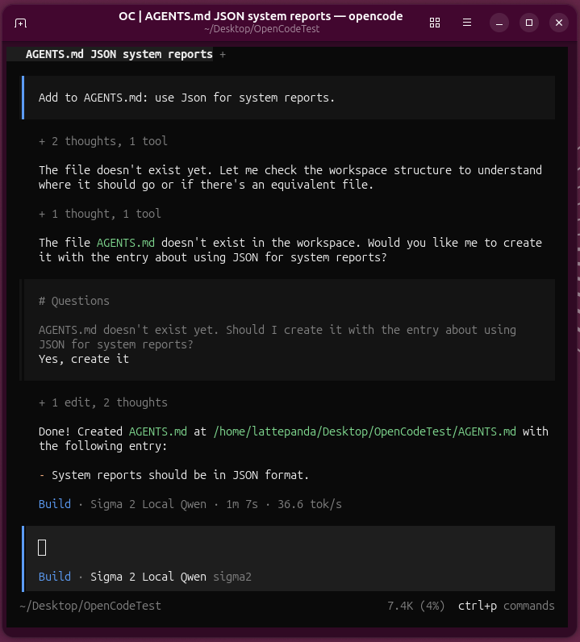{width="600"}

    Open the desktop `OpenCodeTest` folder and check the rule in `AGENTS.md`. Use `/new` in OpenCode to start a new session, then enter:

    > Check my Ubuntu version and current time, then save a system report.

    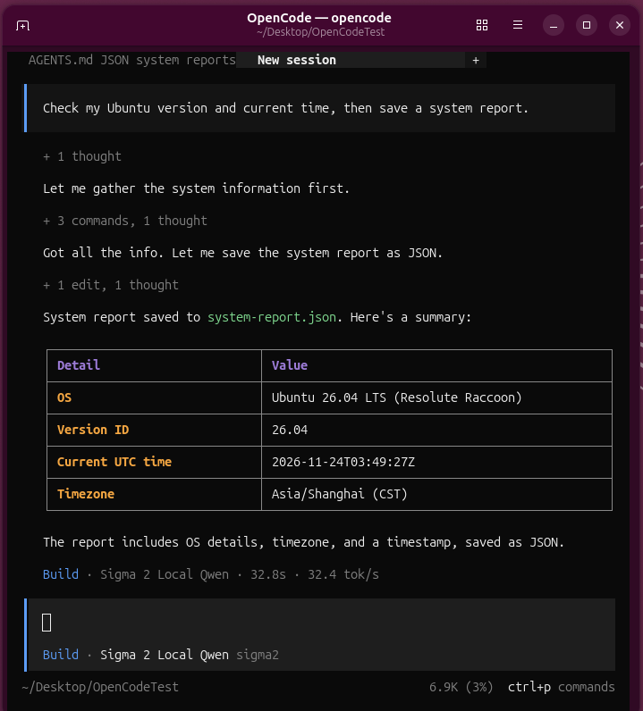{width="600"}

    Open the desktop `OpenCodeTest` folder and check that the JSON report contains the Ubuntu version and current time.

    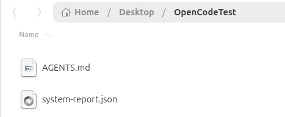{width="400"}

    !!! note
        This example checks the local model connection, command execution, and file operations, together with persistent project instructions through `AGENTS.md`.

4. **Exit the Agent**

    Enter `/exit` or press `Ctrl + D` to return to the Ubuntu terminal.

## Pi

[Pi](https://pi.dev/) is a lightweight terminal coding agent that you can customize with extensions and skills.

Tested with version **1.6.0**.

1. **Install**

    Run:

    ```bash
    curl -fsSL https://pi.dev/install.sh | sh
    pi --version
    ```

    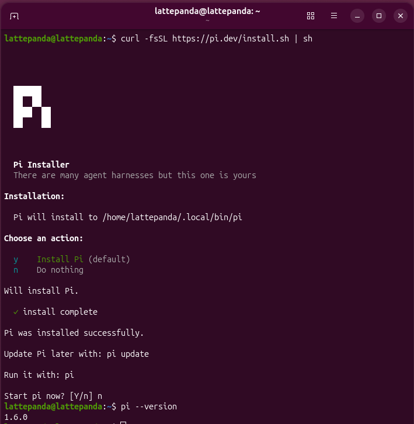{width="600"}

2. **Configure the Local Model**

    Create the configuration directory and open the file:

    ```bash
    mkdir -p ~/.pi/agent
    nano ~/.pi/agent/models.json
    ```

    Add the following configuration:

    ```json
    {
      "$schema": "https://pi.dev/schemas/models.schema.json",
      "providers": {
        "sigma2": {
          "baseUrl": "http://localhost:8080/v3",
          "api": "openai-completions",
          "apiKey": "local",
          "models": [
            {
              "id": "qwen",
              "name": "Sigma 2 Local Qwen"
            }
          ]
        }
      }
    }
    ```

    Pi uses `local` as a placeholder; this OVMS endpoint does not require authentication.

    Save with `Ctrl + O`, then `Enter`. Exit Nano with `Ctrl + X`.

3. **Test File Operations and Preferences**

    Use a test folder with no existing reports:

    ```bash
    mkdir -p ~/Desktop/PiTest
    cd ~/Desktop/PiTest
    pi
    ```

    Use `/model` to select `sigma2/qwen`, then enter:

    > Add to AGENTS.md: use JSON for system reports.

    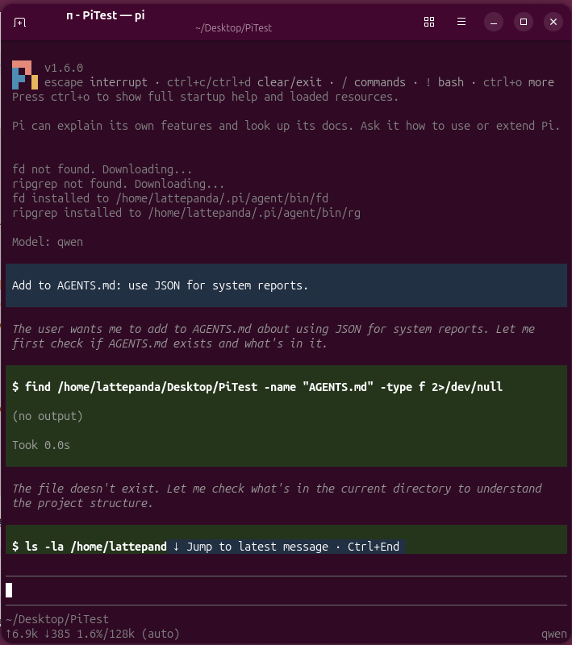{width="600"}

    Open the desktop `PiTest` folder and check the rule in `AGENTS.md`. Use `/new` in Pi to start a new session, then enter:

    > Check my Ubuntu version and current time, then save a system report.

    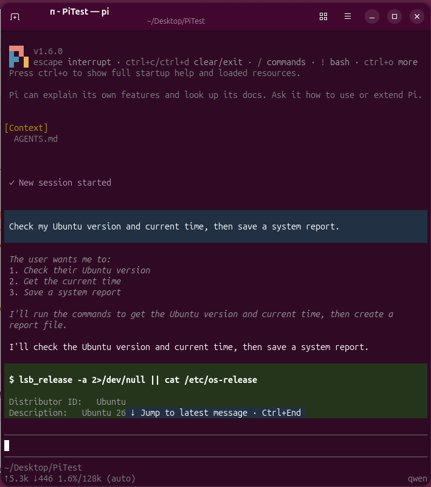{width="600"}

    Open the desktop `PiTest` folder and check that the JSON report contains the Ubuntu version and current time.

    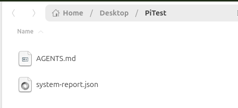{width="400"}

    !!! note
        This example checks the local model connection, command execution, and file operations, together with persistent project instructions through `AGENTS.md`.

4. **Exit the Agent**

    Enter `/quit` or press `Ctrl + D` with an empty input box to return to the Ubuntu terminal.

## Hermes Agent

[Hermes Agent](https://hermes-agent.nousresearch.com/) is a personal AI assistant from Nous Research, with persistent memory and tools for automating everyday tasks.

Tested with version **0.23.3**.

1. **Install**

    Run:

    ```bash
    curl -fsSL https://hermes-agent.nousresearch.com/install.sh | bash
    source ~/.bashrc
    hermes --version
    ```

2. **Configure the Local Model**

    Run:

    ```bash
    hermes model
    ```

    Select **Custom endpoint (enter URL manually)**, then complete the configuration:

    | Setting | Value |
    | :--- | :--- |
    | API base URL | `http://localhost:8080/v3` |
    | API key | Leave empty |
    | Add /v1? | Enter `n` to keep the URL unchanged |
    | API compatibility mode | Enter `1` for **Auto-detect** |
    | Model name | `qwen` |
    | Context length in tokens | Leave empty for auto-detection |
    | Display name | `LattePanda Sigma 2` |

    Settings are saved to `~/.hermes/config.yaml`.

3. **Test File Operations and Preferences**

    Use a test folder with no existing reports:

    ```bash
    mkdir -p ~/Desktop/HermesTest
    cd ~/Desktop/HermesTest
    hermes
    ```

    Enter:

    > I prefer JSON for system reports.

    Confirm that Hermes shows a memory update:

    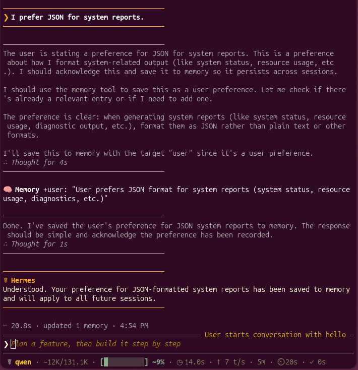{width="600"}

    Use `/new` in Hermes to start a new session, then enter:

    > Check my Ubuntu version and current time, then save a system report.

    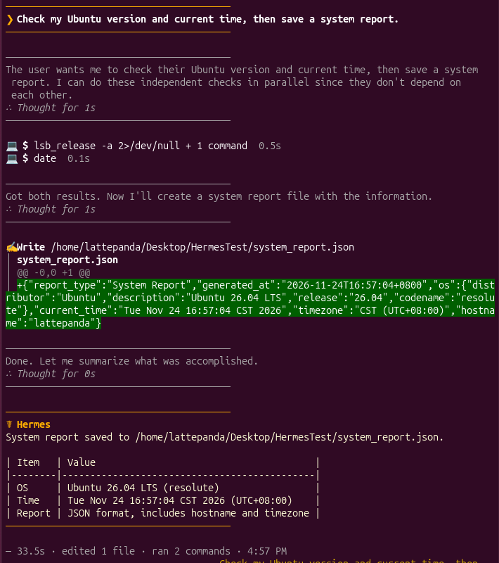{width="600"}

    Open the desktop `HermesTest` folder and check that the JSON report contains the Ubuntu version and current time.

    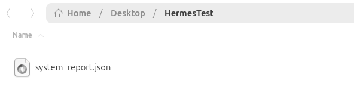{width="400"}

    !!! note
        This example checks the local model connection, command execution, and file operations, together with built-in memory across sessions.

4. **Exit the Agent**

    Enter `/quit` or press `Ctrl + D` with an empty input box to return to the Ubuntu terminal.

## Reasonix

[Reasonix](https://github.com/loserbcc/reasonix) is a terminal AI coding agent with support for multiple models and plugins.

Tested with version **2.61.0**.

1. **Install**

    Make sure Node.js and npm are available. Then run:

    ```bash
    npm install -g reasonix
    reasonix --version
    ```

2. **Configure the Local Model**

    Run:

    ```bash
    reasonix setup
    ```

    Select **Add OpenAI-compatible provider** → **OpenAI Chat Completions** → **Enter model name manually**, then configure:

    | Setting | Value |
    | :--- | :--- |
    | Base URL | `http://localhost:8080/v3` |
    | Model Name | `qwen` |
    | API Key variable name | Default: `CUSTOM_LOCALHOST_8080_API_KEY` |
    | API Key | `local` (placeholder) |
    | Context window in tokens | Default: `128000` (Reasonix client setting) |

    Select **custom-localhost-8080** → **Set default model** → **qwen**, then **Save and exit**.

3. **Test File Operations and Preferences**

    Use a test folder with no existing reports:

    ```bash
    mkdir -p ~/Desktop/ReasonixTest
    cd ~/Desktop/ReasonixTest
    reasonix
    ```

    Confirm that the active model is `qwen`, then enter:

    > Add to AGENTS.md: use JSON for system reports.

    Approve creating or editing `AGENTS.md` if prompted. Open the desktop `ReasonixTest` folder and check the rule in `AGENTS.md`.

    Use `/new` in Reasonix to start a new session in the same folder, then enter:

    > Check my Ubuntu version and current time, then save a system report.

    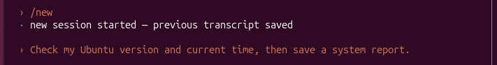{width="600"}

    Approve the required tool operations if prompted.

    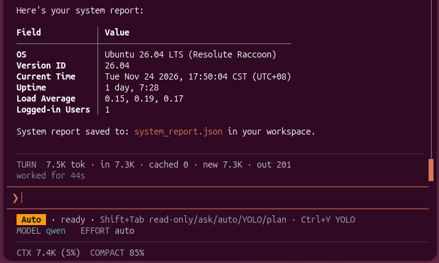{width="600"}

    Open the desktop `ReasonixTest` folder and check that the JSON report contains the Ubuntu version and current time.

    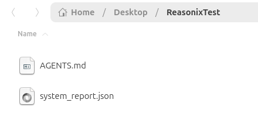{width="400"}

    !!! note
        This example checks the local model connection, command execution, and file operations, together with persistent project instructions through `AGENTS.md`.

4. **Exit the Agent**

    Enter `/quit` or press `Ctrl + D` to return to the Ubuntu terminal.

## Stopping the Service

Exit the agent first. When no application needs the local model, double-click **💤 Stop AI Assistant** to stop OVMS and the pre-installed OpenClaw Gateway.

To restart OVMS, double-click **🔮 Start OVMS API**.

## Troubleshooting

- **Agent cannot connect to the local model** — double-click **🔮 Start OVMS API**, then check the service with `curl http://localhost:8080/v3/models`.
- **Endpoint verification fails or the model is not found** — use `http://localhost:8080/v3` as the base URL.
- **Agent responds but does not create or edit files** — allow the requested file operations. In OpenCode, use `/agents` to select **Build**.

For startup errors and OVMS log checks, see [Pre-installed AI — Troubleshooting](local_ai_getting_started.md#troubleshooting).

## References

- [OpenCode Documentation](https://opencode.ai/docs/)
- [Pi Documentation](https://docs.pi.dev/latest/quickstart)
- [Hermes Agent Documentation](https://hermes-agent.nousresearch.com/docs/getting-started/quickstart)
- [Reasonix Documentation](https://github.com/loserbcc/reasonix/blob/main-v2/docs/GUIDE.md)

------

[**:simple-discord: Join our Discord**](https://discord.gg/k6YPYQgmHt){ .md-button .md-button--primary }
