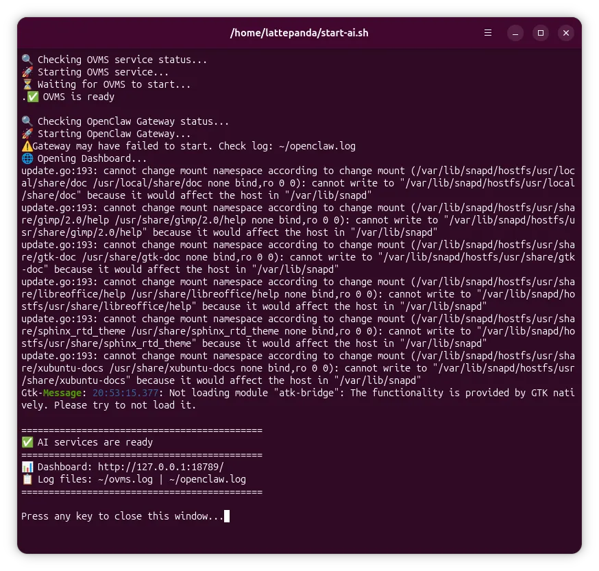
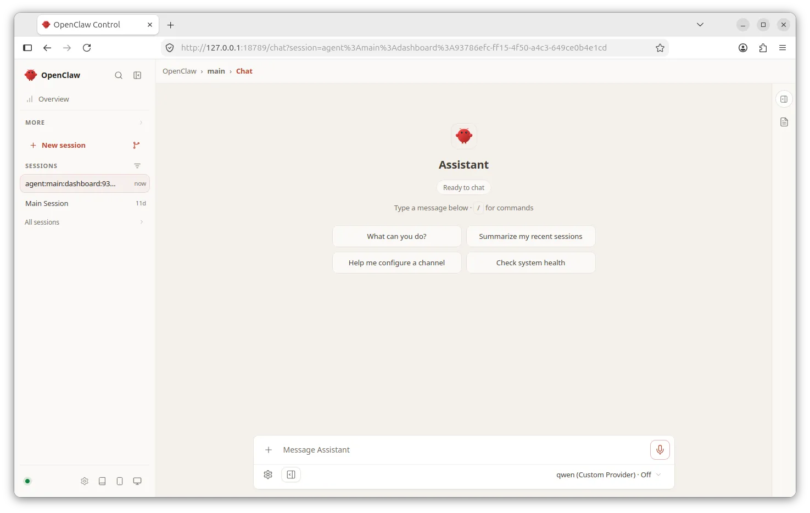
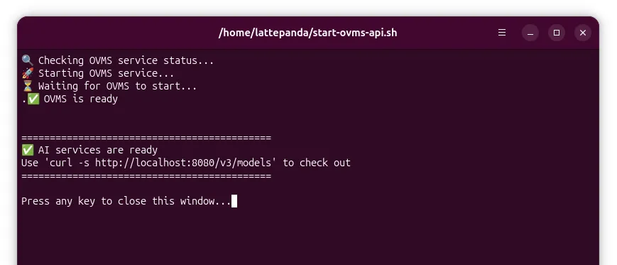

# Local AI Quick Start

LattePanda Sigma 2 is built for local AI workloads. Its pre-installed 1TB SSD comes with everything you need — operating system, drivers, inference server, AI agent, and models — so you can go from power-on to a running local AI agent in minutes, with no Internet connection and no cloud API required. All data processing is performed on your local device, helping protect your privacy and data security.

## What Is Pre-installed

| Software | Details |
| :--- | :--- |
| Ubuntu OS | Version: 26.04<br>Pre-installed on the 1TB SSD (auto-login enabled) |
| System Account | Username: `lattepanda` <br>Password: `lattepanda` |
| Intel GPU / NPU Drivers | Hardware acceleration for the Arc B390 GPU and Intel NPU |
| OVMS (OpenVINO Model Server) | Serves the local AI model through an OpenAI-compatible API (port 8080) |
| OpenClaw | A pre-configured local AI agent with a browser Dashboard (port 18789) |
| Local AI Model | Qwen3.6-35B-A3B (INT4, OpenVINO format), stored in `~/models/` |

On the desktop you will find a `README.md` file and three shortcuts: **🔮 Start AI Assistant**, **🔮 Start OVMS API** and **💤 Stop AI Assistant**. The README file contains detailed troubleshooting and maintenance information.

## Start the AI Assistant (Local API + OpenClaw)

This option starts both the OVMS inference service and the OpenClaw AI agent, then opens the conversation interface — the fastest way to chat with your local AI.

1. Power on and boot into the pre-installed Ubuntu OS.

2. Double-click the **🔮 Start AI Assistant** icon on the desktop.

3. A terminal window opens and shows the startup progress. When it displays `✅ AI services are ready`, the services have started successfully.

    The terminal may display some warning messages — please ignore them.
    
    Once the service starts, it will continue running in the background even after you close the terminal window.

    

4. Wait 2–3 seconds. Your default browser will automatically open the OpenClaw Dashboard.

    

    !!! tip "Browser Does Not Open?"
        Open your browser manually and go to `http://127.0.0.1:18789/`.

5. Enter your question in the input box at the bottom and press Enter to send it. The AI will respond in real time.

    !!! note "The First Conversation Takes Longer"
        The first request may take up to 30 seconds or more: OpenClaw performs a one-time warm-up (building the tool list, loading plugins and assembling the system prompt), and OpenVINO performs a final model compilation for the GPU on the first inference. Subsequent conversations are smooth and responsive.

## Start the OVMS API Only

If you want to connect your own AI agent or application to the local model, double-click the **🔮 Start OVMS API** icon. This starts only the OVMS inference service, which exposes an OpenAI-compatible API:



| Item | Value |
| :--- | :--- |
| Base URL | `http://localhost:8080/v3` |
| API Format | OpenAI-compatible Chat Completions API |
| Model Name | `qwen` |
| API Key | Not required |

Once the service starts, it will continue running in the background even after you close the terminal window.

**Quick test** — list the available models:

```bash
curl http://localhost:8080/v3/models
```

**Send a chat request**:

```bash
curl http://localhost:8080/v3/chat/completions \
  -H "Content-Type: application/json" \
  -d '{
    "model": "qwen",
    "messages": [{"role": "user", "content": "Hello!"}]
  }'
```

Point your own AI agent (such as Hermes Agent, or any framework supporting OpenAI-compatible endpoints) to `http://localhost:8080/v3`, and all inference then runs entirely on-device.

## Stopping the Service

Double-click the **💤 Stop AI Assistant** icon on the desktop. It safely stops both OVMS and the OpenClaw Gateway. Press any key to close the window when prompted.

## Important Files

| File Path | Purpose |
| :--- | :--- |
| `~/start-ai.sh` | Starts OVMS and the OpenClaw Gateway, then opens the Dashboard |
| `~/start-ovms-api.sh` | Starts the OVMS API service only |
| `~/stop-ai.sh` | Safely stops all related services |
| `~/ovms.log` | OVMS runtime log (model loading and inference) |
| `~/openclaw.log` | OpenClaw Gateway runtime log (API calls and connections) |
| `~/models/` | AI model files (**do not delete or modify**) |
| `~/Downloads/ovms/` | OVMS executable and dependency libraries |

!!! tip "Useful Tweaks"
    - The model runs on the GPU by default (`--target_device GPU` in the startup scripts).
    - To change the context length, add the `--max_num_batched_tokens` parameter to the `ovms` command in `~/start-ai.sh` and `~/start-ovms-api.sh`, e.g. `--max_num_batched_tokens 32768`.

## Troubleshooting

- **Nothing happens after double-clicking an icon** — open a terminal and run `chmod +x ~/start-ai.sh ~/start-ovms-api.sh ~/stop-ai.sh`.
- **Dashboard opens but the conversation does not respond** — check the OVMS log with `tail -50 ~/ovms.log`, and check whether the ports are occupied with `lsof -i :8080` and `lsof -i :18789`.
- **Check whether the services are running** — `curl http://localhost:8080/v3/models` (OVMS) and `curl http://localhost:18789/v1/models` (OpenClaw Gateway).

For more detailed troubleshooting and maintenance commands, please refer to the `README.md` file on the desktop.

------

[**:simple-discord: Join our Discord**](https://discord.gg/k6YPYQgmHt){ .md-button .md-button--primary }
