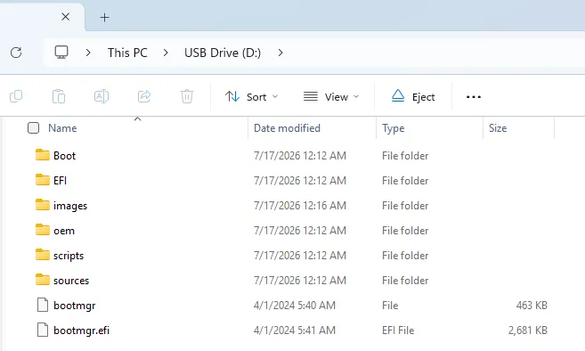

# Windows Installation

This guide will walk you through the process of installing Windows 11 on your LattePanda Sigma 2.

!!! note "Windows 11 Recommended"

    As the LattePanda Sigma 2 features a hybrid processor architecture with Performance-cores, Efficient-cores and Low Power Efficient-cores, Windows 11 is recommended for more optimized thread scheduling and improved performance and power efficiency.

## Official Windows 11 Recovery Image

This image comes with all hardware drivers and is ready to use, providing you with a fast and friendly experience.

This image is not updated in real time. Therefore, if you need to install the latest version of the Windows 11 OS, you will need to download it yourself and install the drivers.

### Preparations

* :material-usb-flash-drive-outline: Empty USB flash drive (16 GB or larger)
* 💿 OS Disc Image File for the LattePanda Sigma 2

### Installation Steps

1. **Download** the Windows 11 disc image file for LattePanda Sigma 2 from the link provided above.

2. **Format** your USB flash drive to **NTFS** format.

3. **Extract** the downloaded Windows disc image file, then copy **all** extracted files and folders to the root directory of your USB flash drive.

    {width="600"}

4. **Insert** the USB flash drive into your LattePanda Sigma 2, then power on or reboot.

5. Immediately and repeatedly press the **++f7++** key to enter the Boot Device Selection Menu.

6. Use the **++arrow-up++** or **++arrow-down++** keys to select your USB flash drive from the list, then press **++enter++**.

    

7. It will boot into the OS installation terminal. The installation process is **fully automatic** and requires no user intervention. Please wait **5–8 minutes** for completion.

    

8. After the installation completes, **remove the USB flash drive**, then type **`EXIT`** and press **++enter++** to reboot the LattePanda Sigma 2.

9. The system will begin the Windows initialization process. After 3 minutes, you will be greeted with the Windows desktop.

**Congratulations! Your LattePanda Sigma 2 is now ready to use.**

------

## Standard Windows Installation

If you prefer to install a different version of Windows or perform a clean installation, you can follow the standard Windows installation procedure. The LattePanda Sigma 2 runs a full version of Windows, so the installation process is similar to that of a regular laptop or desktop computer.

### Installation Steps

1. **Download Windows OS Image**

    Visit the [**Microsoft Software Download**](https://www.microsoft.com/software-download) page and download the Windows ISO file for the version you need.

2. **Create Bootable USB Drive**

    Use a tool like [**Rufus**](https://rufus.ie/) to create a bootable USB drive from the Windows ISO file.

3. **Boot from USB**

    Insert the bootable USB drive into your LattePanda Sigma 2 and power on the device. Press **++f7++** repeatedly to enter the boot menu, then select to  boot from the USB drive.

4. **Install Windows**

    Follow the on-screen instructions to complete the Windows installation process.

5. **Install Drivers**

    After Windows is installed, you will need to install the necessary drivers for optimal performance. Please refer to our [**Download Resources**](download_resources.md) section to download and install all required drivers.

    !!! tip "Driver Installation Order"
        We recommend installing the Intel Chipset Driver first, followed by the Intel Innovation Platform Framework Driver — the Intel Processor Power Management (PPM) Driver depends on it — and then the remaining drivers. Restart the system after all drivers are installed.

------

[**:simple-discord: Join our Discord**](https://discord.gg/k6YPYQgmHt){ .md-button .md-button--primary }
