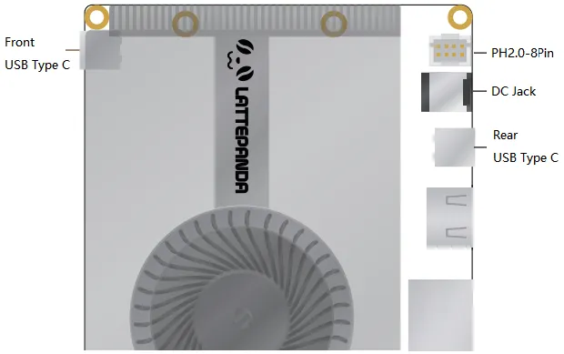
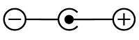
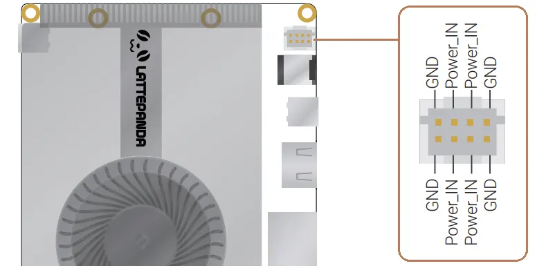

# Power Options

To power your LattePanda Sigma 2, you have several options depending on your specific needs and preferences. 

In this chapter, we will explore the different ways that you can power your LattePanda Sigma 2 and provide you with the necessary information and steps to get started.

## 3 Ways to Power the LattePanda

!!! warning "Voltage and Power"

    - In these 3 ways, please ensure the voltage doesn't exceed 20V.
    - Please use a **DC power adapter** of at least **120W**. Otherwise the LattePanda Sigma 2 may suddenly shut down during boot-up or when the processor is under high load.
    - When powering via USB Type-C, a **PD 20V** adapter of at least **100W** is recommended.

1. Power Adapter with 5.5 x 2.5mm DC Jack (**Recommended**)

2. USB Type-C PD Adapter

3. DC-IN 8-Pin Connector (2mm pitch)

    

## Power Supply Priority

The PD adapter and DC adapter can be connected at the same time. LattePanda Sigma 2 prioritizes using the connector with the higher voltage for its power supply.

The prority is that: 
``` text
USB Type C(Front) > USB Type C(Rear) > DC Jack = PH2.0-8Pin connector
```
The power supply with high priority will be used first.

!!! Example
    === "Senario 1"
        If the USB Type-C port is powered by 20V PD adapter, and the DC Jack port is powered by 19V adapter, **LattePanda will prioritize the power supply from the USB Type-C port.**<br>
        > 1. In case the power supply from the USB Type-C port is accidentally cut off, LattePanda will automatically switch to the power supply from the DC Jack port.<br>
        > 2. When the power supply from the USB Type-C port is restored, LattePanda will automatically switch back to using the power supply from the USB Type-C port.<br>
        > 3. During the power switching process, LattePanda will continue to operate normally without any unexpected power outages.

    === "Senario 2"
        If both the USB Type-C ports are powered by 20V PD adapter, **LattePanda will utilize the power supply from front USB Type-C ports.**

!!! note

    - The USB Type C ports only accepts PD 20V power supply.
    - The pins of the JST PH2.0-8Pin connector are directly connected internally to the pins of the DC jack.


## Powered by DC Jack (Recommended)

### Input Specifications

- Acceptable: 12–20 V
- Recommended: 15–20 V
- 120 watts or above

    

### DC Adapter Wattage and Performance

When powered by the DC Jack, maximum performance is released by default, that is: PL1=65W, PL2=95W.

LattePanda Sigma 2 has a DC 5.5mm x 2.5mm circular power jack onboard, and a power adapter is attached in the package. It is strongly recommended to use the attached power adapter (20V 180W) to ensure the stability and safety of the power supply.

!!! note "Understanding PL1 and PL2"

    - PL1 (Power Limit 1): The long-term power limit. This defines the sustained power consumption the processor maintains under continuous load.
    - PL2 (Power Limit 2): The short-term burst power limit. It allows the processor to exceed PL1 for a brief period to handle instantaneous spikes in workload before scaling back to the PL1 level to manage thermals.

To manually set the PL1 and PL2 values, see the [TDP Power Limit Settings](bios_setup.md#tdp-power-limit-settings) section.

## Powered by USB Type-C Port

### Input Specifications

- 20V
- 100 watts or above

Both USB Type-C ports on LattePanda Sigma 2 are full-featured Thunderbolt 4 ports and accept PD 20V power input.

### PD Adapter Wattage and Performance

A 100W or higher PD power adapter is recommended.

A lower-wattage PD adapter (such as 65W or 45W) can also power the LattePanda Sigma 2 normally, but performance will be limited — Sigma 2 automatically detects the maximum power output of the connected PD adapter and adjusts the processor's power limits (PL1 / PL2) accordingly:

| PD Adapter Power Rating | PL1 Value | PL2 Value |
| :---------------------- | :-------- | :-------- |
| 45W                     | 30W       | 30W       |
| 65W                     | 40W       | 40W       |
| 100W                    | 65W       | 65W       |

Power limits are only detected and applied during an initial cold boot. Hot-plugging a different PD or DC power supply while the system is running will not alter the current power profile. To apply new power limits:

1. Shut down the system completely and disconnect all power sources.
2. Connect the new PD adapter.
3. Power on the board.

## Powered by DC-IN 8-Pin Connector

!!! warning "Ensure Correct Polarity Connection"
    Please make sure the positive and negative pins are properly connected and double-check your connections before turning on your LattePanda.

### **Input Specifications**

- Acceptable: 12–20 V
- Recommended: 15–20 V
- 120 watts or above
    

**The pins of the JST PH2.0-8Pin connector are directly connected internally to the pins of the DC jack.**

When the LattePanda is placed inside a device, you can use this connector (8-pin, 2mm pitch) to power it through the internal wiring of the device.

### Recommend Cable

- [PHB2.0-8PIN Power Supply Cable](https://www.dfrobot.com/product-2736.html)

------

[**:simple-discord: Join our Discord**](https://discord.gg/k6YPYQgmHt){ .md-button .md-button--primary }
