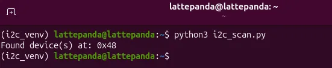
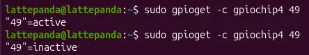

# Processor GPIO Programming

Besides the GPIOs provided by the onboard RP2350 co-processor, the 34-pin GPIO header of LattePanda Sigma 2 also exposes 4 pins routed from the Intel processor (PCH): an I2C3 port (`SCL3` / `SDA3`) and two general-purpose I/Os (`D22` / `D23`).

This chapter demonstrates how to operate these pins under Linux (the pre-installed Ubuntu 26.04 LTS). For GPIO control via the RP2350 co-processor instead, please refer to the [RP2350 GPIO Programming](rp2350_programming.md) chapter.

## Pinout Assignment

| Header Pin | Processor PCH Signal | Function | Notes |
| :--------- | :--------------- | :------- | :---- |
| SCL3 | I2C3_SCL | I2C3 Clock | Integrated 2.2K pull-up resistor |
| SDA3 | I2C3_SDA | I2C3 Data | Integrated 2.2K pull-up resistor |
| D22 | GPP_D22 | General-Purpose I/O | Integrated 4.7K pull-up resistor |
| D23 | GPP_D23 | General-Purpose I/O | Integrated 4.7K pull-up resistor |

For the physical pin locations on the 34-pin header, please refer to the [GPIO Header](io_playability_internal.md#gpio-header) section.

These pins originate from the processor PCH (1.8V logic level) and undergo MOSFET level-shifting to reach a **3.3V logic level**. The high level of these pins is achieved via pull-up resistors, which provides weaker drive capability compared to push-pull outputs.

!!! danger

    All these pins use 3.3V logic levels. Do not connect 5V devices directly.

## I2C (I2C3 Port)

### Preparation

Install the i2c-tools package:

```bash
sudo apt update
sudo apt install i2c-tools
```

On the Ubuntu OS, the processor's I2C3 port enumerates as **`/dev/i2c-2`** (bus number `2`).

To access the bus without `sudo`, add your account to the `i2c` group (takes effect after re-login or reboot):

```bash
sudo usermod -aG i2c $USER
```

### Scan for Devices

Connect your I2C device to `SCL3` / `SDA3` (and `GND`, plus 3.3V power if needed), then scan the bus for device addresses:

```bash
i2cdetect -y -r 2
```


### Programming with Python smbus2

On Ubuntu 23.04 and later, the system Python environment is externally managed ([PEP 668](https://peps.python.org/pep-0668/)), so installing packages into it with `pip install` is blocked by default. 

Create an isolated virtual environment first:

```bash
sudo apt install python3-venv
python3 -m venv ~/i2c_venv
source ~/i2c_venv/bin/activate
pip install smbus2
```

The following example scans the I2C3 bus and prints the addresses of all connected devices. Save it as `i2c_scan.py`:

```python
from smbus2 import SMBus

BUS = 2  # I2C3 enumerates as /dev/i2c-2
FIRST = 0x03
LAST = 0x77

found = []

with SMBus(BUS) as bus:
    for addr in range(FIRST, LAST + 1):
        try:
            bus.read_byte(addr)  # The device ACKs if present
            found.append(addr)
        except OSError:
            pass  # No device at this address

if found:
    print("Found device(s) at: " + ", ".join(f"0x{a:02X}" for a in found))
else:
    print("No I2C device found.")
```

Run it with the virtual environment activated:

```bash
python3 i2c_scan.py
```



This produces the same result as the `i2cdetect -y -r 2` command above — both list the addresses of the devices connected to the bus.

## GPIO (D22 / D23)

### Output Drive Capability

On `D22` / `D23`, the high level is provided by pull-up resistors (see [Pinout Assignment](#pinout-assignment)), so the pins source only weak current in the HIGH state. Wire loads active-low where possible — e.g. connect an LED between 3.3V and the pin (it lights up when the pin is LOW) — rather than driving loads from the pin to GND.

### GPIO Chip and Line Offsets

PCH GPIOs are exposed through the Linux GPIO character device interface and are operated with the `libgpiod` tools. Install them and list the controllers:

```bash
sudo apt update
sudo apt install gpiod python3-libgpiod
sudo gpiodetect
```

On the Ubuntu OS, the PCH GPIO communities enumerate as five controllers, `gpiochip0` – `gpiochip4` (`INTC10BC:00` – `INTC10BC:04`). 

`D22` and `D23` belong to `gpiochip4` (`INTC10BC:04`, 72 lines), at the following line offsets:

| Header Pin | GPIO Line | GPIO Controller | Line Offset | Status |
| :--------- | :-------- | :-------------- | :---------- | :----- |
| D22 | GPP_D22 | gpiochip4 | 49 | Verified on Ubuntu 24.04 & 26.04 |
| D23 | GPP_D23 | gpiochip4 | 50 | Verified on Ubuntu 24.04 & 26.04 |

### Root Privileges Required

On the Ubuntu OS, the `/dev/gpiochip*` devices are owned by `root:root` with mode `0600`, and no `gpio` group exists — **all GPIO operations below require `sudo`**, including the Python examples. (Granting non-root access via a custom udev rule is possible but not covered here.)

### Control via Command Line

Read the input level of `D22` — left floating it reads `active` (HIGH, pulled up by the onboard 4.7K resistor); short the pin to GND and it reads `inactive` (LOW):

```bash
sudo gpioget -c gpiochip4 49
```



Set `D23` to output and hold its level:

```bash
# Output LOW (held until Ctrl+C)
sudo gpioset -c gpiochip4 50=0

# Output HIGH (held until Ctrl+C)
sudo gpioset -c gpiochip4 50=1
```

### Programming with Python libgpiod

#### GPIO Input (D22 / D23)

Save the following code as `gpio_in.py` — it reads and prints the levels of `D22` and `D23` every second (both pins are requested as inputs in a single multi-line request; the next example drives them as outputs):

```python
import time
import gpiod
from gpiod.line import Direction, Value

CHIP = "/dev/gpiochip4"   # PCH GPIO controller
LINE_OFFSET_D22 = 49      # Line offset of GPP_D22
LINE_OFFSET_D23 = 50      # Line offset of GPP_D23

with gpiod.request_lines(
    CHIP,
    consumer="sigma2-gpio-in",
    config={
        LINE_OFFSET_D22: gpiod.LineSettings(direction=Direction.INPUT),
        LINE_OFFSET_D23: gpiod.LineSettings(direction=Direction.INPUT),
    },
) as request:
    print("Reading D22 D23 every second. Press Ctrl+C to stop.")
    try:
        while True:
            values = request.get_values([LINE_OFFSET_D22, LINE_OFFSET_D23])
            d22, d23 = values
            print(f"D22: {'HIGH' if d22 == Value.ACTIVE else 'LOW'}  "
                  f"D23: {'HIGH' if d23 == Value.ACTIVE else 'LOW'}")
            time.sleep(1)
    except KeyboardInterrupt:
        pass
```

Run it (sudo required):

```bash
sudo python3 gpio_in.py
```

With nothing connected, both pins print `HIGH` (pulled up by the onboard 4.7K resistors); short either pin to GND and its reading prints `LOW` until released.

#### GPIO Output (D22 / D23)

Save the following code as `gpio_out.py` — it drives `D22` and `D23` to complementary levels and swaps them every second:

```python
import time
import gpiod
from gpiod.line import Direction, Value

CHIP = "/dev/gpiochip4"  # PCH GPIO controller
LINE_OFFSET_D22 = 49     # Line offset of GPP_D22
LINE_OFFSET_D23 = 50     # Line offset of GPP_D23

with gpiod.request_lines(
    CHIP,
    consumer="sigma2-gpio-out",
    config={
        LINE_OFFSET_D22: gpiod.LineSettings(
            direction=Direction.OUTPUT,
            output_value=Value.ACTIVE,
        ),
        LINE_OFFSET_D23: gpiod.LineSettings(
            direction=Direction.OUTPUT,
            output_value=Value.INACTIVE,
        ),
    },
) as request:
    print("D22 and D23 alternating every second. Press Ctrl+C to stop.")
    try:
        while True:
            request.set_values({
                LINE_OFFSET_D22: Value.ACTIVE,
                LINE_OFFSET_D23: Value.INACTIVE,
            })
            time.sleep(1)
            request.set_values({
                LINE_OFFSET_D22: Value.INACTIVE,
                LINE_OFFSET_D23: Value.ACTIVE,
            })
            time.sleep(1)
    except KeyboardInterrupt:
        pass
```

Run it (sudo required):

```bash
sudo python3 gpio_out.py
```

Wire an LED with a current-limiting resistor between 3.3 V and each pin. The two LEDs light up alternately, each when its pin is LOW.

!!! note "libgpiod v1 vs v2"
    The examples above use the libgpiod **v2** API (gpiod 2.2.x) with Ubuntu 26.04, and both were verified on it. Examples written for the older v1 API (`gpiod.Chip` / `get_line`) will not run on this system.

## Language Reference

- `man i2cdetect` / `man i2cget` / `man gpioset` / `man gpioget`
- [libgpiod documentation](https://libgpiod.readthedocs.io)

------

[**:simple-discord: Join our Discord**](https://discord.gg/k6YPYQgmHt){ .md-button .md-button--primary }
