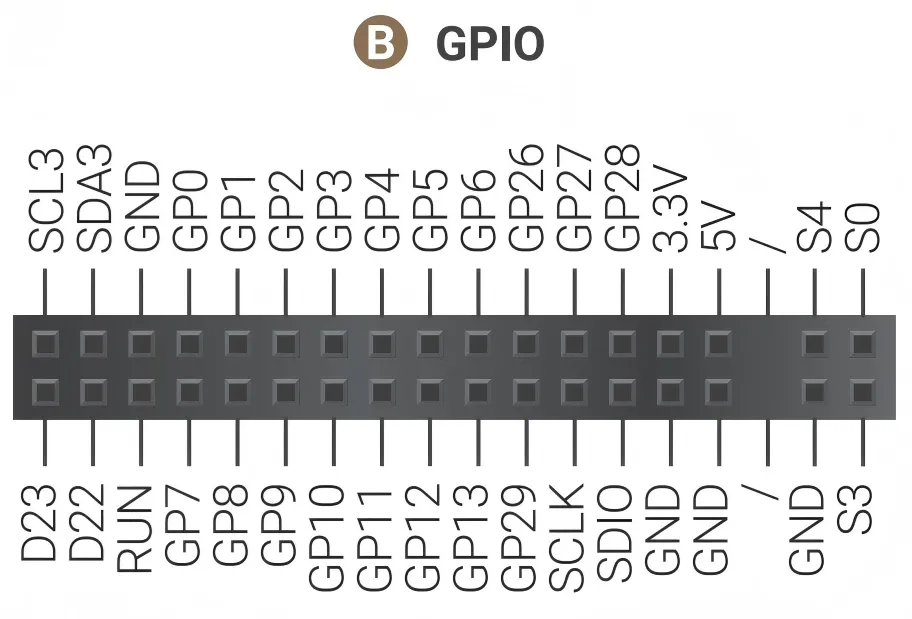
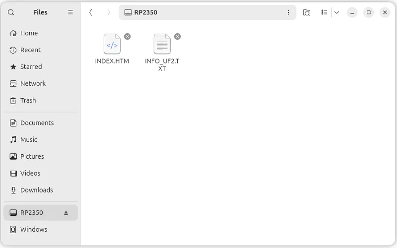

# RP2350 GPIO Programming

LattePanda Sigma 2 integrates an **RP2350** co-processor. It communicates with the Intel processor via USB 2.0, and connects your local AI agents and applications to physical hardware via the 34-pin GPIO header — enabling event-driven control directly on the board.

- Dual ARM Cortex-M33 @ 150MHz
- 520KB on-chip SRAM
- 8MB onboard Flash
- 3.3V I/O Level
- Pre-loaded with MicroPython firmware

!!! danger "3.3V I/O Level Limit"
    The RP2350 operates at a 3.3V logic level. Its I/O pins are not 5V tolerant. Do not connect 5V devices directly to the GPIOs.

!!! info "About RP2350"
    The RP2350 is Raspberry Pi's second-generation microcontroller. For chip details, refer to the [official RP2350 documentation](https://www.raspberrypi.com/documentation/microcontrollers/silicon.html#rp2350).

## RP2350 GPIO Mapping

{width="500"}

Most of the RP2350's GPIOs are routed out through the 34-pin GPIO header, and the remaining are internally connected or floating: 

| RP2350 Pin | Board Connection / Function | Notes |
| :--------- | :-------------------------- | :---- |
| GPIO0 ~ 13 | Header Pin `GP0` ~ `GP13` | Routed to the GPIO Header |
| GPIO14 ~ 17 | Not Connected | Internally Floating |
| GPIO18 | S0 | Internally Connected to `S0` State Pin |
| GPIO19 | S3 | Internally Connected to `S3` State Pin |
| GPIO20 | SW | Internally Connected to `SW` Button |
| GPIO21 | RST | Internally Connected to `RST` Button |
| GPIO22 | S4 | Internally Connected to `S4` State Pin |
| GPIO23 ~ 24 | Not Connected | Internally Floating |
| GPIO25 | Onboard Red LED | Internally Connected to Red LED |
| GPIO26 ~ 29 | Header Pin `GP26` ~ `GP29` | Multiplexing Function: ADC each pin in parallel with a 100nF capacitor |
| SWCLK | Header Pin `SCLK` | SWD Clock |
| SWDIO | Header Pin `SDIO` | SWD Data I/O |
| RUN | Header Pin `RUN` | Hardware Reset, Active Low |
| IOVDD/DVDD | Header Pin `3.3V` | Power Supply |

!!! note
    GPIO26 to GPIO29 of the RP2350 can be muxed as ADC input. To ensure stable ADC sampling values, these pins are paralleled with 100nF capacitors, which can affect rapidly changing signals such as I2C. If using I2C, please avoid these four GPIO pins and choose alternative GPIO pins instead.

## Uploading New Firmware to the RP2350

The RP2350 features a built-in USB bootloader stored in its ROM, which allows you to upload new firmware simply by copying a file — the board appears as a USB Mass Storage Device.

### Onboard Buttons

- **MCU_RST**: The reset button. A short press performs a hard reset on the RP2350, restarting its current program.
- **MCU_BOOT**: The boot select button, used to put the RP2350 into bootloader mode, preparing it to receive new firmware.

### Upload Instructions

Follow these steps to upload a .uf2 file to the RP2350:

- Press and hold the `MCU_BOOT` button.
- While still holding `MCU_BOOT`, press and release the `MCU_RST` button.
- Release the `MCU_BOOT` button.
- The OS will now detect the RP2350 as a new USB Mass Storage Device (like a flash drive), typically named `RP2350`.

    {width="600"}

- Drag and drop your firmware file (.uf2) onto this new drive.
- Once the file is copied, the bootloader will automatically verify the firmware, write it to the RP2350's flash memory, and then reboot. Your new program will start running immediately.

## RP2350 Power Control

LattePanda Sigma 2 allows control of the RP2350's power supply through the onboard **DIP switch** and **BIOS settings**:

- The **DIP switch** (MCU Power Control) controls whether the RP2350 is supplied with power after the board receives power input but before the system is turned on. Please refer to the [DIP Switch](io_playability_internal.md#dip-switch) section.
- The RP2350's power behavior in other system states (running, sleep/suspend, hibernate, shutdown) must be configured in the BIOS. Please refer to the [MCU Power Control](bios_setup.md#mcu-power-control) section.

## Programming Languages

- [MicroPython](rp2350_programming_micropython.md) — the pre-loaded firmware; the fastest way to start, and the recommended path for letting local AI agents control the GPIO.
- [Arduino C++](rp2350_programming_arduino.md) — for projects based on the Arduino framework and its library ecosystem.

------

[**:simple-discord: Join our Discord**](https://discord.gg/k6YPYQgmHt){ .md-button .md-button--primary }
