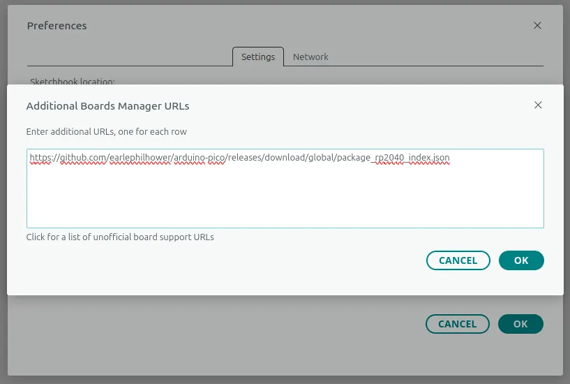
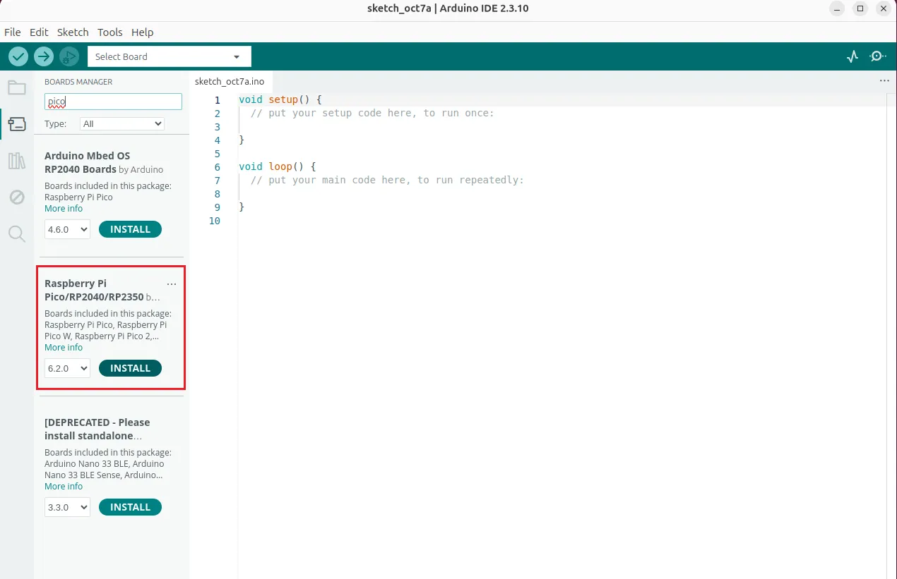
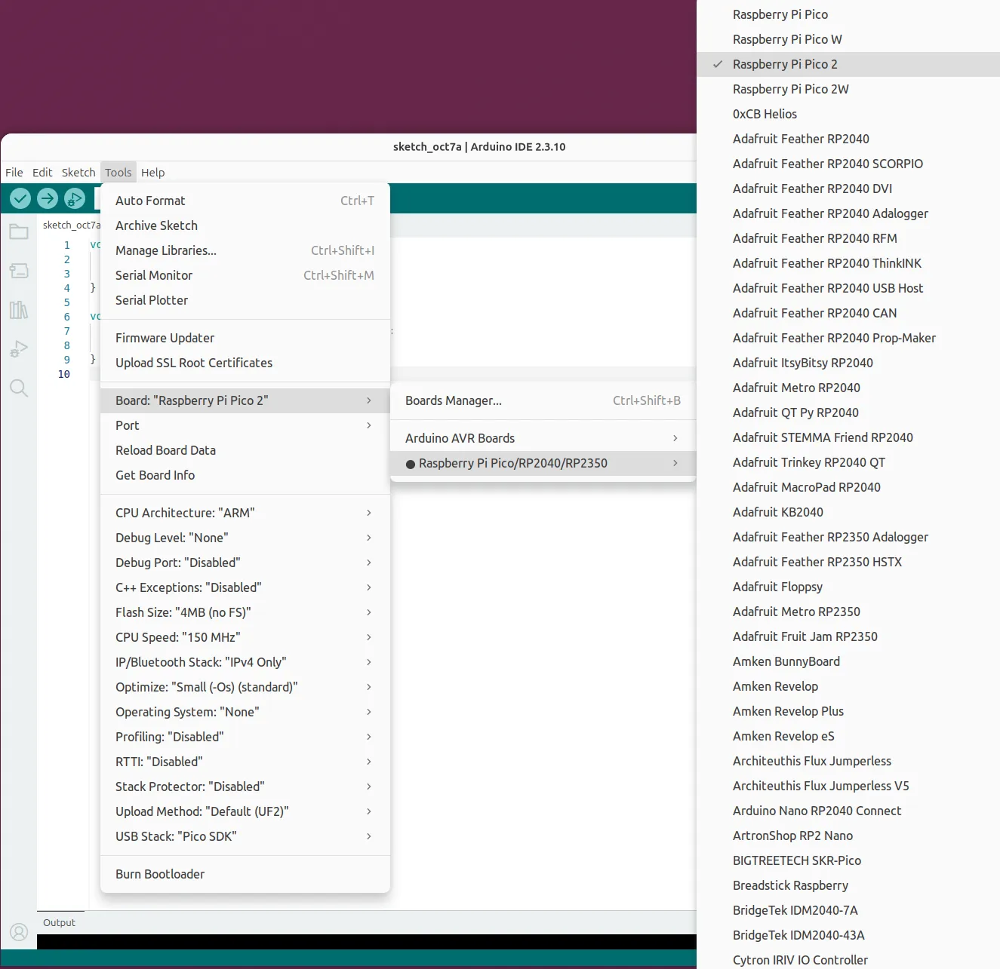
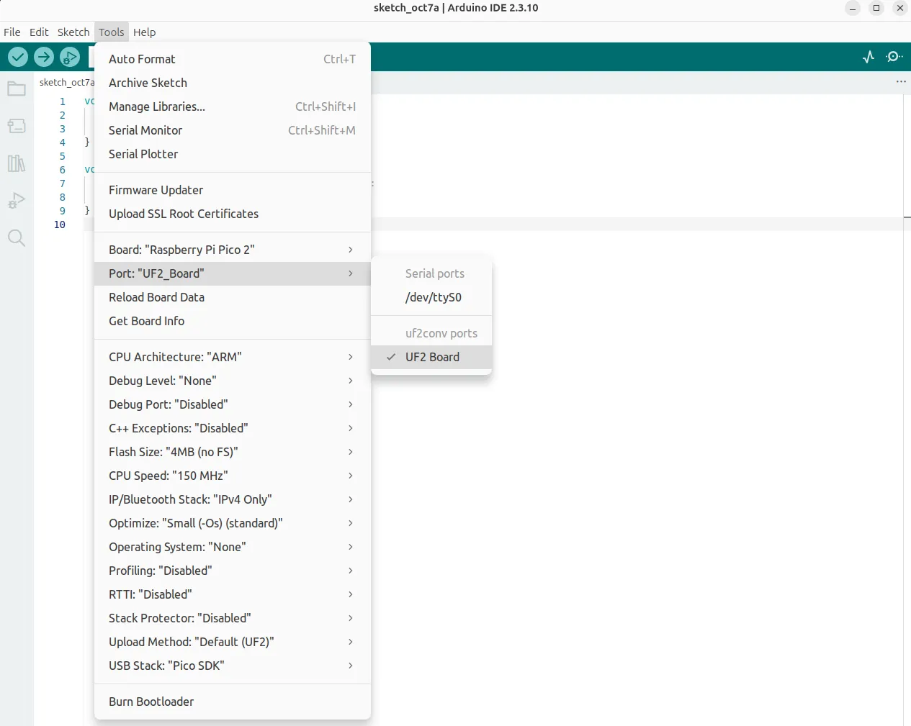
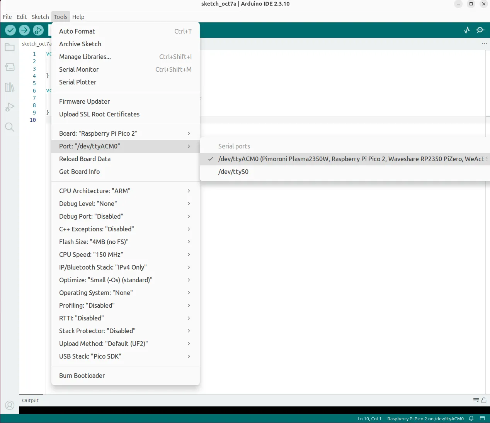

# RP2350 GPIO Programming - Arduino C++

## Preparation

Arduino C++ provides a simple and intuitive framework for programming microcontrollers. This section guides you through setting up the Arduino IDE to program the RP2350.

Follow these steps to set up your development environment:

- Install the Arduino IDE.

    Download and install the Arduino IDE from the [official Arduino website](https://www.arduino.cc/en/software).

- Add RP2350 board support to the Arduino IDE.

    Open the Arduino IDE, navigate to: `File` → `Preferences`.

    In the `Additional Boards Manager URLs` field, add the following URL:
    ```
    https://github.com/earlephilhower/arduino-pico/releases/download/global/package_rp2040_index.json
    ```

    Click `OK` to save the settings.

    {width="500"}

- Install the board package.

    Navigate to: `Tools` → `Board` → `Boards Manager`.

    Search for `pico` or `rp2350` in the search box.

    Find `Raspberry Pi Pico/RP2040/RP2350` by Earle F. Philhower, III, then click `Install`.

    {width="600"}

    Wait for the installation to complete. The download process may take time, depending on your network speed.

    !!! note
        RP2350 support requires version **4.0 or later** of the arduino-pico core. If you installed the package before, update it in the Boards Manager.

- Select the board.

    After installation, navigate to: `Tools` → `Board` → `Raspberry Pi Pico/RP2040/RP2350`, select `Raspberry Pi Pico 2`.

    {width="600"}

## Upload the First Sketch

For the first upload, you must manually put the RP2350 into bootloader mode. This section uses the built-in "Blink" example to demonstrate the process. The example blinks `LED_BUILTIN`, which maps to GPIO25 — the onboard red LED on Sigma 2, so no external wiring is required.

- Open the Arduino IDE.

- In the Arduino IDE, navigate to `File → Examples → Basics → Blink`.

- Verify that the `Raspberry Pi Pico 2` board is selected.

- Enter bootloader mode.

    Press and hold the `MCU_BOOT` button, then press and release the `MCU_RST` button. Finally release the `MCU_BOOT` button.

    The OS will now detect the RP2350 as a new USB Mass Storage Device (like a flash drive), typically named `RP2350`.

- Select the upload port.

    Navigate to: `Tools → Port` → Select `UF2 Board`.

    {width="600"}

    After the first upload, this is not necessary as the arduino-pico core has auto-reset support. Select the appropriate serial port shown in the Arduino `Tools → Port → Serial Port` menu once.

- Click the `Upload` button to upload the code to the RP2350.

    Wait for the upload process to complete. You should see "Done uploading" in the status bar.

- The onboard red LED will begin flashing on and off at 1-second intervals.

## Upload Subsequent Sketches

After the first upload, the arduino-pico core enables an auto-reset feature, which simplifies future uploads. You no longer need to enter bootloader mode manually.

- **Select the Serial Port**

    Navigate to `Tools → Port` and select the serial port corresponding to the onboard RP2350 (e.g., `COM3` or `/dev/ttyACM0`).

    {width="600"}

- **Upload your code**

    With your new sketch open, simply click the `Upload` button. The Arduino IDE will automatically handle the reset and upload process.

## Language Reference

[Arduino C++ Language Reference](https://www.arduino.cc/reference/en/)

[Arduino-Pico Core Documentation](https://arduino-pico.readthedocs.io/en/latest/)

[Arduino-Pico Core Library](https://github.com/earlephilhower/arduino-pico)

------

[**:simple-discord: Join our Discord**](https://discord.gg/k6YPYQgmHt){ .md-button .md-button--primary }
