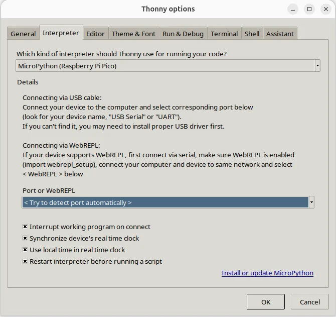
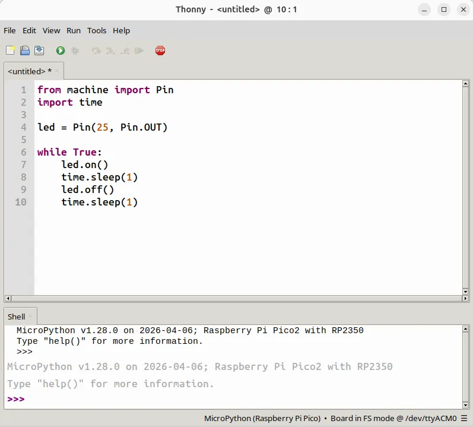
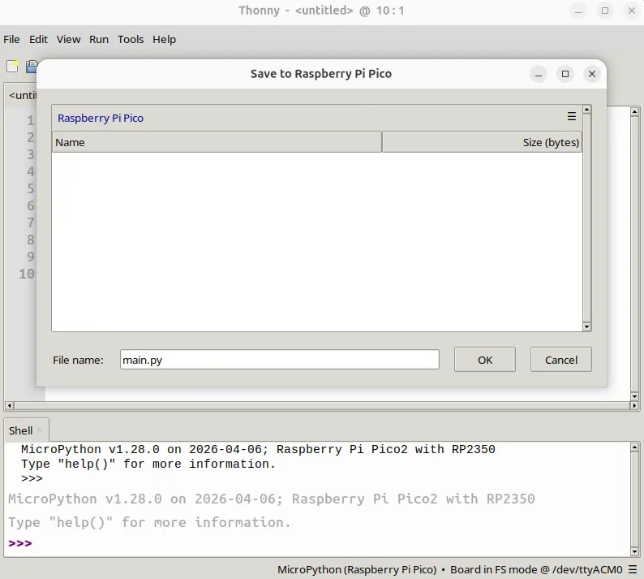

# RP2350 GPIO Programming - MicroPython

## Preparation

If you are familiar with Python, MicroPython is the preferred choice for programming and controlling the RP2350 MCU, as it greatly simplifies the development process.

This section demonstrates how to use the RP2350 with MicroPython via the Thonny IDE. Follow these steps:

- Upload the MicroPython firmware to the RP2350.

    The onboard RP2350 is pre-flashed with MicroPython firmware. You can skip this step if the RP2350 has not been programmed with other software.

    If the firmware was overwritten by another programming IDE, download the latest firmware for **Raspberry Pi Pico 2** from the [official MicroPython website](https://micropython.org/download/RPI_PICO2/) and re-flash it. Refer to the [Upload Instructions](rp2350_programming.md#upload-instructions) section, and copy the downloaded .uf2 file to the RP2350's drive.

- Download and install an IDE that supports MicroPython.

    For example: [Thonny](https://thonny.org/)

!!! question "How the RP2350 Appears in the Operating System"
    - With MicroPython firmware running, the RP2350 enumerates as a USB serial port: typically `/dev/ttyACM0` on the pre-installed Ubuntu OS (check with `ls /dev/ttyACM*` or `dmesg | grep tty`), or a `COMx` port on Windows. 
    - On Ubuntu, if you cannot open the port, add your account to the `dialout` group with `sudo usermod -aG dialout $USER` and log in again.

## Upload & Run Code

In this section, we will run a simple blink program to make the onboard red LED continuously flash. The red LED is internally connected to GPIO25 of the RP2350 — no external wiring is required.

- Open the Thonny IDE.

- Navigate to: `Tools`->`Options`->`Interpreter`. Select `MicroPython (Raspberry Pi Pico)` as the interpreter.

    {width="500"}

- Write the blink code in the IDE:

    {width="500"}

```python
from machine import Pin
import time

led = Pin(25, Pin.OUT)

while True:
    led.on()
    time.sleep(1)
    led.off()
    time.sleep(1)
```

- Click `Save` and choose `Raspberry Pi Pico` as the destination. Name the file `main.py`.

    Using this filename allows the RP2350 to execute the code automatically upon power-on or after a hard reset.

    {width="500"}

- Click `Run` or press the **MCU_RST** button. The onboard red LED will begin flashing on and off.

## Language Reference

[MicroPython quick reference for the RP2 (RP2040 / RP2350)](https://docs.micropython.org/en/latest/rp2/quickref.html)

------

[**:simple-discord: Join our Discord**](https://discord.gg/k6YPYQgmHt){ .md-button .md-button--primary }
