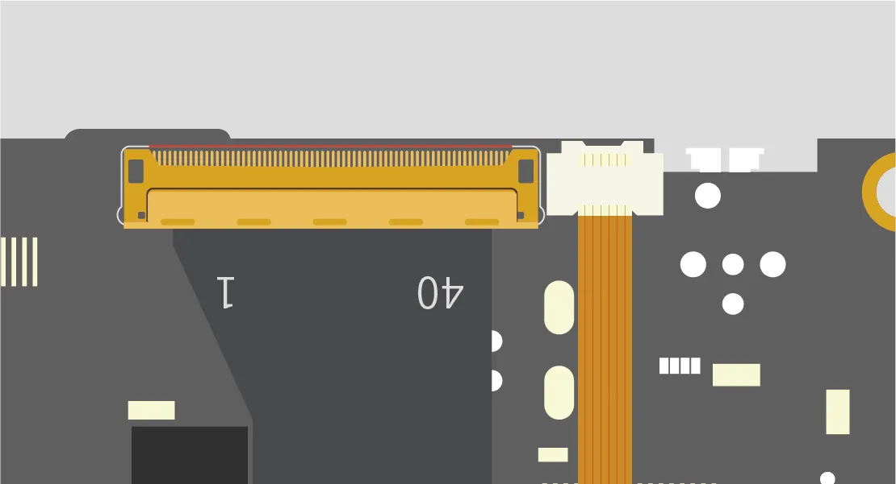
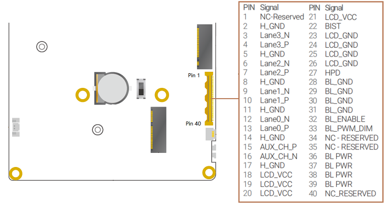
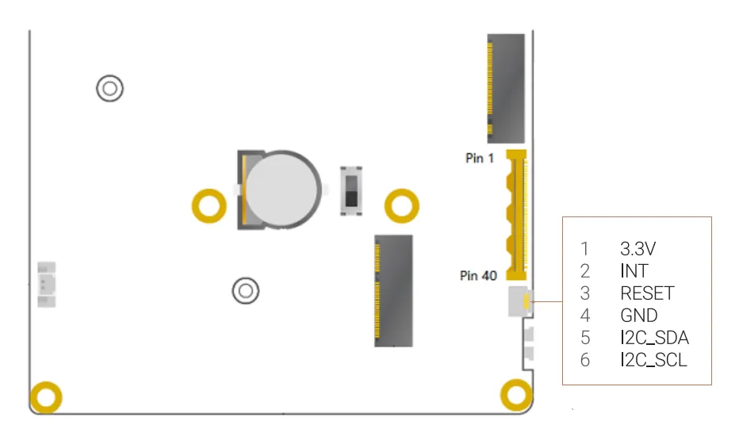

# Display Connections

This chapter will demonstrate multiple ways to connect display devices to your LattePanda Sigma 2, and provide information on the necessary components and installation steps.

!!! warning "Electrostatic Warning"

    Be sure to remove the static electricity from your body before touching the LattePanda! Otherwise, it may cause potential static discharge and damage your LattePanda!

## 3 Ways to Connect Your Display

=== "HDMI Display"

    * via HDMI port
    * HDMI 2.1, up to 4096 x 2304 @ 60Hz
    * for standard desktop usage
    * hot-plug support

=== "USB Type-C Display or USB Type-C to HDMI / DP Dock"

    * via USB Type-C port (Thunderbolt 4) 
    * DP 2.1, up to 7680 x 4320 @ 60Hz
    * for standard desktop or mobile usage
    * hot-plug support

=== "eDP Display"

    * via eDP connector (40-pin FPC, 0.5mm pitch)
    * eDP 1.5, 4-lane, up to 3840 x 2400 @ 120Hz
    * for embedded application scenarios
    * no hot-plug support

!!! note "Display Capabilities"

    LattePanda Sigma 2  supports up to four independent displays, each capable of running up to 4K@60Hz concurrently.

## HDMI

### Preparations

- HDMI Cable (2.1 recommended)
- TV or Display with HDMI Port

### Steps

1. Connect one end of the HDMI cable to the HDMI port on the LattePanda.
2. Connect the other end of the HDMI cable to the TV or monitor.
3. Power on the LattePanda board — display should initialize automatically.

## USB Type-C (Thunderbolt 4)

The two USB Type-C ports on LattePanda Sigma 2 are both full-featured Thunderbolt 4 ports. They support power, USB data, video output and PCIe.

### Preparations

- USB Type-C Display, or USB Type-C / Thunderbolt Dock
- USB Type-C / Thunderbolt Cable

### Steps

- If your display device does not have a USB Type-C port, you will need a USB Type-C Dock:

    > a. Locate the USB Type-C port on your LattePanda (either of the two ports can be used). 
    > b. Connect the USB Type-C Dock to the USB Type-C port of your LattePanda. 
    > c. Connect the display cable (DP / HDMI) to the USB Type-C Dock. 
    > d. Connect the other end of the display cable to your TV or display.

- If your display has a USB Type-C port, you can directly connect your LattePanda using a USB Type-C cable.

## eDP (Embedded DisplayPort)

The LattePanda Sigma 2 uses a **0.5mm pitch 40-pin FPC connector** for its eDP connector, which has 4 lanes and supports up to 3840 x 2400 @ 120Hz. This design allows for a power-efficient and high-bandwidth display connection while also enabling thinner and lighter device designs.

### Compatibility

In most cases, display devices equipped with a native **40-pin eDP connector** and **3.3V logic level** are compatible with the LattePanda and do not require the installation of additional drivers. 

We recommend starting with our official [**11.6-inch eDP Touch Display**](https://www.dfrobot.com/product-2794.html), tested and optimized for LattePanda boards.

### Preparations

- Compatible eDP display
- eDP ribbon cable (usually included with display)

### Steps

!!! warning "Ensure Correct eDP Cable Installation"

    To avoid any potential damage to your LattePanda or display device, it's important to ensure that the eDP cable is correctly installed and the display is connected before turning on your LattePanda. Please double-check these connections carefully, as failure to do so may cause a short circuit.

- Before starting, ensure that your LattePanda is powered off and disconnected from its power supply cable.

- Align the eDP cable with the eDP connector on LattePanda. Make sure the gold fingers of the eDP cable face up.

    { width="500" }

!!! tip
    Gently insert the eDP cable into the connector. If the cable has a latch, press down on the latch to secure the cable in place.

### Pin Definition

- Voltage of the Power Pin:

    - LCD_VCC: 3.3V
    - BL_PWR: 9.6V

## Touch Panel

The LattePanda Sigma 2 provides a dedicated touch panel connector (**6-pin FPC, 0.5mm pitch, I2C**), which is commonly used for eDP touchscreens in embedded applications.

### Pin Definition

{ width="600" }

### Common Touch Panel Interface

=== "USB 2.0"

    - Enjoy true plug-and-play convenience — no drivers or configuration required. 
    - Perfect for interactive kiosks, desktop workstations, and rapid prototyping where simplicity and speed matter most.

=== "I2C"

    - Engineered for embedded systems: low power, minimal wiring, and seamless integration. 
    - Ideal for space-constrained or battery-powered projects demanding efficiency and reliability.

!!! note "Driver Compatibility"

    - ✅ **Official eDP Touch Display**: Fully plug-and-play. Works instantly with the Ubuntu OS, Windows, or any standard Linux distribution.
    - ⚠️ **Third-party Touch Panels**: Third-party USB touch panels are plug-and-play. Third-party I2C touch panels require BIOS firmware adjustments to work.

### Steps

- Before starting, ensure that your LattePanda is powered off and disconnected from its power supply cable.

- Gently lift the black latch on the touch conector.

- Align the touch cable with the touch connector on LattePanda. Make sure the gold fingers of the touch cable face up. 

- Insert the cable fully and press the latch down to lock it.

    { width="500" }

### Official eDP Touch Display

- [11.6-inch eDP display with I2C touch panel](https://www.dfrobot.com/product-2794.html)

------

[**:simple-discord: Join our Discord**](https://discord.gg/k6YPYQgmHt){ .md-button .md-button--primary }
