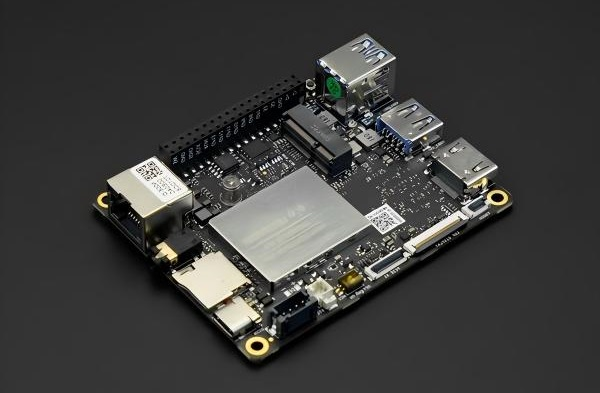
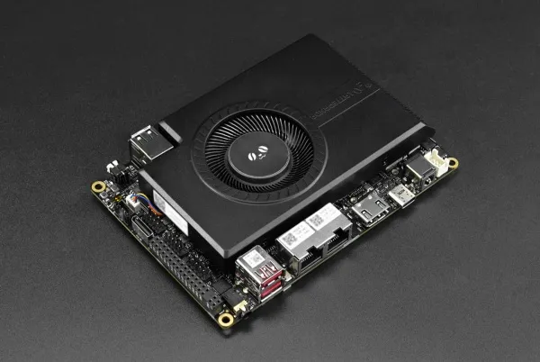
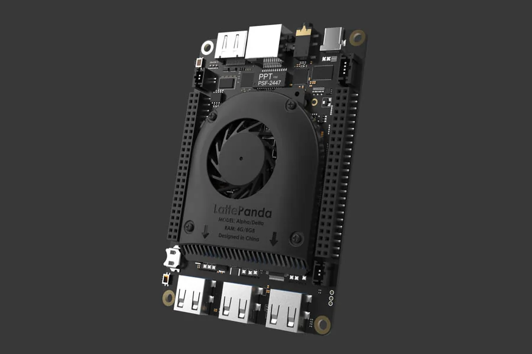
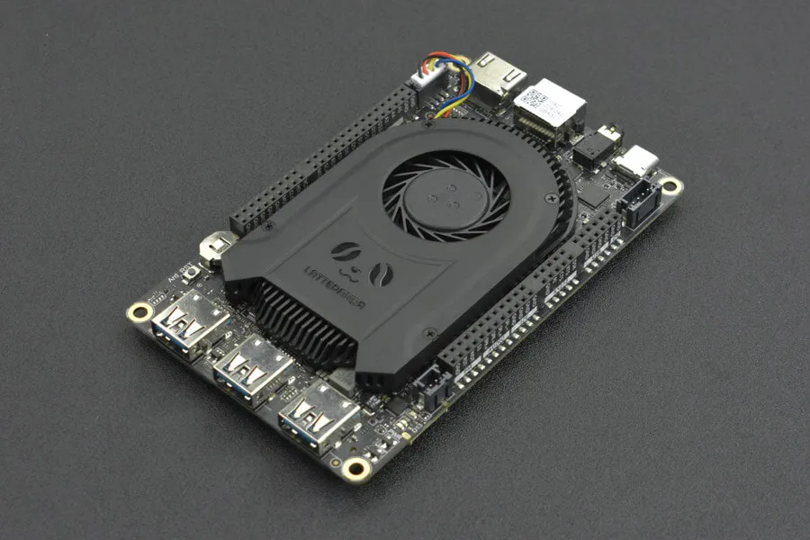
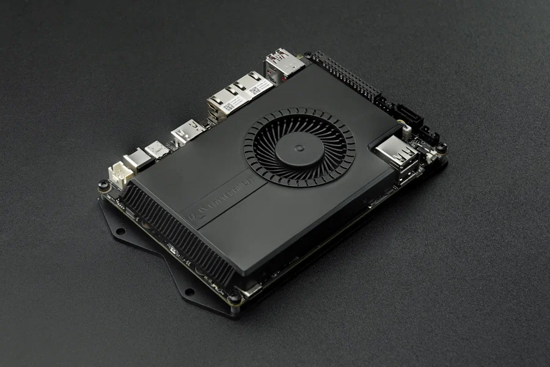
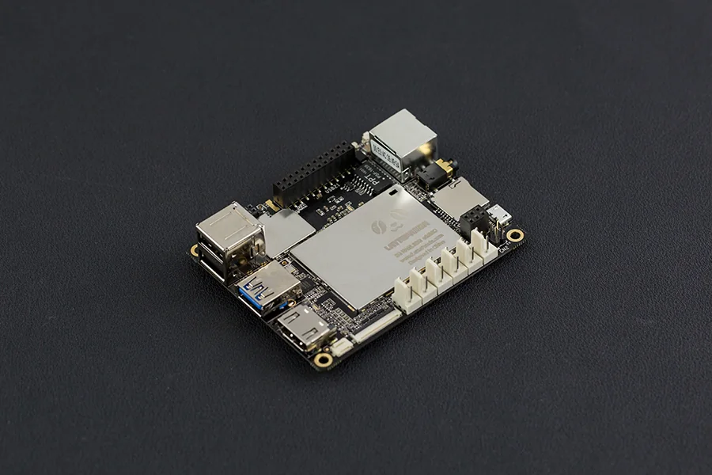

# Documentation

## Single Board Computer Overview

| [LattePanda IOTA][10] |
| ---------------------------------------- |
|  |
| Model                             |
| DFR1226: N150 Processor, 8GB RAM, 64GB eMMC DFR1226-ENT: N150 Processor, 8GB RAM, 64GB eMMC, Win11 IoT Ent License  DFR1227: N150 Processor, 16GB RAM, 128GB eMMC DFR1227-ENT: N150 Processor, 16GB RAM, 128GB eMMC, Win11 IoT Ent License |

[10]: content/iota_edition/get_started.md

| [LattePanda Sigma 2][11] |
| ---------------------------------------- |
|  |
| Model                             |
| DFR1316: Intel Core Ultra X7 358H processor, 64GB RAM, 1TB SSD) |

[11]: content/sigma2_edition/getting_started.md

| [LattePanda Alpha][2] | [LattePanda 3 Delta][7] |
| ---------------------------------------- | ---------------------------------------- |
|  |  |
| Model                             | Model |
| DFR0545: 8GB RAM, No eMMC DFR0546: 8GB RAM, 64GB eMMC DFR0547: 8GB RAM, 64GB eMMC,  Windows 10/11 Pro License  | DFR0981: 8GB RAM, 64GB eMMC DFR0982: 8GB RAM, 64GB eMMC, Windows 10 IoT Enterprise 2021 LTSC License  |

[2]: content/alpha_edition/get_started.md
[7]: content/3rd_delta_edition/get_started.md

| [LattePanda Sigma][8] |
| ---------------------------------------- |
|  |
| Model                             |
| DFR1080: 16GB RAM, No eMMC & SSD, No WiFi DFR1081: 16GB RAM, 500GB NVMe SSD(PCIe4.0 x4), WiFi 6E DFR1090: 32GB RAM, No eMMC & SSD, No WiFi DFR1091: 32GB RAM, 500GB NVMe SSD(PCIe4.0 x4), WiFi 6E  |

[8]: content/sigma_edition/Getting_Started.md

| [LattePanda V1(Discontinued)][1] | [LattePanda Delta(Discontinued)][6] |
| :--------------------------------------- | :--------------------------------------- |
|  |  |
| Model                                   | Model                                   |
| DFR0444: 2GB RAM, 32GB eMMC DFR0419: 4GB RAM, 64GB eMMC DFR0418: 2GB RAM, 32GB eMMC,  Windows 10 Home License DFR0470-ENT: 4GB RAM,  64GB eMMC, Windows 10 Enterprise 2016 LTSB License  | DFR0543: 4GB RAM, 32GB eMMC DFR0544: 4GB RAM, 32GB eMMC, Windows 10 Pro License  |

[1]: content/1st_edition/power_on.md
[6]: content/delta_edition/get_started.md

This guide will show you how to use LattePanda products to start up your little drive first. And kick-off your adventure of software plus hardware development.

!!! note

    If you have any problem or idea when reading our docs, feel free to **commit your suggestions** directly on the **[Github Docs Repo][4]** or discuss through the **[FORUM][3]**. We, together with our community members, are always ready to help you and listen to your suggestions!

[3]: https://www.lattepanda.com/forum
[4]: https://github.com/LattePandaTeam/Docs

## Content Structure
The documentation for each product generally follows a consistent structure. 

1. **Tech Specs** details the hardware specifications of the board — processor, memory, storage, interfaces and dimensions.
2. **Initial Setup** goes over how to unbox, connect and power on your device for the first time.
3. **Power Options** introduces the different ways to power the board, such as USB PD and DC jack.
4. **Display Connections** shows how to connect displays and touch panels, including eDP and HDMI.
5. **Multiple OS Support** lists compatible operating systems and provides installation guides for Windows, Ubuntu, and more.
6. **Multiple Network** covers the available network connectivity options — Ethernet, Wi-Fi and cellular.
7. **Hardware Interface** details the pinout and layout, plus external and internal interfaces for your projects and products.
8. **BIOS Setup** explains how to enter the BIOS and adjust common settings such as TDP, USB power control and boot order.
9. **Download Resources** collects OS images, drivers and BIOS / EC firmware downloads.
10. **FAQ** answers frequently asked questions and helps troubleshoot common issues.

## How to Contribute

This documentation is managed by LattePanda, **BUT** supported by the all community members, which is pretty important as a team growing up from open maker community. We welcome contributions such as:

- Edits to improve grammar or fix typos
- Edits to improve clarity
- Additional annotated examples for others to follow
- Additional content that would help provide a complete understanding of the LattePanda platform
- Translations to other languages
- Open - anything u think is good for the growth of this community

Making a contribution is as simple as forking this repository, making edits to your fork, and contributing those edits as a pull request. For more information on how to make a pull request, see [Github's documentation](https://help.github.com/articles/using-pull-requests/).

## Ready?  [Go!][5]
[5]: content/iota_edition/get_started.md
